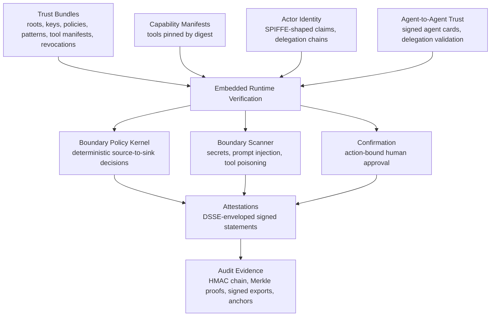
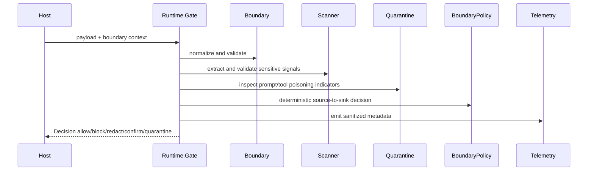
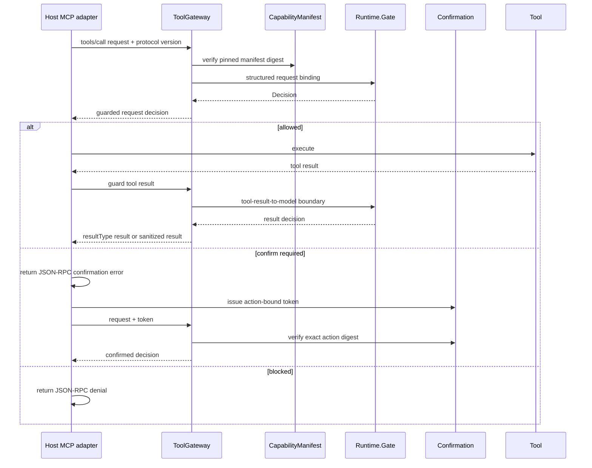
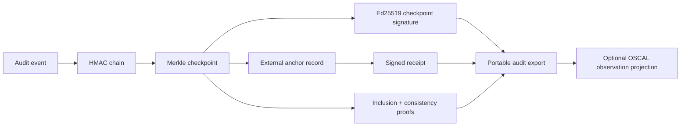

# SigilGuard Architecture

SigilGuard verifies local trust material and evaluates MCP and agent-tool
boundaries in the host's BEAM process. The Agent Trust Profile specifies the
signed statements, the digests that bind them to decisions, and the trust
material used to verify them.

## Component Layers

Trust material and capability manifests are verified offline and feed a
deterministic runtime that emits typed attestations and signed evidence.



## Module Topology

Public entry points and the modules each subsystem uses.

```mermaid
flowchart TD
    API[SigilGuard<br/>scan · guard · policy_verdict]

    API --> Profile[Trust Profile]
    Profile --> TrustProfile[TrustProfile]
    Profile --> Attestation[Attestation]
    Attestation --> Statement[Attestation.Statement]
    Attestation --> Digest[Attestation.Digest]
    Attestation --> Envelope[Attestation.Envelope]
    Profile --> JCS[Canonical.JCS]

    API --> Bundle[TrustBundle]
    Bundle --> BundleVerify[TrustBundle.Verify]
    Bundle --> BundleSchema[TrustBundle.Schema]
    Bundle --> BundleCache[TrustBundle.Cache]
    Bundle --> BundleQuar[TrustBundle.Quarantine]
    Bundle --> PatternSets[PatternSets]

    API --> Gateway[Tool Gateway]
    Gateway --> ToolGateway[ToolGateway]
    ToolGateway --> ToolGatewayBase[ToolGateway.Base]
    Gateway --> Manifest[CapabilityManifest]
    Gateway --> MCP[MCP.Gateway facade]
    MCP --> Protocol[MCP.Protocol]
    MCP --> SecurityPayload[MCP.SecurityPayload]
    MCP --> AppResource[MCP.AppResource]
    Gateway --> Confirmation[Confirmation]

    API --> Runtime[Boundary Runtime]
    Runtime --> Boundary[Boundary]
    Runtime --> BoundaryPolicy[BoundaryPolicy]
    BoundaryPolicy --> PolicyFile[BoundaryPolicy.File]
    BoundaryPolicy --> PolicyContract[BoundaryPolicy.Contract]
    Runtime --> Gate[Runtime.Gate]
    Runtime --> Stream[Runtime.Stream]
    Runtime --> Scanner[Scanner]
    Scanner --> ScannerPipeline[Scanner.Pipeline]
    Runtime --> Quarantine[Quarantine]
    Runtime --> Hooks[Hooks]
    Runtime --> RepoPolicy[RepoPolicy]

    API --> Audit[Audit]
    Audit --> Event[Audit struct]
    Audit --> Checkpoint[Audit.Checkpoint]
    Audit --> Proof[Audit.Proof]
    Audit --> Evidence[Audit.Evidence]
    Audit --> Witness[Audit.Witness]
    Audit --> CloudEvents[Audit.CloudEvents]
    Audit --> Anchor[Audit.Anchor + Store]
    Audit --> Export[Audit.Export]
    Export --> Assessment[Assessment.OSCAL]

    API --> Peers[AgentCard]
    Peers --> AgentTrust[AgentTrust]

    API --> Host[Host Behaviours]
    Host --> Signer[Signer / Signer.Ed25519]
    Host --> Vault[Vault]
    Host --> IdentityB[Identity]
    Host --> HTTPClient[HTTPClient]

    API --> Infra[Runtime (application- or host-supervised) · Config · Telemetry
    · ReplayStore]
```

## Boundary Flows

### Runtime Gate

The gate evaluates the payload and boundary context, then combines scanner,
quarantine, and policy results. Built-in rules apply even when the host
supplies no policy file. The decision includes the action and the matched rules.



### MCP And Tool Gateway

When a host supplies a pinned capability manifest, the gateway checks the
tool definition against it. Hosts can require signed attestations and use
confirmation tokens bound to the structured action, including MRTR input
responses and state. MCP Apps add a same-server caller and offline UI
resource verification.



### Audit Evidence

The host appends decisions to a tamper-evident chain as audit events. The chain
adds signed checkpoints, inclusion and consistency proofs, and portable exports
for external anchoring.



## Components

| Component | Responsibility |
|-----------|----------------|
| Trust Profile | Profile constants, canonical encoding (DSSE over JCS), and signed attestations over action, payload, context, and manifest digests. |
| Trust Bundles | Offline load, verification, caching, and quarantine of signed trust material with TUF-style roles, thresholds, expiry, and revocation. |
| Tool Gateway | Transport-neutral request/result guards, MCP v2 (`2026-07-28`) structured binding, manifest v2 pinning, MRTR/result shaping, and action-bound confirmation. |
| MCP Apps Boundary | App/model visibility, same-server app callers, and offline UI byte/CSP/permission verification; rendering remains host-owned. |
| Boundary Runtime | The deterministic gate, boundary normalization, source-to-sink policy, staged scanner, quarantine, lifecycle hooks, and streaming sanitizer. |
| Audit | HMAC-linked event chains, Merkle checkpoints with proofs, external anchor stores, and portable signed exports. |
| External Assessment | Host-context OSCAL Assessment Results v1.2.3 observations that reference a pinned audit-export digest without inferring findings or control satisfaction. |
| Agent-to-Agent Trust | Signed agent cards and delegation-chain validation for inter-agent calls. |
| Host Behaviours | Signing, vault, identity, audit persistence, and outbound HTTP, supplied by the host application. |
| Infrastructure | Configuration, telemetry with OpenTelemetry attribute mapping, and replay protection. |

## Non-Goals

- No public hosted registry dependency.
- No Rust or NIF backend path.
- No network calls in core decision paths. Remote trust material reaches
  SigilGuard only through host-owned transport.
- No ML model weights in core; adaptive detection is an optional behaviour with
  a deterministic nil-path.
- No inferred assessment findings or control-satisfaction claims; hosts and
  assessors own assessment authority and mappings.
