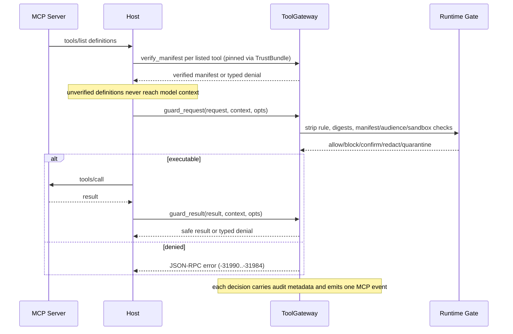

---
sigil_guard:
  id: "SP.03"
  title: "MCP And Tool Attestation Gateway"
  domain: security
  status: implemented/partial
  priority: critical
  created: "2026-07-01"
  updated: "2026-11-20"
  tags:
    ["mcp", "attestation", "capability-manifest", "confirmation", "json-rpc",
     "oauth", "v3"]
  depends_on: ["R.01", "R.02", "R.05", "R.06", "SP.01", "SP.02"]
---

# SP.03 - MCP And Tool Attestation Gateway

## Executive Summary

V3 turns the current MCP helpers into a first-class, transport-neutral tool
gateway. This spec is normative for four artifacts: the CapabilityManifest
canonical form and its `manifest_digest` field list (referenced but not
defined by SP.01), the `tool_request`/`tool_result` predicate bindings, the
confirmation-token lifecycle, and the JSON-RPC error registry. MCP is the
first adapter target; the same contract serves HTTP MCP, stdio MCP, and
in-process tool runners. `SigilGuard.MCP.Gateway` remains permanently as a
thin facade over `SigilGuard.ToolGateway` (D14).

## Business Value

- **Problem:** Tool calls are poisoned through descriptions, schemas,
  annotations, arguments, results, token passthrough, and audience
  confusion (R.06 rows 2-8) - mostly before any content scanner runs.
- **Solution:** Pin every tool to a signed capability-manifest digest, bind
  requests and results to the SP.01 digest set, gate approvals through
  digest-bound single-use tokens, and deny drift deterministically.
- **Beneficiary:** Hosts exposing or consuming MCP tools and local agent
  runtimes, including the reference consumer.
- **Impact:** Tamper-resistant tool-call verification with no adapter
  lock-in and typed, wire-ready denial responses.

## Technical Architecture

### Overview

Four verified surfaces: the capability manifest (canonical form below,
verified at `tools/list` time and re-checked at every guarded request);
the `tool_request` attestation over the SP.01 action, payload, context,
and manifest digests; the `tool_result` attestation binding result digest,
output-schema digest, quarantine status, scanner summary, evidence refs,
and the request back-reference; and the confirmation token, an
exact-action approval bound to the action, payload, context (including
`sandbox_id`), and manifest digests.

### Data Flow



### Architectural Patterns

| Pattern | Used | Justification |
|---------|------|---------------|
| GenServer | no | Guard calls are pure; pinned manifests come from the bundle or host. |
| Behaviour | no | `ToolGateway` is concrete; transports adapt by shaping maps. |
| ETS | yes | `SigilGuard.ReplayStore` consumes single-use confirmation nonces. |
| Telemetry | yes | One consolidated MCP decision event plus the runtime-gate event; manifest and result facts stay on `Decision.audit_metadata`, and there are no separate event families. |

## CapabilityManifest Canonical Form

This section is this spec's data model and the normative owner of the
`manifest_digest` referenced by SP.01's Digest Computation section.

### Digest Field List (Normative)

The preimage field list is exact and closed. Table order is canonical
(JCS) key order, which for these ASCII keys equals byte order.
Normalization follows SP.01 (atoms to strings, omit absent/`nil` optional
fields, never emit `null`). All digests are lowercase-hex SHA-256.

| Field | Type | Required | Rule |
|-------|------|----------|------|
| `allowed_sink_zones` | list | no | Sink trust zones the tool's output may reach; sorted ascending by byte order; consumed by SP.04 output contracts. Omitted = unrestricted, delegated to SP.04 policy. |
| `allowed_source_zones` | list | no | Trust zones allowed to invoke the tool; sorted ascending; omitted = delegated to SP.04 policy. |
| `annotations_sha256` | string | no | SHA-256 of the JCS bytes of the normalized annotations map; omitted when no annotations are declared. |
| `audience` | list | no | RFC 8707-style audience/resource identifiers the tool's upstream credentials are minted for; sorted ascending; omitted when the tool uses no upstream credentials. |
| `description_sha256` | string | yes | SHA-256 of the raw UTF-8 description bytes (SP.01 binary payload class; no JCS). |
| `expires_at` | string | yes | ISO 8601 UTC with millisecond precision, per SP.01. |
| `icons_sha256` | string | no | SHA-256 of the JCS bytes of the MCP icon list; omitted when no icons are declared. |
| `input_schema_sha256` | string | yes | SHA-256 of the JCS bytes of the JSON Schema document. |
| `input_sensitivity` | string | yes | Closed: `public`, `internal`, `private`. |
| `issuer_keyid` | string | yes | `"sha256:" <> hex` per SP.01's keyid rule. It names the issuer for the host's records and is covered by the manifest digest. The library checks its format and does not compare it with a bundle's keys: a manifest in a bundle's `tools` section is authenticated by the bundle signature, and a manifest in `:manifests` by the host that pinned it. |
| `manifest_format` | string | yes | Constant `sigil_guard_capability_manifest/v2`; the digest domain separator. |
| `name` | string | yes | Tool name; MUST be byte-equal to the `tools/list` name. |
| `network_access` | string | yes | Closed: `none`, `outbound`, `bidirectional`. |
| `output_schema_sha256` | string | no | SHA-256 of the JCS bytes of the output schema; omitted when none is declared. |
| `output_sensitivity` | string | yes | Closed: `public`, `internal`, `private`. |
| `reversibility` | string | yes | Closed: `reversible`, `irreversible`. |
| `sandbox` | map | yes | `{"required": boolean}`, plus `{"min_isolation": "container" \| "vm" \| "remote_attested"}` exactly when `required` is `true`. Level ordering is owned by SP.04. |
| `scopes` | list | no | Required OAuth/local scopes; sorted ascending; omitted when none. |
| `server` | string | yes | Canonical MCP server URI for network transports; host-assigned local runner id for stdio and in-process tools. |
| `side_effects` | list | yes | Closed: `none`, `read`, `write`, `delete`, `execute`, `privileged`; sorted ascending; non-empty; `none` MUST be the sole element when present. |
| `suspicious_params` | list | yes | Recomputable disclosure list (next subsection); MAY be empty; deduplicated, sorted ascending. |
| `title_sha256` | string | no | SHA-256 of raw UTF-8 MCP title bytes; omitted when no title is declared. |
| `ui_sha256` | string | no | SHA-256 of normalized MCP Apps UI metadata (`resource_uri`, sorted `visibility`); omitted for non-App tools. |
| `version` | string | yes | Tool implementation version being pinned. |

`manifest_digest` is the lowercase-hex SHA-256 over the compact JCS bytes
of this preimage map; it fills the `manifest` subject entry of
`tool_request` and `tool_result` statements (SP.01 Digest Computation).

Sandbox identity binding: the manifest declares the requirement; the
concrete `sandbox_id` and `isolation_level` are per-execution context
facts. The gateway reads `Context.sandbox_id` and `Context.isolation_level`
(an atom or its string name) and, for a field that is unset, falls back to
`sandbox_id` and `isolation_level` under `context.metadata` (atom or string
keys). When `sandbox.required` is `true`, a request whose context names no
`sandbox_id`, or whose isolation level ranks below `min_isolation`, MUST be
denied with `:sandbox_required`. The ranking is `container` < `vm` <
`remote_attested`; `none`, an absent level, and an unknown name rank below
all three.

Only the `Context` fields enter the SP.01 context digest. Values carried
only under `context.metadata` satisfy the requirement but are outside the
context digest, and so outside an attestation's `context` subject. A
confirmation token still covers them through its `action_digest`, which
digests the whole context including `metadata` (Confirmation Lifecycle).

Carried form: the distributed document carries `description`, `title`,
`icons`, `annotations`, `input_schema`, `output_schema`, and normalized `ui`
in full; normalization substitutes the `*_sha256` preimage fields. Carried
`*_sha256` fields MUST match recomputation, else
`{:error, :invalid_manifest}`. The gateway pins what the host passes: an
entry of the `:manifests` map, or a `tools` entry of the `:trust_bundle`
value (a `%SigilGuard.TrustBundle{}`, a map with a `tools` list, or a bare
list). `:manifests` is consulted first. The gateway verifies no bundle
signature at guard time. Loading and verifying the bundle (SP.02) before the
call is the host's step, and a manifest passed through `:manifests` carries
only the trust the host gives it. Standalone manifest signing is not a v3
surface.

Manifest v2 validates every `x-mcp-header` annotation found in
`input_schema`: the header name is a valid HTTP field-name token, the property
type is `boolean`, `integer`, or `string`, and names are unique
case-insensitively. Suspicious credential parameter names are rejected even
when optional. Header transport and value serialization remain host-owned.

### Suspicious Required Parameters

Schema-injection defense (R.06 row 4, TM.04) binds indicators into the
signed digest. `suspicious_params` is computed deterministically from the
input schema: collect every string element of every list found under a map
key exactly equal to `"required"`, at any depth; lowercase each name and
replace `-` with `_`; a name is suspicious when the normalized form
contains any substring from the closed built-in set `suspicious-params-v1`:

```
access_key, api_key, apikey, authorization, bearer, cookie, credential,
passwd, password, private_key, secret, session_id, token
```

The field records the original schema-declared names. Verifiers MUST
recompute the set from the carried schema with this built-in set only;
bundle pattern extensions feed SP.04 policy indicators, never this field.
A mismatch fails with `{:error, :suspicious_required_param}` (the manifest
lies about its own schema). A matching, non-empty disclosure forces a
`{:confirm, _}` verdict at `guard_request` unless the caller passes
`allow_suspicious_params: true`. A decision that is already blocked stays
blocked.

### Canonical Example

The `repo_file_write` manifest referenced by SP.01's worked `tool_request`
vector, pretty-printed with keys in JCS order (fixtures store compact
bytes). `audience` and `output_schema` are absent, therefore omitted:

```json
{
  "allowed_sink_zones": ["semi_trusted", "trusted"],
  "allowed_source_zones": ["semi_trusted", "trusted"],
  "annotations": {"destructiveHint": false, "title": "Repo File Write"},
  "description": "Write one UTF-8 text file inside the repository working tree.",
  "expires_at": "2027-01-01T00:00:00.000Z",
  "input_schema": {
    "$schema": "https://json-schema.org/draft/2020-12/schema",
    "additionalProperties": false,
    "properties": {"content": {"type": "string"}, "path": {"type": "string"}},
    "required": ["content", "path"],
    "type": "object"
  },
  "input_sensitivity": "internal",
  "issuer_keyid": "sha256:<computed: issuer public key digest>",
  "manifest_format": "sigil_guard_capability_manifest/v2",
  "name": "repo_file_write",
  "network_access": "none",
  "output_sensitivity": "internal",
  "reversibility": "reversible",
  "sandbox": {"min_isolation": "container", "required": true},
  "scopes": ["repo:write"],
  "server": "repo-mcp",
  "side_effects": ["write"],
  "suspicious_params": [],
  "version": "1.4.2"
}
```

The digest preimage is this document with `annotations`, `description`,
and `input_schema` replaced by `annotations_sha256`, `description_sha256`,
and `input_schema_sha256`; all other fields are unchanged. Fixture
convention, mirroring SP.01's generator rules (deterministic,
byte-identical on regeneration, frozen once committed):

```
test/fixtures/capability_manifest/<name>.manifest.json
test/fixtures/capability_manifest/<name>.preimage.json
test/fixtures/capability_manifest/<name>.expected.json
```

`repo_file_write` is the first fixture; its `manifest_digest` is the value
SP.01's `tool_request` golden vector carries in its `manifest` subject.

## Request And Result Attestation Binding

Subject digests (action, payload, context, manifest) follow SP.01's Digest
Computation, including the per-type action-digest preimages and the
metadata strip rule. `attest_request/3` and `attest_result/3` compute them
with `Attestation.Digest.digests/4` over the gate payload that
`MCP.SecurityPayload.for_gate/3` builds from the `:payload` option. That is
the same value `guard_request/3` verifies an inbound attestation against.
The action preimage reads through that gate payload to the MCP message it
wraps (SP.01, Action Digest). The tables fix where each bound item lives.

### tool_request Binding

`attest_request/3` writes the SP.01 predicate fields `profile`,
`statement_type`, `actor` (`id`, `trust_level`), `verdict`, `issued_at`,
`expires_at`, and `nonce`, which is generated unless the caller passes one.
It adds `action`, `risk_level`, `tool`, `resource`, `reason` when the
decision has one, `matched_rules` when the decision has matched rules, and
`evidence` from the `:evidence` option, else from the decision's
`evidence_refs` when that list is not empty. It writes no `boundary` mirror.
Granted scopes bind as the ascending-sorted, single-space-joined string in
`resource.scope`.

| Bound item | Where it binds |
|------------|----------------|
| Actor | `predicate.actor.id` (the context `actor`, else `identity`) + `actor` key of the context digest. |
| Tool identity (tool digest) | `manifest` subject entry = `manifest_digest`, written when the caller passes `:manifest` (a `%CapabilityManifest{}`) or `:manifest_digest`; `predicate.tool` mirror (`name`, `mcp_server`, `manifest_digest`). |
| Action | `action` subject entry. The SP.01 `tool_request` preimage reads through the gate payload to the message it wraps, so it holds `statement_type`, the context `tool`, the request `method`, and the `arguments`. It is the same preimage as for the raw MCP message. Two calls to one tool with different arguments have different action digests. The `payload` subject binds method and arguments too. |
| Full guarded payload | `payload` subject entry. |
| Boundary context incl. `sandbox_id` | `context` subject entry (SP.01 field list; the `Context` fields, not `context.metadata`). |
| Resource / audience | `predicate.resource` `{"uri", "audience", "scope"}`, from the `:resource`, `:audience`, and `:scopes` options; `uri` falls back to the context `resource_uri` and `audience` to the context `intended_audience`. |
| Scopes | `predicate.resource.scope`, joined as above. |
| Nonce | `predicate.nonce`. `Attestation.from_decision/3` generates 16 random bytes as 32 lowercase hex characters unless the caller passes `:nonce`. A caller's string is written as given; its format is not checked. `nonce: false` or `nonce: nil` omits the field, and a statement without a nonce fails `Attestation.verify/3` with `replay: true` (`:invalid_payload`). |
| Expiry | `predicate.expires_at` (TTL default per SP.01). Both timestamps have three fractional digits, with or without `:now`. The helper passes `:now` to `from_decision/3` and to `sign/3`, and both write a `DateTime` with millisecond precision. |

An attestation that a gateway signed while the action preimage held
`statement_type` and `tool` only carries a different `action` digest. It
fails digest recomputation with `:digest_mismatch`, so both sides of a
gateway run a version with the same preimage.

The context passed to `attest_request/3` must name the `tool` and an `actor`
or `identity`; otherwise the call returns `{:error, :invalid_payload}`. The
function casts the context as given. It does not apply the `origin: :model`
and `sink: :tool` request defaults that `guard_request/3` applies. A context
that leaves `origin` or `sink` unset is attested as `:unknown` and
`:internal`, and the inbound check of that envelope then fails with
`:invalid_attestation`. The caller passes a context with explicit `origin`,
`sink`, and `tool` that matches what `guard_request/3` evaluates.

### tool_result Binding

The last four rows are the SP.03-owned `tool_result` predicate extension
fields, additive to the SP.01 core. `attest_result/3` also needs a context
that names the `tool` and an `actor` or `identity`, and it requires
`:request_action_digest`.

| Bound item | Where it binds |
|------------|----------------|
| Result content (result digest) | `payload` subject entry over the stripped result. |
| Action | `action` subject entry. The SP.01 `tool_result` preimage reads through the gate payload as the request preimage does. The gateway's result projection has a `nil` method, so the preimage holds `statement_type`, the context `tool`, and `request_action_digest`, as for the raw JSON-RPC response. A member of the result object named `method` is application data and does not enter the preimage; the `payload` subject binds it. |
| Sink | `sink` key of the context digest + `predicate.boundary.sink`. |
| Evidence refs | `predicate.evidence` (SP.01 shape), from the caller's `:evidence` option, else from `Decision.evidence_refs` when that list is not empty; either list is shape-checked (`:invalid_evidence`). `guard_result/3` returns a decision with an empty list, so the field is written only when the caller passes the option or fills the list. |
| Manifest | `manifest` subject entry, written when the caller passes `:manifest` or `:manifest_digest`. Passing the paired request's manifest is the caller's step; `guard_result/3` resolves none. |
| Request back-reference | `predicate.request_action_digest` (string, required) mirroring the `request_action_digest` inside the action-digest preimage (SP.01). The gateway does not compute it: the caller supplies the `:request_action_digest` option, 64 lowercase hex characters. The `action` subject of the paired `tool_request` statement covers that request's method and arguments, so passing it ties the result to them and not to the tool name alone. |
| Output schema digest | `predicate.output_schema_sha256` (string): the caller's `:output_schema_sha256` option when given, else the field of the `:manifest` struct; omitted when neither is set. It MUST equal the manifest field when the manifest declares one. That equality is not implemented: no code compares a caller-supplied value with the manifest, so the caller has to pass the manifest's value or omit the option. |
| Quarantine status | `predicate.quarantine` (map, required): `{"status": "none" \| "quarantined" \| "released_sanitized", "indicator_ids": [string]}`. `status` comes from the `:quarantine_status` option when the caller passes one. Otherwise a decision whose `audit_metadata.release_status` is `:confirmed_sanitized` gives `"released_sanitized"`. `guard_result/3` sets that value when a confirmation releases a quarantined result, and leaves `quarantine_status` at `:quarantined`. For any other decision `audit_metadata.quarantine_status` decides: `:quarantined` gives `"quarantined"`, `:released_sanitized` gives `"released_sanitized"`, and any other value gives `"none"`. `indicator_ids` are the indicator ids as strings, deduplicated and sorted. |
| Scanner summary | `predicate.scanner` (map, required): `{"hit_count": integer, "redacted": boolean}`; summary only, never raw content. |

## Confirmation Lifecycle

Normative resolution of the v2 open lifecycle questions. Tokens are
HMAC-SHA256, host-internal, and never cross a trust boundary; DSSE is not
used here. The token body is the base64url (no padding) of the canonical
bytes of the claims map; the MAC is computed over those same bytes; the
token is `body <> "." <> base64url(mac)`. The canonical bytes come from the
legacy canonical JSON encoder (`SigilGuard.Canonical.LegacyJSON`: compact
JSON, object keys sorted by byte order, values encoded by Jason). They do
not come from the RFC 8785 JCS encoder that SP.01 digests use. Verification
re-encodes the decoded claims and rejects a body whose bytes differ with
`:invalid_token`.

### Claims (Authoritative v3 List)

This table is the complete, authoritative v3 confirmation-token claim set;
SP.08 references it and never restates it. The token wire-format version
stays `2` (`v: 2`, `typ: "sigil_guard.confirmation.v2"`) - v3 keeps the HMAC
format and adds the `manifest_digest` and sandbox-aware `context_digest`
bindings below.

| Claim | Value |
|-------|-------|
| `v` / `typ` / `alg` | `2`, `"sigil_guard.confirmation.v2"`, `"HS256"`. |
| `actor` | Approving actor id: the context `actor` when it is a non-empty string, else the context `identity`, else the `:actor` option, else `"unknown"`. The option does not override a context value. |
| `action_digest` | Legacy action digest from `SigilGuard.Confirmation.fetch_action_digest/2`: SHA-256 over the legacy canonical JSON of `{"context": <every Context field>, "payload": <payload>}`. It is not `Attestation.Digest.action_digest/4`; the two values differ for the same request. |
| `payload_digest` | SP.01 payload digest (`Attestation.Digest.payload_digest/1`). |
| `context_digest` | SP.01 context digest (`Attestation.Digest.context_digest/2`); `Context.sandbox_id` and `Context.isolation_level` are inside it, so a changed sandbox invalidates the token. |
| `manifest_digest` | Pinned manifest digest, written when the issuer passes `:manifest` (a `%CapabilityManifest{}` or its digest) or `:manifest_digest`, and omitted otherwise. `guard_request/3` expects the claim to equal the resolved manifest's digest: a token without the claim fails when a manifest resolves, and a token with the claim fails when none resolves, both with `:manifest_digest_mismatch`. A drifted or re-listed manifest therefore invalidates the token. |
| `decision` / `action` / `reason` | `"confirm"`; the gate action string; the decision reason (MAY be empty). |
| `issued_at` / `expires_at` | ISO 8601 UTC ms; `expires_at` later than `issued_at`. |
| `nonce` | 16 random bytes, lowercase hex. |

### Defaults And Rules

- **TTL:** default `300_000` ms via `:ttl_ms`; no application env key (the
  closed v3 config surface is owned by SP.01).
- **Single-use by default:** verification consumes the nonce through
  `SigilGuard.ReplayStore` (key `"confirmation:" <> actor`, TTL = the
  remaining token lifetime); a second verification fails with
  `:replay_detected`. Pass `consume: false` to `Confirmation.verify/5`, or
  `consume_confirmation: false` to the gateway, for stateless verification.
- **Digest recomputation:** verification recomputes the action, payload,
  and context digests from the live request and context, and compares the
  `manifest_digest` claim with the digest of the manifest the gateway
  resolved. Any change - arguments, sink, actor, `sandbox_id`,
  `isolation_level`, or manifest - fails with `:digest_mismatch` or
  `:manifest_digest_mismatch`. An expired token fails with `:expired`.
  Tokens are never renewed; any change or expiry requires re-issue.
- **Phases:** `context_digest` uses the context phase as the SP.01 statement
  type. `Confirmation.issue/5` therefore issues tokens for `tool_request`,
  `tool_result`, and `repo_change` contexts and returns
  `{:error, :invalid_payload}` for `inbound_user` and `outbound_model`.
- **Strip rule:** exactly SP.01's six keys, removed from the payload top
  level and from the map under `params` before digest computation:
  `:_agent_trust`, `"_agent_trust"`, `:_agent_confirmation`,
  `"_agent_confirmation"`, `:confirmation_token`, `"confirmation_token"`.
  The gateways apply it in `MCP.SecurityPayload.for_gate/3` before they hand
  the payload to `SigilGuard.Confirmation`. `Confirmation.issue/5` and
  `verify/5` do not strip for `action_digest`: `payload_digest` strips
  through `Attestation.Digest.payload_digest/1`, but
  `fetch_action_digest/2` digests the payload as given. A host that calls
  `Confirmation` directly strips first; otherwise a token verified against
  a payload that carries it fails with `:digest_mismatch`.
- **Token carriers:** the `:confirmation_token` option, or the
  `_agent_confirmation` or `confirmation_token` key at the request root or
  under `params`.

### Multi-Step Approval Flow

1. `guard_request/3` returns a `{:confirm, reason}` decision.
2. Host calls `ToolGateway.issue_confirmation/5`, passing `manifest:` when
   a pinned manifest applies to the request; the token binds the digests
   above.
3. Host renders its approval UI from the matched rules and
   `action_digest`; raw payload display is host policy, never required.
4. The approver accepts; the host re-submits the identical request with
   the token under `_agent_confirmation`.
5. `guard_request/3` (with `:confirmation_key`) verifies and consumes the
   token; the decision upgrades to allowed and takes the action recorded in
   `Decision.effect` (`:allow`, `:redact`, or `:quarantine`). On the result
   side `guard_result/3` does the same; confirmed quarantined results
   release only as sanitized text, never raw output.
6. Any change since issuance fails verification, blocks the request, and
   requires a fresh gate pass plus re-issue.

## Threat Coverage And Host-Owned Exclusions

Rows align 1:1 with R.06's control mapping; `TM.xx` names the M5 test
family that MUST be green before 1.0.0.

| Attack (R.06 row) | SP.03 control | Family |
|-------------------|---------------|--------|
| Tool poisoning via descriptions/metadata (2) | Manifest digest pinning over description, annotations, and schema digests; drift denies. | TM.02 |
| Line jumping (3) | `verify_manifest/2` at `tools/list` time, BEFORE any definition enters model context and before any invocation. | TM.03 |
| Schema injection (4) | Schema digests inside the manifest digest + `suspicious_params` disclosure bound into the signed digest and recomputed at verify. | TM.04 |
| Rug pull / TOFU drift (5) | Drift rejection; `notifications/tools/list_changed` forces full re-verification, and re-listed manifests invalidate cached approvals because tokens bind `manifest_digest`. | TM.05 |
| Confused deputy incl. consent replay (6) | Audience/resource binding into attestations and manifests; nonce + expiry on tokens and statements. OAuth consent itself is host-owned. | TM.06 |
| Token passthrough (7) | Explicit deny: a credential whose audience is the host itself is never forwarded upstream (`:token_passthrough_denied`). | TM.07 |
| Stale authorization across stateless requests/list changes (8) | Host-owned subscription transport; SigilGuard independently gates each action and assists with nonce/replay scope plus relisted-manifest re-verification. | TM.07 |

Host-owned exclusions (R.06): OAuth flows, token issuance, and consent
storage; TLS, subscription delivery, and request routing; sandbox creation
and escape-hardening; model behavior. SigilGuard binds the results
(audience, resource, sandbox identity) and records evidence; it never
runs these systems.

## Public API Sketch

Return-type unions name the SP.03 error atoms; spec-local atoms are defined
in Error Handling below, shared atoms in SP.01. SP.16 adds
`:invalid_header_annotation` and `:sensitive_header_param` to the manifest
unions of `verify_manifest/2`, `CapabilityManifest.new/1`, and
`CapabilityManifest.verify/2`.

```elixir
defmodule SigilGuard.ToolGateway do
  @type ctx :: SigilGuard.Context.t() | map() | keyword()

  @type manifest_deny ::
          :unknown_manifest | :manifest_digest_mismatch
          | :schema_digest_mismatch | :manifest_expired
          | :suspicious_required_param | :invalid_manifest

  @type attest_error ::
          SigilGuard.Attestation.from_decision_error()
          | SigilGuard.Attestation.sign_error()

  @spec guard_request(term(), ctx(), keyword()) :: SigilGuard.Decision.t()
  # opts: :manifests (%{name => manifest}) | :trust_bundle, :server,
  #  :require_manifest (default true when either is given, else false),
  #  :allow_suspicious_params (default false),
  #  :attestation (:off | :optional | :required, default :off),
  #  :trust_material (SP.01), :confirmation (:honor | :off, default
  #  :honor), :confirmation_key, :confirmation_token, :consume_confirmation
  #  (default true), :audience, :resource, :self_resource, :now,
  #  :max_skew_ms. Denials are block decisions carrying the deny atom in
  #  reason and audit_metadata.

  @spec guard_result(term(), ctx(), keyword()) :: SigilGuard.Decision.t()
  # opts: :request_action_digest (64 lowercase hex; any other value denies
  #  with :invalid_payload), the confirmation options (:confirmation,
  #  :confirmation_key, :confirmation_token, :consume_confirmation, :now),
  #  and the runtime-gate options. guard_result/3 resolves no manifest and
  #  verifies no attestation: :manifests, :trust_bundle, :require_manifest,
  #  :attestation, :trust_material, :audience, :resource, and
  #  :self_resource have no effect on a result.

  # guarded_request/3 and guarded_result/3 wrap the same guards in the v2
  # wire shapes: {:ok, decision} | {:error, response, decision} and
  # {:ok, response, decision} | {:error, response, decision}. The stream
  # trio (stream_result/2, guarded_result_chunk/3,
  # finish_guarded_result_stream/2) and response_for_decision/3 keep their
  # v2 signatures over Runtime.Stream.

  @spec verify_manifest(observed :: map(), opts :: keyword()) ::
          {:ok, SigilGuard.CapabilityManifest.t()}
          | {:error, manifest_deny()}
  # observed: one tools/list entry (string keys "name", "description",
  # "inputSchema", "outputSchema", "annotations"; snake_case twins are
  # accepted) or a carried manifest map. opts: :manifests | :trust_bundle
  # (one required), :server (required), :now, :max_skew_ms.

  @spec attest_request(SigilGuard.Decision.t(), ctx(), keyword()) ::
          {:ok, envelope :: map()} | {:error, attest_error()}
  # opts: :payload (required), :signer (required), :keyid, :manifest,
  # :manifest_digest, :resource, :audience, :scopes, :ttl_ms, :now, :nonce
  # (generated when absent), :evidence. Builds and signs a tool_request
  # statement via Attestation.from_decision/3 + Attestation.sign/3 (SP.01);
  # both receive the options. The context must name the tool and an actor
  # or identity.

  @spec attest_result(SigilGuard.Decision.t(), ctx(), keyword()) ::
          {:ok, envelope :: map()} | {:error, attest_error()}
  # As attest_request/3 plus required :request_action_digest (missing
  # fails with {:error, :invalid_payload}).

  @spec issue_confirmation(term(), ctx(), SigilGuard.Decision.t(),
          key :: binary(), keyword()) ::
          {:ok, String.t()}
          | {:error, :invalid_key | :not_confirmable | :invalid_ttl
             | :invalid_actor | :invalid_nonce | :invalid_now
             | :invalid_payload}
  # opts: :direction (:request | :result, default :request), :manifest
  # (a %CapabilityManifest{} or its digest) or :manifest_digest, :actor
  # (used only when the context has no actor or identity), :ttl_ms
  # (default 300_000), :now, :nonce.
end

defmodule SigilGuard.CapabilityManifest do
  @type t :: %__MODULE__{}  # one struct field per canonical-form row

  @spec new(map()) ::
          {:ok, t()}
          | {:error, :invalid_manifest | :suspicious_required_param
             | :unsupported_number_range}
  # Validates required fields, closed enums, and list sorting; computes
  # inner digests and suspicious_params from carried documents; checks
  # caller-supplied *_sha256 and suspicious_params against recomputation.

  @spec digest(t() | map()) ::
          {:ok, String.t()}
          | {:error, :invalid_manifest | :unsupported_number_range}
  # manifest_digest over the compact JCS bytes of the normalized preimage.

  @spec verify(pinned :: t(), observed :: map()) ::
          :ok
          | {:error, :manifest_digest_mismatch | :schema_digest_mismatch
             | :suspicious_required_param | :invalid_manifest}
  # Pure comparison; trust resolution and expiry live in
  # ToolGateway.verify_manifest/2.
end
```

Check order inside `guard_request/3` is normative: (1) strip rule and
structured projection (`MCP.SecurityPayload.for_gate/3` and `context/3`);
the later steps compute their digests from that projection; (2) manifest
resolution and verification when required, then manifest expiry; (3)
passthrough, resource, audience checks - `:token_passthrough_denied` when
`opts[:self_resource]` equals `opts[:audience]` or is one of its entries,
with or without a resolved manifest; with a resolved manifest,
`:resource_mismatch` when `opts[:resource]` differs from the manifest
`server`, and `:audience_mismatch` when `opts[:audience]` matches neither
the manifest `server` nor any `audience` entry; (4) caller visibility
(SP.16), denying with `:app_visibility_denied` or `:app_server_mismatch`;
(5) sandbox requirement; (6) inbound attestation verification per
`:attestation`; (7) runtime gate evaluation (SP.04, SP.07), then the
suspicious-parameter confirmation; (8) confirmation application. The first
failing step denies. [SP.19](SP.19-physical-effect-authority.md) places its
`:effect_binding` checks around these steps without reordering them.

Step 1 does not deny on the context shape. A `ctx` that is not a context
struct, map, or keyword list is replaced by the direction defaults
(`phase: :tool_request`, `origin: :model`, `sink: :tool`, and the `Context`
defaults for the rest) before the later steps run.

Step 6 reads the envelope from `_agent_trust` at the request root. An
envelope under `params` is not read, and `attestation: :required` then
denies with `:invalid_attestation`. Every verification failure is reported
as `:invalid_attestation`; the SP.01 `verify_error` atom is not kept.

At step 7 the gateway passes the resolved manifest's digest and
`side_effects` to the gate as the `:manifest_facts` option and discards a
caller-supplied `:manifest_facts`. Without a resolved manifest the gate
treats the tool as class `execute` (SP.07, Sandbox default).

`guard_result/3` runs none of steps 2 to 6. It validates
`:request_action_digest`, evaluates the gate, records the result binding
metadata (`request_action_digest`, `scanner_summary`, `quarantine_status`),
and applies confirmation. It resolves no manifest and discards a
caller-supplied `:manifest_facts`, so a result is class `execute` in the
sandbox matrix. A result confirmation
token has to be issued without `:manifest`: `guard_result/3` supplies no
expected manifest digest, so a token that carries the claim fails with
`:manifest_digest_mismatch`.

### MCP.Gateway Facade (D14)

`SigilGuard.MCP.Gateway` REMAINS in v3 as a permanent thin facade over
`ToolGateway` - not deprecated (D14). It stays the discoverable MCP entry
point and keeps the JSON-RPC shaping. Every current helper is kept with its
name and arity. The request, result, confirmation, and stream helpers
delegate to `ToolGateway` with an identical return shape.

The six signed helpers do not verify attestations. They delegate to
`SigilGuard.ToolGateway.Base`, which has no accepting path for signed
request metadata: the guards always return a block decision, and the token
helper never issues a token. The working signed-request path is
`ToolGateway.guard_request/3` or `guarded_request/3` with
`attestation: :required`. The facade's `guard_request/3` and
`guard_confirmed_request/3` forward that option unchanged.

| Facade function (kept) | V3 delegation target |
|------------------------|----------------------|
| `guard_request/3` | `ToolGateway.guard_request/3` with `confirmation: :off`. |
| `guarded_request/3` | `ToolGateway.guarded_request/3` with `confirmation: :off`. |
| `guard_confirmed_request/3` | `ToolGateway.guard_request/3`. |
| `guarded_confirmed_request/3` | `ToolGateway.guarded_request/3`. |
| `guard_signed_request/3` | `ToolGateway.Base.guard_signed_request/3`: always a block decision. No attestation is verified and the runtime gate does not run. |
| `guarded_signed_request/3` | `ToolGateway.Base.guarded_signed_request/3`: always `{:error, response, decision}` with code `-31990`. |
| `guard_signed_confirmed_request/3` | `ToolGateway.Base.guard_signed_confirmed_request/3`: always a block decision. The confirmation token is not read. |
| `guarded_signed_confirmed_request/3` | `ToolGateway.Base.guarded_signed_confirmed_request/3`: always `{:error, response, decision}` with code `-31990`. |
| `verify_request_envelope/2` | `ToolGateway.Base.verify_request_envelope/2`: always `{:error, reason}`. It does not call `Attestation.verify/3`. |
| `issue_confirmation_token/5` | `ToolGateway.issue_confirmation/5` (`direction: :request`). |
| `issue_signed_confirmation_token/5` | `ToolGateway.Base.issue_signed_confirmation_token/5`: returns the `verify_request_envelope/2` error and never issues a token. |
| `issue_result_confirmation_token/5` | `ToolGateway.issue_confirmation/5` (`direction: :result`). |
| `guard_result/3` | `ToolGateway.guard_result/3` with `confirmation: :off`. |
| `guarded_result/3` | `ToolGateway.guarded_result/3` with `confirmation: :off`. |
| `guard_confirmed_result/3` | `ToolGateway.guard_result/3`. |
| `guarded_confirmed_result/3` | `ToolGateway.guarded_result/3`. |
| `stream_result/2` | `ToolGateway.stream_result/2`. |
| `guarded_result_chunk/3` | `ToolGateway.guarded_result_chunk/3`. |
| `finish_guarded_result_stream/2` | `ToolGateway.finish_guarded_result_stream/2`. |
| `response_for_decision/3` | `ToolGateway.response_for_decision/3`. |

`verify_request_envelope/2` looks for `_agent_trust` at the request root and
under `params`. It returns `{:error, :missing_envelope}` when the key is
absent, `{:error, :invalid_envelope}` when the value is not a map,
`{:error, :missing_identity}` when the map has no string `identity` field,
and `{:error, :legacy_envelope_removed}` otherwise. An SP.01 DSSE envelope
has no `identity` field and gets `:missing_identity`. The signed guards turn
the reason into a block decision whose `audit_metadata` carries
`envelope_status: :invalid` and `envelope_reason`, and emit the MCP
telemetry event. The response code is `-31990` with `data.status`
`"blocked"`; a missing envelope on these helpers does not map to `-31985`.

The unsigned request and result helpers without `confirmed` in their name
force `confirmation: :off`, so they return a `{:confirm, _}` decision
unchanged even when the request carries a token.

## JSON-RPC Error Registry

Codes sit in an application-defined range outside JSON-RPC's reserved
server-error band. `data` is a
string-keyed map; `nil`-valued fields are omitted. Common `data` fields for
every code: `status`, `action`, `reason`, `phase`, `risk_level`,
`trust_level`, `hit_count`, `indicator_ids`, `content_hash`, and, when the
decision's `audit_metadata` carries them, `action_digest`, `scanner_error`,
`confirmation_status`, `confirmation_reason`, and `evidence` (list of
`{"kind", "ref"}` maps, SP.01 evidence shape). The gate records
`action_digest` on a confirm decision; SP.19 extends that. No gateway path
sets `evidence`, so the field appears only when a host adds an `:evidence`
list to the metadata before it shapes the response.

MCP `2026-07-28` treats `-32000..-32019` as a legacy allocation and reserves
`-32020..-32099`. SigilGuard therefore uses `-31990..-31984`, outside the
complete `-32768..-32000` reserved server-error band. This is
a v3 change from v0.2's `-32001..-32003` and supersedes the pre-release D19
allocation (Decision D20, SP.16).

| Code | `data.status` | Trigger | Additional `data` fields |
|------|---------------|---------|--------------------------|
| `-31990` | `"blocked"` | Any other block verdict, including `:audience_mismatch`, `:resource_mismatch`, `:token_passthrough_denied`, `:invalid_manifest`, the SP.16 visibility denials (named in `reason`), a rejected confirmation token, and the signed `MCP.Gateway` helpers. | `scanner_error` on a scanner failure; `confirmation_status` (`"invalid"`) and `confirmation_reason` on a rejected token. |
| `-31989` | `"confirmation_required"` | `{:confirm, _}` when no token was read: none supplied, or `confirmation: :off`. A rejected token is a block (`-31990`). | None. `confirmation_status` and `confirmation_reason` do not occur on this code. |
| `-31988` | `"quarantined"` | `action: :quarantine`, or a pending confirm whose `effect` is `:quarantine`. | `sanitized_text` only when `include_sanitized: true`. |
| `-31987` | `"manifest_drift"` | `:manifest_digest_mismatch`, `:schema_digest_mismatch`, `:suspicious_required_param`, and the SP.16 atoms `:invalid_header_annotation` and `:sensitive_header_param`. | `tool`, `server` (the context `mcp_server`, when set), `drifted_fields`. A gateway denial sets `drifted_fields` to one coarse label: `["manifest"]`, `["schema"]`, `["suspicious_params"]`, or `["input_schema"]`. `expected_manifest_digest`, `received_manifest_digest`, and a list of the preimage keys that differ are specified but not produced by any gateway denial; the shaper emits them only when `audit_metadata` already carries them. |
| `-31986` | `"unknown_manifest"` | `:unknown_manifest`, `:manifest_expired`. | `tool`, `server` (as above), `manifest_status` (`"unknown"` \| `"expired"`). `expires_at` when expired is specified but not produced: the `:manifest_expired` denial does not record it. |
| `-31985` | `"invalid_attestation"` | `attestation: :required` with a missing envelope; `:required` or `:optional` with an envelope that fails SP.01 verification; an `:attestation` value outside the three modes. | `attestation_error`. For these denials the value is always `"invalid_attestation"`. The SP.01 atom as string is specified but produced only by the SP.19 nonce-consumption denial below. |
| `-31984` | `"sandbox_required"` | `:sandbox_required`. | `tool`, `required_isolation`, `received_isolation`, `sandbox_id_present` (boolean). |

[SP.19](SP.19-physical-effect-authority.md) adds the `:effect_binding`
option and three block reasons: `:effect_binding_required`,
`:invalid_effect_binding`, and `:effect_replay_protection_required`. They map
to `-31990` and mint no code. With the option at its default `:off`,
`guard_request/3` verifies an inbound attestation without consuming its
nonce. With `:required` the nonce is consumed once, on the pass that allows
execution, and a failed consumption returns `-31985` with
`attestation_error` set to the SP.01 atom.

## Agent-To-Agent Pointer

This spec is tool-focused. The `agent_request`/`agent_response` statement
types, agent cards (the capability-manifest analog, sharing the
manifest-digest family), delegation-chain validation, and peer trust rules
live in SP.13 on the R.05 groundwork. `ToolGateway` does not accept agent
statements.

## Module Map

| Module | Purpose |
|--------|---------|
| `lib/sigil_guard/tool_gateway.ex` | Transport-neutral guard, manifest verification, attest helpers. |
| `lib/sigil_guard/tool_gateway/base.ex` | JSON-RPC response shaping, stream helpers, and the fail-closed signed helpers. |
| `lib/sigil_guard/capability_manifest.ex` | Canonical form, inner digests, `manifest_digest`, verify. |
| `lib/sigil_guard/mcp/gateway.ex` | Permanent MCP facade (D14) and JSON-RPC shaping. |
| `lib/sigil_guard/mcp/protocol.ex` | MCP revision and successful-result discrimination. |
| `lib/sigil_guard/mcp/security_payload.ex` | Structured request/result security projection. |
| `lib/sigil_guard/mcp/app_resource.ex` | Offline MCP Apps resource verification. |
| `lib/sigil_guard/confirmation.ex` | v2 claims, four-digest binding, single-use default. |
| `test/sigil_guard/tool_gateway_test.exs` | Guard, drift, audience, sandbox, ordering tests. |
| `test/sigil_guard/capability_manifest_test.exs` | Canonical form, digest, suspicious-param tests. |
| `test/sigil_guard/mcp/gateway_test.exs` | Facade parity and JSON-RPC registry tests. |
| `test/fixtures/capability_manifest/repo_file_write.*.json` | Golden manifest, preimage, and expected digest vector. |

## Integration Points

| System | Integration | Direction | Protocol |
|--------|-------------|-----------|----------|
| Host MCP adapter | `tools/list` verification, guarded calls/results | inbound | Elixir API |
| Runtime gate (SP.04, SP.07) | boundary decisions | internal | Elixir API |
| Attestation (SP.01) | digests, sign/verify, `_agent_*` helpers | internal | Elixir API |
| TrustBundle (SP.02) | pinned manifests, issuer keys | internal | Elixir API |
| Audit (SP.05) | `Decision.audit_metadata` for the host to log; the gateway writes no audit event and fills no evidence refs | internal | Elixir API |

## Telemetry And Observability

The stable 1.0 gateway event is `[:sigil_guard, :mcp, :request]`, with
`%{system_time: integer}` measurements. `guard_request/3` and
`guard_result/3` each emit it once per call. Its metadata is the decision's
`audit_metadata` filtered through a fixed allow-list: phase, origin, sink,
actor, identity, tool, `mcp_server`, `resource_uri`, `protocol_version`,
`mcp_result_type`, trust zone, trust level, risk level, verdict, action, hit
and indicator counts, indicator ids, `content_hash`, `action_digest`,
`action_digest_error`, `scanner_error`, `runtime_input_error`, envelope
status/reason, confirmation status, reason, actor, nonce hash, and
issue/expiry times, the SP.19 effect-binding fields, and the repo-policy
verdict, rules, and unmatched paths.

The allow-list drops every other key. `deny_reason`, `manifest_digest`,
`manifest_name`, `suspicious_params`, `request_action_digest`,
`scanner_summary`, `quarantine_status`, `release_status`, and the sandbox
denial fields stay on `Decision.audit_metadata` and do not reach the event.
A telemetry handler therefore cannot tell a manifest denial from another
block; a host that needs the reason reads the returned decision.

The runtime gate also emits `[:sigil_guard, :runtime, :gate]` for the
underlying boundary decision. A denial before the gate emits only the MCP
event, and the stream helpers emit only the gate event. There are no
separate `:tool_gateway` event families. SP.16 extends the MCP event
metadata for MCP v2 and Apps without renaming the event. Raw request/result
content and credential material never enter metadata. The exact public list
is `SigilGuard.Telemetry.events/0`; prefix reconciliation (D16) is owned by
SP.05.

## Error Handling

Spec-local atoms. Shared atoms (`:digest_mismatch`, `:expired_attestation`,
`:replay_detected`, `:invalid_signature`, `:unknown_key_id`,
`:invalid_payload`, and the rest of SP.01's taxonomy) are reused unchanged.

| Error | Trigger | Recovery | User Impact |
|-------|---------|----------|-------------|
| `:unknown_manifest` | Manifest required and no pinned manifest exists for `(server, name)` (gateway trigger for the SP.01 shared atom) | load a signed bundle carrying the manifest | request blocked; definition withheld |
| `:manifest_digest_mismatch` | Recomputed preimage digest differs from the pinned digest, the attestation `manifest` subject, or the token `manifest_digest` claim | re-verify listing; re-sign the manifest deliberately | request blocked; approvals invalidated |
| `:schema_digest_mismatch` | Observed input/output schema JCS digest differs from the pinned `*_sha256` field | treat as drift; re-sign deliberately | request blocked |
| `:manifest_expired` | `now > expires_at + max_skew_ms` for the pinned manifest | issue a manifest with a fresh expiry | request blocked |
| `:suspicious_required_param` | Recomputed suspicious set differs from the signed `suspicious_params` field | fix or honestly disclose the schema | manifest rejected |
| `:invalid_manifest` | Missing required field, unknown enum value, unsorted list, or carried digest that fails recomputation | fix the manifest document | manifest rejected |
| `:audience_mismatch` | Supplied credential audience matches neither the manifest `server` nor any `audience` entry | acquire a credential for the right audience | request blocked |
| `:resource_mismatch` | RFC 8707 resource indicator differs from the manifest `server` | request tokens with the correct resource | request blocked |
| `:token_passthrough_denied` | Attached credential audience equals `:self_resource` - an inbound token forwarded upstream | run a proper OAuth flow for the upstream | request blocked |
| `:sandbox_required` | `sandbox.required` and the context lacks `sandbox_id` or `isolation_level` is below `min_isolation` | execute in a compliant sandbox and bind its identity | request blocked |

## Security Considerations

- Tool descriptions, schemas, and annotations are supply-chain material:
  digest-verified before entering model context, policy inputs only, and
  trusted only as far as the manifests the host pins. Verifying the bundle
  that carries them (SP.02) is the host's step before the guard call;
  unknown or unverifiable definitions MUST be withheld from model context.
- A changed tool listing delivered by the host subscription path MUST trigger
  full re-verification; cached approvals die structurally because tokens bind
  `manifest_digest`.
- Token passthrough is forbidden by the MCP specification; the gateway
  enforces the deny deterministically rather than trusting servers.
- Confirmation tokens cannot approve changed arguments, sinks, actors,
  sandboxes, manifests, or contexts; single-use is the default.
- Privileged tools fail closed without required sandbox identity; tool
  output is untrusted until scanned and source-to-sink policy allows it
  (SP.04); quarantined output releases only as sanitized text.

## Testing Strategy

| Test | Module | What It Verifies |
|------|--------|------------------|
| manifest golden vector | `CapabilityManifestTest` | `repo_file_write` fixture digests reproduce byte-identically. |
| drift matrix | `ToolGatewayTest` | Changed name, description, annotations, scopes, `side_effects`, `network_access` each fail `:manifest_digest_mismatch`; changed input/output schema fails `:schema_digest_mismatch` (TM.02, TM.05). |
| list-before-invoke | `ToolGatewayTest` | Verification at `tools/list` time rejects a poisoned listing before any `guard_request` (TM.03). |
| suspicious params | `CapabilityManifestTest` | Undisclosed suspicious required param fails `:suspicious_required_param`; disclosed non-empty set forces confirm (TM.04). |
| list_changed | `ToolGatewayTest` | Post-`list_changed` drift invalidates prior verification and outstanding tokens (TM.05). |
| wrong audience/resource | `ToolGatewayTest` | `:audience_mismatch` and `:resource_mismatch` block (TM.06). |
| token passthrough | `ToolGatewayTest` | Audience equal to `:self_resource` blocks with `:token_passthrough_denied` (TM.07). |
| unsandboxed privileged tool | `ToolGatewayTest` | Missing/insufficient sandbox blocks with `:sandbox_required` (TM.09). |
| poisoned result | `ToolGatewayTest` | Injected result content quarantines; release is sanitized-only (TM.01). |
| confirmation binding | `ConfirmationTest` | Token cannot approve a changed action, payload, context (incl. `sandbox_id`), or manifest; second use fails `:replay_detected`; expiry honored (TM.06). |
| action binding | `ToolGatewayTest`, `Attestation.DigestTest` | The `action` subject of a gateway-built `tool_request` statement changes with the arguments, and the gateway accepts its own attestation; the preimage of the gate payload equals that of the raw message, also when the params object has a member named `params` or `method`. |
| released result | `AttestationFromDecisionTest`, `ToolGatewayTest` | A decision with `release_status: :confirmed_sanitized` attests `released_sanitized`; `guard_result/3` sets that status on a confirmed release. |
| facade parity | `MCP.GatewayTest` | Every facade helper delegates per the mapping table with identical return shapes and JSON-RPC codes. |

Every module includes negative, tamper, replay, expiration, and
malformed-input cases per repository rule 9.

## Acceptance Criteria

- [x] `CapabilityManifest.digest/1` reproduces the committed
      `repo_file_write` golden vector; SP.01's `tool_request` vector
      references that exact digest.
- [x] Every drift-matrix mutation is rejected with its named atom; none
      falls through to a generic error.
- [x] `tools/list` verification runs before any definition reaches model
      context; `list_changed` forces re-verification and invalidates
      outstanding tokens via `manifest_digest`.
- [x] `suspicious_params` recomputation uses only `suspicious-params-v1`;
      a lying manifest fails `:suspicious_required_param`; a disclosed
      non-empty set forces confirm by default.
- [x] Passthrough, audience, resource, and sandbox denials produce their
      named atoms and documented JSON-RPC codes.
- [x] Confirmation tokens: `300_000` ms default TTL, single-use by
      default, four-digest binding, re-issue required on any change.
- [x] Codes `-31990..-31984` are selected per the registry, and `data`
      omits `nil` fields.
- [ ] Gateway denials populate `expected_manifest_digest`,
      `received_manifest_digest`, the differing preimage keys in
      `drifted_fields`, `expires_at`, and the SP.01 atom in
      `attestation_error` (not implemented: no `guard_request/3` denial
      records them, apart from the SP.19 nonce-consumption path for
      `attestation_error`).
- [x] The unsigned `MCP.Gateway` request, result, confirmation, and stream
      helpers delegate per the facade table with an identical return shape
      (parity tests).
- [ ] The signed `MCP.Gateway` helpers verify `_agent_trust` attestations
      and issue or accept confirmation tokens (not implemented: they always
      block; hosts call `ToolGateway.guard_request/3` with
      `attestation: :required`).
- [x] Gateway digests are identical with and without the six stripped keys
      present at root and under `params`.
- [ ] `Confirmation.issue/5` and `verify/5` called directly produce the
      same `action_digest` with and without the stripped keys (not
      implemented: `fetch_action_digest/2` applies no strip rule; a direct
      caller strips first).
- [x] Every spec-local error atom is produced by at least one test.

## Implementation Roadmap

Aligned with the task milestones (the task list owns task IDs): gateway
and manifest work lands in M3; the threat suite lands in M5; legacy strip
removal lands in M6.

- [x] M3: `SigilGuard.CapabilityManifest` canonical form, inner digests,
      and the `repo_file_write` golden fixture.
- [x] M3: `suspicious-params-v1` extraction in creation and verification.
- [x] M3: `verify_manifest/2` with the `tools/list`-time flow and
      `list_changed` re-verification.
- [x] M3: `guard_request/3` and `guard_result/3` with the normative check
      order and deny atoms.
- [x] M3: `attest_request/3` and `attest_result/3` over SP.01 Attestation.
- [x] M3: confirmation v2 claims, single-use default; transition
      dual-strips `_sigil*` alongside `_agent_*`.
- [x] M3: JSON-RPC codes `-31990..-31984` and `data` shapes.
- [x] M3: `MCP.Gateway` rewired as the permanent facade per the table.
- [x] M5: threat-model modules for the TM rows owned here.
- [x] M6: remove `_sigil*` reading; the strip rule reduces to SP.01's six
      keys.

## Success Metrics

| Metric | Target | Measurement |
|--------|--------|-------------|
| Tamper rejection | 100% of drift/tamper vectors | gateway and manifest tamper tests. |
| Facade parity | 100% of helpers delegate identically | parity test suite. |
| Golden vectors | byte-stable across releases | conformance suite in CI. |
| Transport lock-in | none | no required MCP adapter dependency. |
| Coverage | >= 95% | `mix test --cover`. |

## Sources

- [R.01 - Embedded Agent Trust Profile](../research/R.01-embedded-mcp-trust-profile.md)
- [R.02 - Attestation Envelope And Canonical Encoding](../research/R.02-attestation-envelope-and-canonical-encoding.md)
- [R.05 - Actor Identity, Delegation, And A2A](../research/R.05-actor-identity-delegation-and-a2a.md)
- [R.06 - Agentic Threat Model And Control Mapping](../research/R.06-agentic-threat-model-and-control-mapping.md)
- [MCP 2026-07-28](https://modelcontextprotocol.io/specification/2026-07-28)
- [MCP Security Best Practices](https://modelcontextprotocol.io/docs/tutorials/security/security_best_practices)
- [RFC 8707 - Resource Indicators for OAuth 2.0](https://www.rfc-editor.org/info/rfc8707)
- [RFC 9728 - OAuth 2.0 Protected Resource Metadata](https://datatracker.ietf.org/doc/html/rfc9728)
- [RFC 8785 - JSON Canonicalization Scheme](https://www.rfc-editor.org/info/rfc8785)
- [JSON Schema 2020-12](https://json-schema.org/specification)
