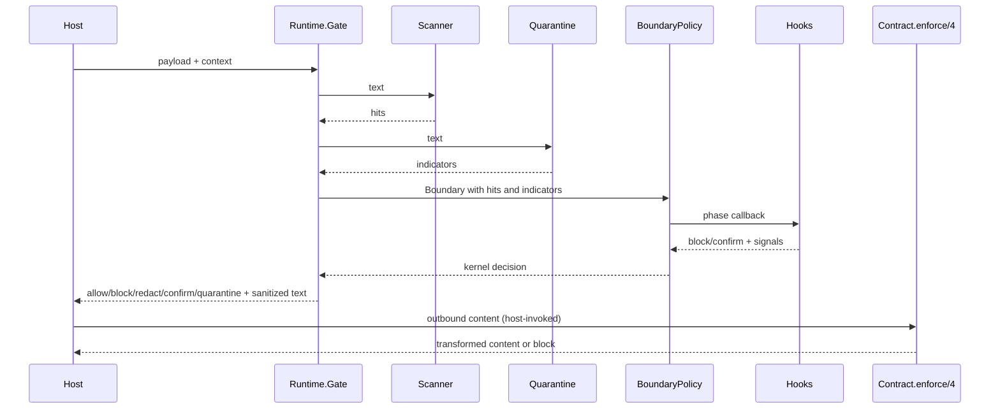

---
sigil_guard:
  id: "SP.04"
  title: "Boundary Scanner And Policy Kernel"
  domain: security
  status: implemented/partial
  priority: critical
  created: "2026-07-01"
  updated: "2026-11-20"
  tags:
    ["scanner", "policy", "boundary", "lifecycle", "output-contracts",
     "sandbox", "hooks", "streaming", "v3"]
  depends_on: ["R.01", "R.06", "R.07", "SP.01", "SP.02", "SP.03"]
---

# SP.04 - Boundary Scanner And Policy Kernel

## Executive Summary

V3 evolves SigilGuard from a scanner with policy helpers into a boundary-aware
policy kernel. Regex remains a fast candidate extractor, but final decisions
must bind source, sink, actor, tool capability, sandbox identity, action digest,
payload digest, context digest, scanner signals, lifecycle phase, and matched
rules. This revision fixes the v3 policy-file grammar, filenames, and digest;
sink-aware output contracts and their transforms (D8); the sandbox
`isolation_level` enum and fail-closed mismatch matrix; the full
`SigilGuard.Hooks` contract; the advisory adaptive-detector behaviour (D5);
the additive scanner-hit extension (D17); and the streaming holdback
property-test specification. It realizes R.06 rows 1, 9, 10, and 11
(test families TM.08 and TM.09).

## Business Value

- **Problem:** Regex-only or verdict-only security misses source-to-sink leaks,
  prompt injection, tool poisoning, lifecycle hook abuse, and repo-governance
  risks.
- **Solution:** Treat scanning as staged signal generation and policy as a
  deterministic decision kernel with digest-bound evidence.
- **Beneficiary:** Host applications using SigilGuard at MCP, repo, CI,
  tool-output, and model-ingress boundaries.
- **Impact:** Explainable decisions, better precision, safer streaming, and a
  reusable policy contract that encodes the lethal-trifecta defense (R.06).

## Technical Architecture

### Policy Pipeline

1. **Normalize boundary context:** `SigilGuard.Boundary` carries phase,
   source, sink, origin, actor, tool, sandbox identity, resource, and trust
   zone. The struct has no tenant or transport field.
2. **Extract candidates:** secret regex patterns in `SigilGuard.Scanner`, and
   prompt-injection and tool-poisoning indicator regexes in
   `SigilGuard.Quarantine`. Structured parsers, known-secret-value matching,
   and URL or path extraction are not implemented.
3. **Validate candidates:** structural format checks, token and label
   boundaries, placeholder and repeated-value rejection, and entropy floors
   for the built-in patterns. Checksums, allowlists, baseline suppressions,
   and bundle-supplied validators are not implemented; a host that needs them
   passes its own `:pipeline` module to the scanner.
4. **Enrich signals:** scanner hits gain confidence, signals, span, and
   validation stage; quarantine indicators gain a category; hooks and the
   adaptive detector add indicators and may raise risk on the kernel
   decision. The manifest digest and policy-file digest are values the host
   places on the boundary.
5. **Evaluate policy:** deterministic deny precedence over kernel invariants,
   the sandbox matrix, policy-file rules, host-supplied repo facts, and hook
   verdicts.
6. **Apply output contracts:** not wired into the kernel or the gate.
   `BoundaryPolicy.Contract.enforce/4` transforms content only when the host
   calls it (see Sink-Aware Output Contracts).
7. **Emit evidence:** the kernel returns a `SigilGuard.Decision` with matched
   rules and audit metadata and emits the `[:sigil_guard, :policy, :decision]`
   telemetry event. The host builds attestations, audit events, and OTel
   attributes from the decision through the SP.01 and SP.05 APIs.
   `Decision.evidence_refs` is always `[]`; no quarantine reference is
   produced.

### Lifecycle Taxonomy

| Phase | Blockable | Description |
|-------|-----------|-------------|
| `:session_start` | no | Host begins a run/session; evidence only. |
| `:tool_request` | yes | Actor asks to invoke a tool. |
| `:permission_requested` | yes | Runtime asks for human/host confirmation. |
| `:permission_resolved` | yes | Confirmation token is issued or denied. |
| `:tool_result` | yes | Tool output is about to enter model/user context. |
| `:file_changed` | yes | Repo/file mutation is proposed or observed. |
| `:model_ingress` | yes | Data is about to enter model context. |
| `:model_egress` | yes | Model output is about to leave the runtime. |
| `:session_end` | no | Host closes a run/session; evidence only. |

The `Blockable` column is the normative classification for the Hooks contract
below. V2 `SigilGuard.Context` phases map as `:inbound_user -> :model_ingress`,
`:outbound_model -> :model_egress`, `:repo_change -> :file_changed`;
`:tool_request`/`:tool_result` are unchanged; session and permission phases are
new v3 boundary events. `Runtime.Gate` produces only the five phases mapped
from `SigilGuard.Context`; the session and permission phases are reachable
only through `BoundaryPolicy.evaluate/2` and `Hooks.dispatch/2` called
directly. Host-defined hooks may contribute signals, but deterministic policy
remains authoritative.

### Decision Combination (Normative)

Verdicts use the SP.07 unified enum with the total order
`block > quarantine > confirm > redact > allow`. Each source contributes at
most one verdict; the final verdict is the strongest contribution:

1. **Boundary validation failure** blocks terminally (no other stage runs).
   A boundary that fails `Boundary.validate/1`, or a malformed option list,
   returns `block` with matched rule `boundary.invalid`.
2. **Kernel invariants** (deny/confirm side, never overridable):
   `trust_zone: :untrusted` at `:tool_request` blocks; an indicator whose
   `quarantine` field is truthy quarantines; a hit with category `:secret`
   or `"secret"` headed to an `external` or `network` sink blocks or redacts
   per `:on_sensitive`. Scanner failure is not a kernel invariant: the kernel
   never observes it, and only the runtime gate blocks on it (below).
   Indicators from `Quarantine.inspect/3` carry no `quarantine` field, so
   they reach the kernel through `indicator:` rules, not this invariant.
3. **Sandbox matrix** (below), unless replaced by an explicit `isolation:`
   rule.
4. **Policy-file `[rules]` verdict:** the strongest matching rule, else the
   file `default` when a policy file is loaded.
5. **Repo facts** from the `:repo_facts` option, at any phase:
   `block -> block`, `require_approval -> confirm`; `allow` contributes
   nothing.
6. **Hook verdicts** (`block`/`confirm` only).

The kernel takes repo facts as data and does not evaluate a repo policy
itself. `File.parse/1` compiles a `[repo]` section into `%File{repo: ...}`;
the runtime gate evaluates it. At the `:repo_change` context phase, which the
gate bridges to `:file_changed`, the gate evaluates its `:repo_policy` option,
or without one the `[repo]` section of its `:boundary_policy` file, builds
the map with `RepoPolicy.policy_facts/2`, and passes it to the kernel as
`:repo_facts` (SP.07). A host that calls the kernel directly does the same
three steps. The kernel applies the map at whatever phase the boundary
names, and reads neither `%File{repo: ...}` nor `Boundary.repo_changes`.

Allow-side contributions take effect only where no stronger contribution
exists. Output contracts are not part of the combination, and no kernel or
gate code runs them. The host applies them to content the final verdict
permits to cross (see Sink-Aware Output Contracts).

This list is the kernel's own combination. When the runtime gate (SP.07)
evaluates through `BoundaryPolicy`, it treats the kernel verdict as one
contribution and composes additional gate-owned signals it alone observes -
scanner failure (fail-closed block), the richer `Quarantine.inspect`
gradations (`:blocked`/`:suspicious` with the `tool_result`+`:model` confirm
downgrade), and the D17 risk×trust ladder - by the same strongest-wins rule.
See SP.07 *Gate ↔ Kernel Delegation*. `BoundaryPolicy.evaluate/2` used directly
by a host applies only the kernel contributions above.

The gate takes the kernel's verdict, reason, and matched rules, and its
advisory signals. Hook and adaptive indicators are appended to the gate
decision's `indicators` after the quarantine indicators, and counted in
`audit_metadata.advisory_indicator_count`. A risk that a hook or the adaptive
detector raises above the gate's own becomes the decision's `risk_level` and
goes back through the risk×trust ladder; a lower one changes nothing.
`adaptive_error` is copied into the audit metadata. The gate sets
`source_sensitivity` from `context.metadata` (key `source_sensitivity`, atom
or string) and otherwise leaves the default `:internal`. It builds the
boundary without `repo_changes`, `hook_results`, or `policy_file_digest`.

The physical-effect checks of
[SP.19](SP.19-physical-effect-authority.md) contribute `block` only. They
never weaken a verdict in this order and never stand in for a `confirm`.

### Data Flow



The last two arrows are the host's own call. No library code calls
`Contract.enforce/4`.

## Data Model

### Policy Decision Input (`SigilGuard.Boundary`)

| Field | Type | Required | Description |
|-------|------|----------|-------------|
| `phase` | atom | yes | Lifecycle phase from the taxonomy above. |
| `source` | atom/string | yes | Source boundary. |
| `sink` | atom/string | yes | Destination boundary. |
| `origin` | atom/string | no | Content origin; the value the `origin:` rule key matches. |
| `source_sensitivity` | atom | no | `:public \| :internal \| :private`; defaults `:internal`. Evaluation fact only, never part of the SP.01 context digest; hosts needing it bound into evidence put it in the payload. `Runtime.Gate` reads it from `context.metadata` (`source_sensitivity`, atom or string key); `Context` has no field for it because every `Context` field enters the confirmation digest. A value outside the enum is an invalid boundary and blocks. |
| `actor` | map | no | Actor identity and trust claims. |
| `tool` | map | no | `name`, `manifest_digest`, `side_effects`. A non-empty `manifest_digest` is the host's statement that it verified the SP.03 manifest; the kernel does not verify it. With it the matrix uses the classes of `side_effects`; without it the matrix class is `execute`. |
| `resource` | map | no | Audience/resource/scope context. |
| `action_digest` | string | yes | Canonical action digest (SP.01). |
| `payload_digest` | string | yes | Canonical payload digest (SP.01). |
| `context_digest` | string | yes | Canonical policy context digest (SP.01). |
| `policy_file_digest` | string | no | Raw-bytes digest of the loaded policy file (below). Carried on the struct only: the kernel does not read it or copy it into the decision. |
| `hits` | list | no | Scanner hits in the extended hit shape below; defaults `[]`. |
| `indicators` | list | no | Prompt-injection/tool-poisoning indicators. |
| `hook_results` | list | no | Host hook signals and outcomes. Carried on the struct only: hooks run through the `:hooks` option and the kernel does not read this field. |
| `repo_changes` | list | no | Path/action facts for repo policy. Carried on the struct only: the kernel does not read it (see Decision Combination). |
| `trust_level` | atom | no | Caller trust level; defaults `:low`. |
| `trust_zone` | atom/string | no | Deployment-defined zone. |
| `sandbox` | map | no | `sandbox_id` (string), `isolation_level` (enum below), `workspace_root_digest` (string). `sandbox_id` and `isolation_level` are part of the SP.01 context digest. |

```elixir
defmodule SigilGuard.BoundaryPolicy do
  alias SigilGuard.Boundary

  @spec evaluate(Boundary.t() | map() | keyword(), keyword()) ::
          SigilGuard.Decision.t()
  # opts: :policy (compiled policy or nil), :on_sensitive (:block | :redact,
  # default :block), :repo_facts (RepoPolicy.policy_facts/2 map or nil),
  # :hooks ([module()], invocation order), :hook_timeout_ms (default 5_000),
  # :adaptive_detector (module() | nil), :text (content for the detector),
  # :evaluate_sandbox (boolean, default true; false skips the sandbox matrix).
end
```

The kernel does not scan and reads no scanner options. It passes the option
list unchanged to each hook callback and to the detector.

SP.04 adds no application-env configuration keys; the SP.01 closed key set is
final. Policies, hooks, detectors, and timeouts are explicit per-call options
or host-loaded values.

## Sandbox Identity

### Isolation Levels

`isolation_level` is a closed enum, ordered weakest to strongest:

```elixir
@type isolation_level :: :none | :container | :vm | :remote_attested
```

`SigilGuard.Context` gains `sandbox_id` and `isolation_level` fields.
`Context.validate/1` MUST reject values outside the enum with
`{:error, :invalid_isolation_level}` (the gate then emits its standard
malformed-input block). An absent (`nil`) level is valid context input. An
omitted level is byte-distinct from `"none"` in the SP.01 context digest. The
two differ in policy as well: the kernel maps an absent level to the matrix's
`absent` column, and the runtime gate skips the matrix when the level is
absent (below).

**Standalone scope.** `BoundaryPolicy.evaluate/2` applies the matrix at the
tool phases when the boundary declares a `tool` map or a `sandbox` map. A
tool-phase boundary with neither gets no sandbox contribution. The
`evaluate_sandbox: false` option skips the matrix for any boundary; the
kernel reads it, the gate sets it, and the function's `@doc` does not list
it.

**Runtime-gate scope (SP.07).** `Runtime.Gate` passes
`evaluate_sandbox: false` unless `Context.isolation_level` is set. With a
level set it builds `sandbox` from `Context.isolation_level` and
`Context.sandbox_id`, and the matrix runs whether or not the context names a
tool. With no level the matrix does not run: the `absent` column is not
reachable through the gate, and the matrix does not quarantine a tool call
whose isolation the host left undeclared. The class comes from the
`:manifest_facts` option (`%{manifest_digest: sha256, side_effects: [name]}`);
without it the class is `execute`. `ToolGateway.guard_request/3` sets
`:manifest_facts` from the pinned capability manifest and discards a
caller-supplied value. `ToolGateway.guard_result/3` resolves no manifest and
discards it too, so a result is class `execute`. A host that passes
`:manifest_facts` to `Gate.evaluate/3` directly is asserting that it verified
the manifest. See SP.07 *Gate ↔ Kernel Delegation*.

`absent` is NOT a member of the `isolation_level` enum — it is the nil /
no-value case. The four enum values are the only values `Context` stores or
`validate/1` accepts. Separately, the policy-file `isolation:` matcher
(Policy File Schema below) accepts five KEYWORDS — the four enum values plus
`absent` — where `absent` matches only the nil case and is never implied by
any enum value. Enum membership (4) and matcher keywords (5) are distinct on
purpose; do not conflate them.

### Fail-Closed Default (Normative)

In `BoundaryPolicy.evaluate/2`, a tool-phase boundary in matrix scope whose
sandbox lacks `isolation_level` takes the `absent` column, and one that
carries `:none` takes the `:none` column: `:quarantine`, or `:block` for
`execute` and `network` at `:none`. A `[rules]` line whose matcher set
includes `isolation:` and that matches the input replaces the matrix for that
evaluation: the matrix contributes nothing and the rule's decision enters the
combination. That explicit-rule override is the only sanctioned weakening of
the matrix below; kernel invariants are never weakened. When a cell other
than `allow` applies, the decision records reason `sandbox_required` and
matched rule id `sandbox.matrix.<class>.<level>`, where `<level>` is `absent`
for a missing level.

### Side-Effect Mismatch Matrix

The matrix applies at `:tool_request` and `:tool_result`. A boundary whose
`tool` carries a non-empty `manifest_digest` uses the classes of its
`side_effects` list (SP.03): `read`, `write`, `execute`, and `network` map to
themselves, `delete` maps to `write`, `privileged` maps to `execute`, `none`
maps to no class, and any other name maps to `execute`. A tool with multiple
classes uses the strictest resulting cell (by the verdict total order). A
manifest whose effects map to no class (`["none"]` or `[]`) selects no cell,
and the matrix contributes nothing. No `manifest_digest`, or a `side_effects`
value that is not a list, means class `execute`.

The kernel does not verify manifests. `manifest_digest` and `side_effects`
are whatever the host placed on the boundary, and the `effect:` matcher reads
`side_effects` whether or not a `manifest_digest` is present. In direct use,
a boundary that lists `side_effects: ["read"]` without a `manifest_digest` is
class `execute` for the matrix and still matches an `effect:read` rule; when
that rule also carries `isolation:`, it replaces the matrix cell. A host that
calls `evaluate/2` directly must copy `side_effects` only from a manifest it
verified. Through `ToolGateway.guard_request/3` both fields come from the
pinned manifest.

| Class \ Level | absent | `:none` | `:container` | `:vm` | `:remote_attested` |
|---------------|--------|---------|--------------|-------|--------------------|
| `read` | quarantine | quarantine | allow | allow | allow |
| `write` | quarantine | quarantine | confirm | allow | allow |
| `execute` | quarantine | block | confirm | allow | allow |
| `network` | quarantine | block | confirm | allow | allow |

`absent` always quarantines (unknown isolation is reviewable evidence); an
affirmative `:none` on `execute`/`network` blocks outright (the host declared
no isolation for the riskiest classes).

### Remote Attestation Evidence

`:remote_attested` MUST only be set by hosts that verified attestation
evidence out-of-band; SigilGuard never verifies it. The evidence blob MAY be
carried opaquely in `context.metadata["attestation_evidence"]` for audit
hand-off. Metadata is excluded from the context digest (SP.01), so hosts that
need the evidence digest-bound MUST place its digest in the payload.

## Policy File Schema

### Grammar

The v3 boundary-policy file extends the implemented `SigilGuard.RepoPolicy`
line-oriented style with structured sections. Lines are UTF-8; `#` starts a
comment; blank lines are ignored; files over 256 KiB fail with
`:policy_too_large`. In `[rules]` and `[contracts]`, a line beginning with
whitespace continues the previous logical line (joined with one space before
tokenizing); the `[repo]` body is passed to the v2 repo parser verbatim, with
no continuation folding.

```
policy_file   = version_line { section }
version_line  = "version 3"            # first non-comment line, mandatory
section       = "[rules]"     { default_line | rule_line }
              | "[repo]"      repo_grammar   # v2 grammar, unchanged
              | "[contracts]" { contract_line }
default_line  = "default" SP decision          # at most one; absent = confirm
rule_line     = decision { SP matcher }
decision      = "allow" | "redact" | "confirm" | "quarantine" | "block"
matcher       = key ":" value { "," value }    # split key on FIRST ":"
contract_line = "contract" SP "sink:" value { "," value } { SP field }
field         = fieldkey ":" fieldvalue
```

Each section appears at most once. Unknown sections, unknown matcher keys,
unknown enum values, a duplicated matcher key within one rule, a duplicated
`default`, or a missing/unknown version line fail with
`{:error, :invalid_policy_file}`. Matcher values within one key OR together;
matchers within one rule AND together; an absent key matches anything.

In `[rules]`, rule ids are `line_<n>`, where `n` is the 1-based file line
number of the first physical line of the logical line. In `[repo]`, the repo
parser assigns `line_<n>` counting from the first line after the `[repo]`
header, so the two sections number independently and a `[repo]` id does not
name a file line. In the canonical file the `[repo]` rules sit on file lines
28 and 29 and have ids `line_2` and `line_3`.

| Key | Matches input field | Values |
|-----|---------------------|--------|
| `phase` | `phase` | the nine lifecycle phases. |
| `origin` | `origin` | `unknown`, `user`, `model`, `tool`, `resource`, `repo`. |
| `source` | `source` | exact string or `*`. |
| `sink` | `sink` | `internal`, `model`, `user`, `tool`, `external`, `network`, `log`, `repo`. |
| `zone` | `trust_zone` | `trusted`, `semi_trusted`, `untrusted`. |
| `trust` | `trust_level` | `low`, `medium`, `high`. |
| `sensitivity` | `source_sensitivity` | `public`, `internal`, `private`. |
| `isolation` | `sandbox.isolation_level` | `absent`, `none`, `container`, `vm`, `remote_attested`. |
| `effect` | classes of `tool.side_effects` (mapping in Side-Effect Mismatch Matrix); a tool with no `side_effects` matches no value | `read`, `write`, `execute`, `network`. |
| `tool` | `tool.name` | exact string or `*`. |
| `actor` | `actor.id` | exact string or `*`. |
| `hits` | scanner hit categories present | `none`, `any`, `secret`, `injection`, `poisoning`. |
| `indicator` | indicator categories present | `none`, `any`, `injection`, `poisoning`. |

`none` MUST be the sole value in its matcher. `isolation:absent` matches a
context with no isolation level; it exists so an explicit rule can override
the matrix's absent column and is never implied by any other value.

Rules are matched against the boundary as passed in, before hooks and the
adaptive detector run, so `indicator:` sees the indicators on the boundary
(through the gate, those from `Quarantine.inspect/3`, each with category
`:injection` or `:poisoning`) and not indicators a hook or detector adds. A
tool the matrix treats as `execute` because it has no `manifest_digest` does
not match `effect:execute` unless its `side_effects` list maps to that class.

No matcher reads a target identity or a payload value. Task-scoped
operation, target, and parameter bounds are specified by the SP.19 effect
envelope, not by policy rules.

### Precedence

Deny-before-allow precedence is preserved from the repo kernel and extended:
when several `[rules]` lines match one input, the strongest decision wins by
`block > quarantine > confirm > redact > allow`. The `[repo]` section keeps
its implemented `block > require_approval > allow` order and its
unmatched-path default semantics exactly as `SigilGuard.RepoPolicy` behaves
today.

### Policy Filenames (D13, Jointly Owned With SP.11)

The loader checks these repo-relative candidates in order:
`SIGILGUARD_POLICY`, `.sigilguard-policy`, `.sigilguard/policy`,
`.github/sigilguard-policy`. Legacy candidates are checked first: if
`SIGIL_POLICY`, `.sigil-policy`, `.sigil/policy`, or `.github/sigil-policy`
exists under the repo root, loading MUST fail with
`{:error, {:legacy_policy_filename, found, use}}` naming the found path and
its 1:1 positional replacement, even when a new-name file also exists. There
is no silent fallback and no coexistence; hosts that load policy at boot MUST
surface this as a typed startup error. `BoundaryPolicy.File.load/2` resolves
each candidate against the repo root and skips one that resolves outside it,
without an error; `RepoPolicy.load/2` rejects absolute and traversal
candidates with typed errors (SP.11). A candidate or parent component that is
a symbolic link is not eligible, so a lexically in-root path cannot redirect
policy loading outside the trust root. For `BoundaryPolicy.File.load/2`,
loader options are a validated keyword list limited to `:candidates`,
`:legacy_replacements`, and `:max_bytes`; malformed option containers, keys,
candidate sets, replacement pairs, and byte limits fail with
`:invalid_options` before filesystem access. `RepoPolicy.load/2` accepts only
`:candidates` and `:max_bytes` and reports bad values with other atoms
(SP.11).

### Policy File Digest

`policy_file_digest` is the lowercase-hex SHA-256 over the raw bytes of the
policy file exactly as read, with no newline normalization, trimming, or
canonicalization. Raw bytes were chosen over a JCS-canonical parse digest
because the digest exists even for files that fail to parse, is byte-stable
across parser versions, matches what `sha256sum` and git produce, and never
lets byte-different files (comment or whitespace edits) collide onto one
digest, which would erase forensic distinctions. The compiled-policy canonical
digest (`RepoPolicy.digest/1` style) remains available for rule-equivalence
checks but is not the evidence value.

```elixir
defmodule SigilGuard.BoundaryPolicy.File do
  @type parse_error ::
          :invalid_policy_file
          | :invalid_options
          | :policy_too_large
          | :invalid_output_contract
          | :unknown_transform

  @spec load(repo_root :: Path.t(), opts :: keyword()) ::
          {:ok, t()}
          | {:error, parse_error() | :not_found}
          | {:error, {:legacy_policy_filename, Path.t(), Path.t()}}

  @spec parse(binary()) :: {:ok, t()} | {:error, parse_error()}

  @spec digest(raw_bytes :: binary()) :: String.t()
  # Lowercase-hex SHA-256 over the raw file bytes exactly as read.
end
```

### Canonical Example And Fixture Convention

The complete canonical policy file is the example in the next section. Its
exact bytes are committed as `test/fixtures/boundary_policy/canonical.policy`,
with `canonical.expected.json` holding the parsed rules, contracts, repo
section, and `policy_file_digest`. `test/fixtures/boundary_policy/invalid/`
holds one minimal file per grammar violation, named after the violation.
`invalid_output_contract.policy` and `unknown_transform.policy` fail with the
atom in their name; the other ten fail with `:invalid_policy_file`.
`:policy_too_large` and `:invalid_options` have no fixture file; `FileTest`
and `LoadTest` build those inputs inline. Fixture regeneration MUST be
byte-deterministic; changing canonical bytes requires bumping the grammar
version.

## Sink-Aware Output Contracts

Output contracts (D8) are per-sink guarantees for content the final verdict
permits to cross. They are designed as the backstop for R.06 rows 1, 10, 11,
and 14: an allowed flow should not carry raw credentials or oversized
payloads into an external sink.

The library parses contracts and provides the transform; it does not apply
them. `File.parse/1` compiles `[contracts]` into `%File{contracts: ...}`, a
map keyed by sink string, and no kernel, gate, or gateway code reads that map
or calls `Contract.enforce/4`. A host that wants the backstop looks up
`policy.contracts[sink]` and calls
`Contract.enforce(contract, sink, content, opts)` on outbound content after
the decision. Until the host does, an allowed flow crosses untransformed.

`enforce/4` does not scan. The host runs the outbound scan and passes the
matched substrings as `:credentials` and `:pii`; `enforce/4` replaces each
occurrence of those literal strings. Its options are `:verdict` (default
`:allow`), `:credentials` (default `[]`), and `:pii` (default `[]`). It
returns `{:ok, content}` or `{:block, "contract.<sink>.class"}`.

### Contract Vocabulary

| Field | Type | Default | Meaning |
|-------|------|---------|---------|
| `max_size` | positive integer (bytes), minimum 64 | unlimited | Cap on outbound byte size of `text` content; violations apply `truncate`. `structured` content is not truncated. |
| `no_raw_credentials` | boolean | `false` | Each string in the caller's `:credentials` list is replaced per `credential_transform`. `enforce/4` runs no secret scan of its own; with an empty list the text is unchanged. |
| `digest_only_pii` | boolean | `false` | Each string in the caller's `:pii` list is replaced with `hash`. No pattern, built-in or bundle-supplied, carries a `pii` flag; the host identifies PII spans. |
| `classes` | CSV of `text`, `structured` | all classes | Allowed content classes from the SP.01 payload class: UTF-8 binary is `text`; map or list is `structured`. A disallowed class is not transformable: `enforce/4` returns `{:block, "contract.<sink>.class"}` and the host must treat the crossing as blocked. No `Decision` is changed. |
| `credential_transform` | `mask` \| `hash` | `mask` | Transform for `no_raw_credentials` replacements; any other value fails with `:unknown_transform`. |

Each sink may appear in at most one contract; duplicates, unknown fields,
invalid classes, or `max_size` below 64 fail with
`{:error, :invalid_output_contract}`.

### Transform Semantics (Normative)

- **`truncate`** - keep the longest prefix whose byte size is at most
  `max_size - 11`, backed off to the previous complete UTF-8 codepoint
  boundary, then append the 11-byte ASCII marker `[TRUNCATED]`. The result is
  always valid UTF-8 and at most `max_size` bytes. Codepoint safety (not
  grapheme safety) is deliberate: it guarantees valid UTF-8 without Unicode
  segmentation tables; a split grapheme is a visual artifact, not a
  correctness fault.
- **`hash`** - replace the span with `"sha256:" <> hex`, the lowercase-hex
  SHA-256 of the span's raw bytes (71 bytes total). Deterministic, so
  identical secrets correlate across events without disclosure.
- **`mask`** - replace every Unicode codepoint of the span with `*` (U+002A),
  preserving the codepoint count (byte length may shrink).

### Evaluation Order (Normative)

Outbound content is to be processed in exactly this order:

1. **Scanner redaction** - hits replaced per replacement hints when the
   decision action is `redact`.
2. **Quarantine decision** - indicator sanitization and verdict effects.
3. **Output contract transforms** - for the contract matching `sink`: class
   check, then `credential_transform` replacements, then `digest_only_pii`
   replacements, then `max_size` truncation, in that order.

`Runtime.Gate` performs steps 1 and 2 when it builds
`Decision.sanitized_text`. Step 3 is not wired: the host calls `enforce/4`
on that text, and `enforce/4` applies the four sub-steps in the order given.

No contract runs on `block` or `quarantine` verdicts. Called with
`verdict: :block` or `verdict: :quarantine`, `enforce/4` skips the contract
and returns `{:ok, content}` with the content untouched; it does not withhold
it. The host must not forward content on those verdicts.

### Complete Policy File Example

```
version 3

[rules]
default allow

# TM.09: private data x untrusted content x external comms
block sensitivity:private origin:tool,resource,repo
  zone:untrusted sink:external,network trust:low,medium
confirm sensitivity:private origin:tool,resource,repo
  zone:untrusted sink:external,network trust:high
confirm sensitivity:internal origin:tool,resource
  sink:external,network

# untrusted callers cannot execute privileged actions
block phase:tool_request zone:untrusted

# TM.08: gate retrieved memory/context at model ingress
quarantine phase:model_ingress origin:tool,resource
  indicator:injection,poisoning

# sandbox-aware overrides of the mismatch matrix
allow phase:tool_result isolation:container,vm,remote_attested
  effect:read
confirm phase:tool_request isolation:none effect:write

[repo]
default require_approval
allow agent:release-bot action:modify docs/** CHANGELOG.md
block agent:* priv/secrets/**

[contracts]
contract sink:external,network max_size:16384
  no_raw_credentials:true digest_only_pii:true classes:text
  credential_transform:hash
contract sink:log max_size:65536 no_raw_credentials:true
contract sink:model classes:text,structured
```

## Dataflow Rules And Lethal Trifecta

The first three rules of the canonical example are the concrete encoding of
R.06's lethal-trifecta sketch (row 10, TM.09), a conjunction over boundary
labels resolved deterministically:

- `sensitivity:private` marks a private-data source (host-labeled
  `source_sensitivity`).
- `origin:tool,resource,repo` plus `zone:untrusted` marks untrusted-content
  exposure.
- `sink:external,network` marks an external-communication sink.

When all three hold, low- and medium-trust actors are blocked outright; a
high-trust actor is routed to `confirm`, whose token binds the exact action
digest including `sandbox_id` (SP.01, SP.03), so an approval can never be
replayed against another action or sandbox. The third rule keeps unlabeled
(`internal` by default) tool/resource content out of external sinks without
confirmation. Because `block > confirm`, an input matching both rules blocks;
the `trust:` matchers partition the cases so the R.06 else-branch is reachable
exactly for `trust:high`.

These results hold for `BoundaryPolicy.evaluate/2` called with a boundary
that carries `source_sensitivity`. `SigilGuard.Context` has no such field and
`Runtime.Gate` does not set it on the boundary it builds, so through the gate
the value is always `:internal`: the two `sensitivity:private` rules cannot
match there, and only the third rule applies. A host that needs the
private-data rules enforced must call the kernel directly with a labeled
boundary.

Rationale: R.06 shows why this is a policy statement, not a classifier call.
CaMeL and the plan-then-execute pattern family demonstrate that untrusted
content must never reach a privileged action without a deterministic
checkpoint; Willison's trifecta reduces the failure condition to three
data-flow properties. The kernel evaluates exactly those properties from
boundary labels, needs no model cooperation, and emits a reproducible,
auditable verdict (R.06, "Why A Deterministic Policy Kernel").

## Hooks Behaviour

Hosts extend the kernel with lifecycle hooks. Hooks contribute signals and
deny-side verdicts; they can never weaken a deterministic decision. Callbacks
map 1:1 to lifecycle phases as `on_<phase>`; the taxonomy's `Blockable`
column is the normative blockable versus notification-only classification:
`on_session_start/2` and `on_session_end/2` are notification-only, the other
seven callbacks are blockable. All nine are optional callbacks.

```elixir
defmodule SigilGuard.Hooks do
  alias SigilGuard.Boundary

  @type hook_signal :: %{
          optional(:risk_level) => :low | :medium | :high,
          optional(:indicators) => [map()],
          optional(:note) => String.t()
        }
  @type blockable_result ::
          {:ok, :continue} | {:ok, :continue, hook_signal()}
          | {:block, reason :: String.t()} | {:confirm, reason :: String.t()}
  @type notify_result :: :ok | {:ok, hook_signal()}

  @callback on_session_start(Boundary.t(), keyword()) :: notify_result()
  @callback on_tool_request(Boundary.t(), keyword()) :: blockable_result()
  @callback on_permission_requested(Boundary.t(), keyword()) ::
              blockable_result()
  @callback on_permission_resolved(Boundary.t(), keyword()) ::
              blockable_result()
  @callback on_tool_result(Boundary.t(), keyword()) :: blockable_result()
  @callback on_file_changed(Boundary.t(), keyword()) :: blockable_result()
  @callback on_model_ingress(Boundary.t(), keyword()) :: blockable_result()
  @callback on_model_egress(Boundary.t(), keyword()) :: blockable_result()
  @callback on_session_end(Boundary.t(), keyword()) :: notify_result()
end
```

### Result Semantics

Hooks are passed via the `:hooks` option and invoked in registration order;
only the callback matching the input phase runs, and unexported callbacks are
skipped. `{:block, reason}` short-circuits remaining hooks; other results
accumulate. `hook_signal` values are advisory: `risk_level` may raise but
never lower computed risk, and `indicators` join the indicator list with
source `:hook`. Hook verdicts enter decision combination as `block`/`confirm`
contributions with matched rule id `hook.<module>.<phase>`. Hooks cannot emit
`allow`, `redact`, or `quarantine`.

The dispatcher accepts both continue forms on every phase. `{:ok, :continue}`
and `:ok` continue, and `{:ok, :continue, signal}` and `{:ok, signal}`
continue with the signal, whether the phase is blockable or
notification-only. A blockable callback that returns `:ok` or
`{:ok, signal}` therefore continues; it is not an invalid result.
`{:block, reason}` and `{:confirm, reason}` are accepted only on a blockable
phase and only with a binary reason. Every other return is
`:invalid_hook_result`, handled as a crash below: a deny-side tuple on a
notification-only phase, a non-binary reason, a signal that is not a map, a
`risk_level` outside `:low | :medium | :high`, an `indicators` value that is
not a list of maps, and any other term. A signal's `note` is accepted and not
recorded.

Signals reach the decision that `BoundaryPolicy.evaluate/2` returns, whose
audit metadata also carries `advisory_risk_level`, the strongest risk a hook
or the adaptive detector asked for. `Runtime.Gate` copies the indicators onto
its decision and raises its risk by that level (see Decision Combination).

### Timeouts And Fail-Closed Matrix

Every hook invocation MUST be time-bounded by `:hook_timeout_ms`
(default `5_000` ms). The value MUST be an integer in the BEAM timeout range
`0..4_294_967_295`; `:infinity`, negative values, and non-integers are invalid.
The hooks option MUST be a list of module atoms. A malformed option container,
hook list, or timeout fails closed with `:invalid_hook_options` at
`Hooks.dispatch/2`. Those, and a detector that is not an atom, fail with
`:invalid_options` at `BoundaryPolicy.evaluate/2` and
`Runtime.Gate.evaluate/3`. Neither reaches `receive ... after` or raises. The
policy and runtime boundaries check only that each hook entry is an atom; an
atom that names no loadable module passes that check and fails at dispatch
with `:invalid_hook_options`, which blocks on a blockable phase.

| Failure | Blockable phase | Notification-only phase |
|---------|-----------------|-------------------------|
| timeout (`:hook_timeout`) | verdict `block`, reason `:hook_timeout` | log-and-continue (telemetry only) |
| crash (raise/exit/throw) | verdict `block`, reason `:hook_crash` | log-and-continue (telemetry only) |
| `:invalid_hook_result` | verdict `block`, reason `:invalid_hook_result` | log-and-continue (telemetry only) |

## Adaptive Detector Behaviour

D5: the behaviour lives in core; model-backed implementations live outside
core. Results are strictly advisory: they may raise the risk level, never
lower it, and are never the sole basis for an allow.

```elixir
defmodule SigilGuard.AdaptiveDetector do
  alias SigilGuard.Boundary

  @type indicator :: %{
          required(:id) => String.t(),
          required(:severity) => :low | :medium | :high,
          required(:confidence) => float(),
          optional(:note) => String.t()
        }

  @callback analyze(text :: String.t(), Boundary.t(), opts :: keyword()) ::
              {:ok, [indicator()]} | {:error, atom()}
end
```

- **Nil path (normative):** with `:adaptive_detector` unset or `nil`, the
  behaviour is absent and decisions are byte-identical to a build without it.
  Tests MUST prove this equality.
- Returned indicators join the indicator list with source `:adaptive` and
  feed the risk ladder exactly like quarantine indicators (`:high` severity
  raises risk to `:high`, `:medium` to at least `:medium`); they never
  produce an allow contribution.
- **Well-formed indicator (normative):** a map with `:id` (non-empty
  binary), `:severity` in `[:low, :medium, :high]`, and `:confidence` a
  float in `0.0..1.0`; `:note` optional binary; no other required keys. A
  returned element is malformed if it is not a map, is missing a required
  key, or carries an out-of-domain `:severity`/`:confidence`. Validation is
  per-element: the core MUST validate every returned indicator before use.
- A detector `{:error, _}`, timeout (bounded by `:hook_timeout_ms`), crash,
  or a result whose top level is not a list, OR any single malformed
  indicator element, degrades the WHOLE result to zero indicators, recorded
  in telemetry and audit metadata as `adaptive_error`; the deterministic
  verdict is unchanged. (All-or-nothing, so a detector cannot smuggle a
  partial result past validation.)
- The indicators, the raised risk level, and `adaptive_error` appear on the
  decision that `BoundaryPolicy.evaluate/2` returns. Through `Runtime.Gate`
  the detector runs and emits its telemetry event, but the gate decision
  carries none of the three.
- The reference implementation (Ortex/ONNX classifier) is an optional
  post-GA package (R.07) and is not specified here.

## Scanner Hit Extension And Pattern-Set Split

### Hit Map (D17, Additive Only)

`SigilGuard.scan/1` returning `{:ok, text} | {:hit, hits}` and
`scan_and_redact/1` returning a binary are unchanged contracts. `name` is the
only load-bearing key for consumers (D17). The set `Scanner.scan/2` requires
of every pipeline, custom ones included, is `name`, `category`, `severity`,
`match`, `offset`, and `length`; a hit missing one of them, or whose `offset`
and `length` fall outside the text, raises `ArgumentError`. The narrower
required set `name`, `match`, `offset`, `length` is not implemented. The
default `:staged` pipeline emits every field below plus `signals`, `stage`,
and `validated`; the `:regex` pipeline emits no `confidence` or `span`.

| Key | Type | Presence | Notes |
|-----|------|----------|-------|
| `name` | `String.t()` | required | Hard consumer contract (D17). |
| `match` | `String.t()` | required | Raw matched bytes. |
| `offset` | `non_neg_integer()` | required | Byte offset. |
| `length` | `non_neg_integer()` | required | Byte length. |
| `replacement_hint` | `String.t() \| nil` | optional | Redaction replacement. |
| `category` | `atom() \| String.t()` | required | Built-in patterns and bundle `secret`-set entries emit `:secret`. `Patterns.compile/1` keeps the entry's own string and defaults to `"unknown"`; it does not map `"credential"` to `:secret`. The gate's scanner-failure hit carries `"scanner"`. The closed atom set `:secret \| :injection \| :poisoning` is not enforced: the scanner accepts any atom or string. Only `:secret` and `"secret"` count as secret for the kernel's external-sink invariant and for `hits:secret`. |
| `confidence` | `float()` in `0.0..1.0` | optional | Staged-pipeline score. |
| `severity` | `:low \| :medium \| :high` | required | Pattern severity. |
| `span` | `{offset, length}` tuple | optional | The staged pipeline sets it to the flat `offset`/`length` byte values. `Scanner.scan/2` does not check it on a custom pipeline's hits. |

### Pattern Sets

Prompt-injection and tool-poisoning indicators become pattern sets distinct
from secret patterns. All three sets are bundle-suppliable: SP.02 bundle
pattern entries gain a `set` field (`"secret"`, `"injection"`, `"poisoning"`)
and each set can be supplied or overridden independently. Quarantine consumes
the injection and poisoning sets; its current seven indicators are the
built-in defaults when no bundle supplies those sets.

| Set | Built-in members | Category |
|-----|------------------|----------|
| secret | `aws_access_key`, `generic_api_key`, `bearer_token`, `database_uri`, `private_key`, `generic_secret` | `:secret` |
| injection | `ignore_instructions`, `exfiltration_request`, `system_prompt_probe`, `model_extraction_request`, `credential_harvest_instruction`, `hidden_html_instruction` | `:injection` |
| poisoning | `tool_poisoning_directive` | `:poisoning` |

### Bundle Pattern-Set Entry (Normative)

SP.02's `patterns` list holds pattern-set entries whose shape SP.04 owns. Each
entry is a map (string or atom keys):

| Field | Type | Required | Notes |
|-------|------|----------|-------|
| `name` | string | yes | Stable id; the scanner hit `name` (secret) or the quarantine indicator `id` (injection/poisoning). Unique within its set. |
| `set` | `"secret" \| "injection" \| "poisoning"` | yes | Closed set. Any other value fails `:invalid_pattern_set`. |
| `regex` | string | yes | Pattern source, compiled with `Regex.compile/1`; a compile failure fails `:invalid_pattern_set`. |
| `severity` | `"low" \| "medium" \| "high"` | no | Defaults `:medium`. |
| `replacement_hint` | string | no | Secret-set redaction replacement. |
| `max_match_bytes` | integer `1..4096` | no | Secret-set holdback bound (Holdback Invariant); defaults 256. An out-of-range or non-integer value falls back to 256 without an error. |
| `prefilter` | list of strings | no | Injection/poisoning fast-path substrings; `[]` means always scan. |

**Independent override (Normative).** Entries are grouped by `set`. A set with
at least one bundle entry **replaces** that set's built-in default entirely;
each set is independent, so supplying `injection` leaves `secret` and
`poisoning` at their built-ins. Within a set, duplicate `name` fails
`:invalid_pattern_set`. Consumers: the secret scanner uses the `secret` set;
quarantine consumes the `injection` and `poisoning` sets, whose seven built-ins
(above) are the defaults when a bundle supplies neither. A secret entry's scanner
hit `category` is the set's own category (`:secret`) and is never entry-settable,
so a bundle cannot mis-tag a secret pattern to dodge secret-only checks such as
`sensitive_sink`. Resolution is pure and never creates atoms from bundle input.
`SigilGuard.TrustBundle.pattern_sets/1` resolves a verified bundle's section;
a legacy `patterns` entry without a `set` fails closed (`:invalid_pattern_set`),
while the raw `SigilGuard.TrustBundle.patterns/1` accessor stays for the v2
compatibility-adapter path.

## Streaming Property-Test Specification

### Holdback Invariant (Normative)

Every compiled pattern carries a bounded `max_match_bytes`. Built-in values:
`aws_access_key` 20, `private_key` 40, and 256 for `generic_api_key`,
`bearer_token`, `database_uri`, and `generic_secret` (unbounded quantifiers
clamped). Bundle patterns MAY declare `max_match_bytes` in `1..4096`;
undeclared defaults to 256. The effective holdback window MUST be greater
than or equal to the largest `max_match_bytes` among active patterns; the
default window (256 bytes) satisfies every built-in, and
`Runtime.Stream.new/2` MUST raise the window to that maximum when the
configured `:stream_window_bytes` is smaller.

### Generators

Property tests MUST cover, for every secret-pattern fixture text:

- **Exhaustive two-chunk splits:** every byte offset `1..byte_size(text)-1`
  becomes a chunk boundary (fixture texts are small; enumeration is cheap).
- **Random multi-chunk partitions** via StreamData, including a degenerate
  all-1-byte-chunks partition.
- **Multi-byte UTF-8 splits:** fixtures embedding 2-4 byte codepoints
  adjacent to and inside secrets, split mid-codepoint inside the holdback
  window.
- **Grapheme-cluster splits:** combining sequences (`e` + U+0301) and emoji
  ZWJ sequences split inside the holdback window.

Invariants: the concatenation of all `push/2` emissions plus the `finish/1`
emission equals the single-shot gate output for the whole text; and no
emitted prefix at any point contains bytes matching any active secret
pattern.

### Latency Budget

Emission lags the high-water mark by at least the effective window, and a
hit that straddles the emit boundary is withheld whole. Two cases withhold
more. With the built-in patterns, or custom patterns whose regex sources are
plain literals, bytes from the first keyword that can begin an unbounded
match stay pending until `finish/1`. The keywords include `api_key`,
`bearer`, `secret`, `password`, `token`, the database URI schemes, and
indicator words such as `ignore`, `system`, `when`, `before`, and `after`.
With other custom
patterns, an `:indicator_sets` option, or a custom `:pipeline`, the whole
stream stays pending until `finish/1`.

The pending buffer is bounded by `:max_stream_bytes` (default 1 MiB). A push
that would exceed the cap, or a cap that is not a positive integer, halts the
stream with a `block` decision whose reason is the string
`"stream capacity exceeded"`; no error atom is attached. `finish/1` MUST
flush all withheld bytes after the final gate evaluation (nothing is withheld
forever), and a halted stream emits nothing further.

### Curated Vector File

`test/fixtures/streaming/split_secret_vectors.json` is the committed vector
set. Each vector is `{"name", "chunks": [utf8 strings], "patterns":
"built_in" | inline, "expected_hit_names": [...], "expected_emitted": exact
concatenation}`. Required contents: for each built-in pattern, splits at the
first byte, one byte before match end, and mid-match; a mid-codepoint split;
a grapheme-cluster split; an all-1-byte-chunks split of one full secret; and
Unicode-confusable negative vectors (for example a Cyrillic `А` inside an
`AKIA` lookalike) that MUST NOT match or redact.

## Non-Goal: Shell-Command AST Risk Analysis (D18)

Parsing shell commands into ASTs to score execution risk is explicitly out of
scope for v1.0. Command risk is shell-dialect and host specific; deterministic
coverage would need a parser per dialect, and the kernel already gates the
`execute` side-effect class through the sandbox matrix and denies untrusted
content into execution sinks via rules. Hosts keep their own
analyzers (the reference consumer keeps its own command analyzer). Revisit
post-GA.

## Module Map

| Module | Purpose |
|--------|---------|
| `lib/sigil_guard/boundary.ex` | Normalized policy decision input struct and validation. |
| `lib/sigil_guard/boundary_policy.ex` | Deterministic evaluation, combination, precedence, explanations. |
| `lib/sigil_guard/boundary_policy/file.ex` | V3 grammar parser, filenames, legacy error, raw-bytes digest. |
| `lib/sigil_guard/boundary_policy/match.ex` | `[rules]` matching and the side-effect class mapping. |
| `lib/sigil_guard/boundary_policy/contract.ex` | Output-contract parsing, the three transforms, and the host-invoked `enforce/4`. |
| `lib/sigil_guard/hooks.ex` | Hook behaviour, dispatcher, timeout, fail-closed handling. |
| `lib/sigil_guard/adaptive_detector.ex` | Advisory detector behaviour with nil path. |
| `lib/sigil_guard/scanner/pipeline.ex` | Candidate extraction, validation, enrichment (existing). |
| `lib/sigil_guard/patterns.ex` | Built-in secret patterns, `max_match_bytes`, hit shape (existing). |
| `lib/sigil_guard/pattern_sets.ex` | Bundle pattern-set resolution into the three sets. |
| `lib/sigil_guard/quarantine.ex` | Pluggable indicator sets; built-in defaults (existing). |
| `lib/sigil_guard/repo_policy.ex` | `[repo]` section parser, and the evaluator the host calls (existing, unchanged grammar). |
| `lib/sigil_guard/runtime/stream.ex` | Chunk-safe streaming sanitizer (existing). |
| `test/fixtures/boundary_policy/`, `test/fixtures/streaming/` | Canonical policy, invalid fixtures, split-secret vectors. |

## V3 API Changes

| Current Surface | V3 Replacement |
|-----------------|----------------|
| Scanner result drives decision directly | Scanner emits signals consumed by `BoundaryPolicy`. |
| `SigilGuard.policy_verdict/3` (`Policy.evaluate/3`) as central gate | `BoundaryPolicy.evaluate/2` over normalized input. |
| Implicit source/sink | Required boundary context. |
| Generic quarantine checks | Quarantine as a first-class verdict with pluggable sets. No evidence reference is emitted. |
| Repo policy separate from runtime evidence | `[repo]` section compiles into `%File{repo: ...}`. `Runtime.Gate` evaluates it at a repo change and passes `RepoPolicy.policy_facts/2` as `:repo_facts`. |
| `SIGIL_POLICY` filename family | `SIGILGUARD_POLICY` family; legacy names return `{:error, {:legacy_policy_filename, found, use}}`. |
| Free-string hit `category` | Built-in and bundle `secret`-set hits carry `:secret`. `Patterns.compile/1` still emits free strings; the closed atom set is not enforced. |

## Integration Points

| System | Integration | Direction | Protocol |
|--------|-------------|-----------|----------|
| Host app | `BoundaryPolicy.evaluate/2`, `File.load/2`, hooks, detector | inbound | Elixir API |
| Runtime gate (SP.07) | gate folds the kernel verdict and matched rules into its own combination | internal | Elixir API |
| MCP gateway (SP.03) | manifest side effects, phases, confirmation digests | internal | Elixir API |
| Repo policy (SP.11) | `[repo]` section parsing; facts through the `:repo_facts` option, which the gate sets | internal | Elixir API |
| Trust bundle (SP.02) | pattern sets. `TrustBundle.policies/1` returns the bundle's raw `policies` section; no code compiles it into kernel or repo rules | internal | Elixir API |
| Attestation/Audit (SP.01, SP.05) | verdicts, digests, evidence refs | internal | Elixir API |

## Telemetry And Observability

| Event | Type | Measurements and metadata | Purpose |
|-------|------|---------------------------|---------|
| `[:sigil_guard, :scan, :start \| :stop \| :exception]` | span | start `%{system_time}` / stop `%{duration}`; bounded scanner configuration and hit counts | Scanner latency and outcome. |
| `[:sigil_guard, :policy, :decision]` | event | `%{system_time}`; common `%{action, risk_level, trust_level, trust_required, error_reason}`, plus boundary `%{phase, verdict}` | Direct policy and boundary-kernel outcomes. |
| `[:sigil_guard, :boundary, :hook]` | event | measurements `%{duration: non_neg_integer}` in native time units; metadata `%{module, phase, hook_result}`; `hook_result` includes successful normalized outcomes and `:hook_timeout`, `:hook_crash`, `:invalid_hook_result`, or `:invalid_hook_options` | Every invoked hook outcome and option-validation failure. |
| `[:sigil_guard, :boundary, :adaptive]` | event | `%{detector, indicator_count, error}` | Advisory detector outcomes. |
| `[:sigil_guard, :runtime, :gate]` | event | `%{system_time}`; bounded boundary, verdict, count, digest, input-error, and repo-policy metadata | End-to-end runtime outcome, including the sanitization effect represented by the final action and decision. |

`BoundaryPolicy.Contract.enforce/4` is a pure host-invoked transform and emits
no event. No runtime or gateway decision records its effect; the host that
calls it owns that evidence. Metadata never carries raw payloads or matched
text. The exact public list is `SigilGuard.Telemetry.events/0`; OpenTelemetry
attribute-prefix reconciliation (D16) is owned by SP.05.

## Error Handling

SP.01's profile-wide taxonomy applies by reference (`:invalid_context`,
`:invalid_payload`, digest and statement atoms). Spec-local atoms:

| Error | Type | Recovery | User Impact |
|-------|------|----------|-------------|
| `:invalid_policy_file` | return tuple | fix version line, section, matcher key, enum value, or duplicate | policy not loaded |
| `:legacy_policy_filename` | typed startup/load error naming the replacement file | rename to the new filename | boot/load fails closed |
| `:invalid_output_contract` | return tuple | fix duplicate sink, unknown field, class, or `max_size` | policy not loaded |
| `:unknown_transform` | return tuple | use `mask` or `hash` | policy not loaded |
| `:hook_timeout` | decision reason | raise `:hook_timeout_ms` or fix hook | blockable phase blocks; notify-only logged |
| `:invalid_hook_result` | decision reason | fix the hook return value | treated as crash per the matrix |
| `:invalid_hook_options` | decision reason | pass a keyword list, module-atom hook list, and bounded integer timeout | blockable phase blocks; notify-only logged |
| `:sandbox_required` | decision reason | supply sandbox identity or add an explicit `isolation:` rule | quarantine/block per the matrix |
| `:invalid_isolation_level` | context validation | use a closed-enum value | request blocked |
| `:scanner_failed` | gate audit metadata `scanner_error` | fix the scanner pipeline or its options | gate blocks; the hit list holds one `scanner_error` hit |
| `:scanner_timeout` | not implemented | none | no code or test produces it; the scanner has no time bound, and a scanner that raises is reported as `:scanner_failed` |
| `:stream_holdback_overflow` | not implemented | none | no code or test produces it; a stream over `:max_stream_bytes` halts with a `block` decision whose reason is the string `"stream capacity exceeded"` |
| invalid scanner options | `ArgumentError` | pass a keyword list | direct scan rejected; runtime gate catches and blocks |
| invalid policy options | blocked verdict | pass a keyword list | action blocked at highest risk |

## Security Considerations

- Regex is a candidate extractor, not the decision engine. Contracts are a
  backstop on allowed flows only where the host calls `Contract.enforce/4`;
  the library does not apply them.
- Output headed toward a model or external sink must carry source and sink;
  the trifecta rules depend on honest boundary labels, including the
  `source_sensitivity` the host states in context metadata.
- The kernel trusts the `manifest_digest` and `side_effects` on a boundary.
  Verifying the manifest is the caller's job (`ToolGateway` or the host).
- Policy is deterministic and explainable; every verdict other than an
  `allow` with no contributing source names its matched rules.
- The streaming holdback window is normatively tied to pattern lengths.
- Every parser enum is closed; no dynamic atoms from policy files, paths,
  actor names, or actions.
- Legacy policy filenames fail closed with a typed error; no silent fallback
  exists for an attacker to exploit by planting an old-name file.
- Hooks and adaptive detectors can only tighten decisions. Hook failures fail
  closed on blockable phases; detector failures leave the verdict unchanged.
  Neither weakens a verdict.
- Remote-attestation evidence is host-verified and never digest-bound via
  metadata; digest binding goes through the payload (SP.01).

## Testing Strategy

| Test | Module | What It Verifies |
|------|--------|------------------|
| trifecta policy (TM.09) | `BoundaryPolicyTest` | Canonical rules block low/medium trust and confirm high trust on the trifecta conjunction. |
| model-ingress gating (TM.08) | `MatchTest`, `Runtime.GateTest` | The canonical rule quarantines an injection indicator at `:model_ingress`; `indicator:` rules match the categories the gate's quarantine inspection emits. |
| sandbox matrix | `BoundaryPolicyTest` | All 20 class-by-level cells, including `absent`; only rules with an `isolation:` matcher override a cell. |
| contract transforms | `ContractTest` | `truncate` UTF-8-safe and size-bounded (property); `hash` emits the 71-byte form; `mask` preserves codepoint count; `enforce/4` applies credential, PII, then truncation in order on caller-supplied matches. |
| grammar negatives | `FileTest` | Every invalid fixture fails with `:invalid_policy_file` or the contract atom it is named after; digest equals raw-bytes SHA-256. |
| legacy filenames | `LoadTest` | Each of the four legacy names yields `:legacy_policy_filename` naming its replacement, even with a new-name file present. |
| hook matrix | `HooksTest` | Timeout/crash/invalid-result block on a blockable phase (`:tool_request`) and log-and-continue on a notification-only phase (`:session_start`). |
| adaptive nil path | `AdaptiveDetectorTest`, `BoundaryPolicyTest` | Decisions byte-identical with detector unset; detector errors change nothing. |
| verdict mutation | `VerdictTest` + Muex | Every compilable unoptimized mutation of the closed verdict set and strongest-wins order is killed; threshold 100%. |
| hit shape and sets | `Scanner.PipelineTest`, `QuarantineTest` | `scan/1`/`scan_and_redact/1` shapes unchanged; additive fields typed; the seven indicators split into sets and are bundle-overridable. |
| holdback properties | `Runtime.StreamTest` | Exhaustive split offsets, UTF-8/grapheme splits, and the curated vector file leak nothing. |

## Acceptance Criteria

- [x] `canonical.policy` parses; `canonical.expected.json` reproduces rules,
      contracts, repo section, and the raw-bytes `policy_file_digest`.
- [x] Every legacy filename produces
      `{:error, {:legacy_policy_filename, found, use}}` with the correct
      positional replacement; no silent fallback path exists.
- [x] Rule precedence follows `block > quarantine > confirm > redact > allow`;
      `[repo]` keeps its implemented precedence and defaults.
- [x] All 20 sandbox matrix cells are tested; absent/`:none` results
      quarantine or block exactly as specified, and only rules carrying an
      `isolation:` matcher override a cell.
- [x] The trifecta example blocks `trust:low,medium` and confirms
      `trust:high`; the confirmation binds the action digest with `sandbox_id`.
- [x] The three transforms match their normative semantics, including the
      truncation UTF-8 property and the 64-byte `max_size` floor, and
      `enforce/4` applies class check, credential, PII, and truncation in
      that order.
- [ ] Outbound content passes through redaction, quarantine, and the sink
      contract in that order (not implemented: no library code calls
      `Contract.enforce/4` or reads `%File{}.contracts`; the host must).
- [ ] `no_raw_credentials` re-scans outbound text with the secret pattern
      set (not implemented: `enforce/4` replaces only the strings the caller
      passes as `:credentials`).
- [x] The `[repo]` section of a loaded policy file contributes a verdict at
      `:file_changed`: the runtime gate evaluates it at `:repo_change` and
      passes the facts to the kernel (`Runtime.GateTest`).
- [x] Every hook callback exists with the specified signature; the fail-closed
      matrix covers timeout, crash, and `:invalid_hook_result` on blockable
      and notification-only phases.
- [x] Adaptive nil-path byte-equality holds; adaptive indicators raise but
      never lower risk and never produce an allow.
- [x] Focused unoptimized mutation testing kills every compilable mutant in
      the verdict-order primitive at a 100% threshold.
- [x] `scan/1` and `scan_and_redact/1` return shapes are unchanged; `name` is
      preserved on every hit; additive fields validate; `span` equals
      `{offset, length}`.
- [x] Streaming properties enumerate every two-chunk split of every secret
      fixture with zero leaks; the effective window rises to the largest
      active `max_match_bytes`.
- [x] `split_secret_vectors.json` exists with the required vector classes,
      including confusable negatives, and executes green.
- [ ] Every spec-local error atom is produced by at least one test
      (`:scanner_timeout` and `:stream_holdback_overflow` are produced by no
      code or test; the other atoms in the Error Handling table are).

## Implementation Roadmap

Aligned with milestone M4 (the task list owns task IDs); TM.08/TM.09 threat
modules land in M5 on top of this work.

- [x] M4: `SigilGuard.Boundary` input struct with sandbox fields,
      `source_sensitivity`, and validation.
- [x] M4: policy-file parser (version line, sections, folding), raw-bytes
      digest, D13 filenames, and the legacy-filename typed error.
- [x] M4: `BoundaryPolicy.evaluate/2` with decision combination, precedence,
      and matched-rule explanations.
- [x] M4: sandbox mismatch matrix, quarantine defaults, and the explicit
      `isolation:` override rule.
- [x] M4: output contracts with the three transforms and the host-invoked
      `Contract.enforce/4`.
- [ ] M4: evaluation-order wiring of contracts into the gate (not
      implemented: `Contract.enforce/4` has no caller in `lib/`).
- [x] M4: `SigilGuard.Hooks` behaviour, dispatcher, timeout, fail-closed
      matrix.
- [x] M4: `SigilGuard.AdaptiveDetector` behaviour with nil-path equality
      tests.
- [x] M4: pattern-set split, `max_match_bytes`, hit-map extension, pluggable
      quarantine sets.
- [x] M4: streaming property tests and the curated vector file.
- [x] M4: canonical and lethal-trifecta policy fixtures with doctests.

## Success Metrics

| Metric | Target | Measurement |
|--------|--------|-------------|
| Streaming leaks | zero known vectors | exhaustive split properties + vector file. |
| Explainability | every block has rule/reason | decision tests. |
| Determinism | same input gives same digest/verdict | policy tests. |
| Sandbox matrix | 20/20 cells tested | `BoundaryPolicyTest`. |
| Verdict mutation score | 100% | focused unoptimized Muex gate. |
| Coverage | >= 95% | `mix test --cover`. |

## Sources

- [R.01 - Embedded Agent Trust Profile](../research/R.01-embedded-mcp-trust-profile.md)
- [R.06 - Agentic Threat Model And Control Mapping](../research/R.06-agentic-threat-model-and-control-mapping.md)
- [R.07 - Runtime Dependency Selection, Detection Placement, And Interoperability](../research/R.07-runtime-dependencies-and-interoperability.md)
- [OWASP Top 10 for Agentic Applications 2026](https://genai.owasp.org/resource/owasp-top-10-for-agentic-applications-for-2026/)
- [OWASP MCP Tool Poisoning](https://owasp.org/www-community/attacks/MCP_Tool_Poisoning)
- [Simon Willison - The lethal trifecta for AI agents (2025-06-16)](https://simonwillison.net/2025/Jun/16/the-lethal-trifecta/)
- [CaMeL - Defeating Prompt Injections by Design (arXiv 2503.18813)](https://arxiv.org/abs/2503.18813)
- [Design Patterns for Securing LLM Agents against Prompt Injections (arXiv 2506.08837)](https://arxiv.org/abs/2506.08837)
