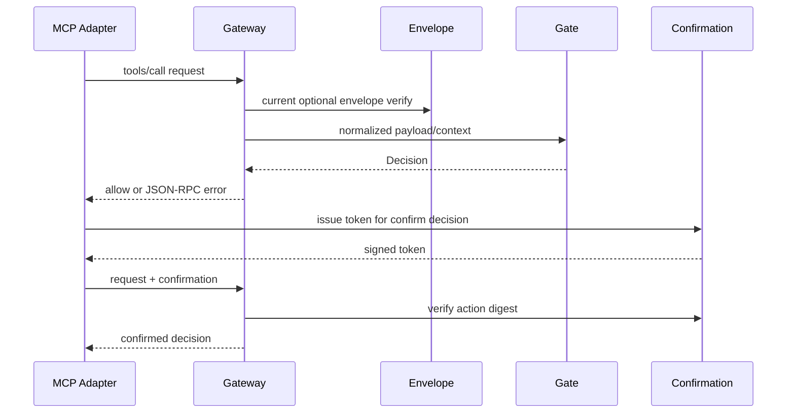

---
sigil_guard:
  id: "SP.08"
  title: "MCP Gateway And Confirmation Transition Contracts"
  domain: security
  status: implemented/partial
  priority: high
  created: "2026-07-01"
  updated: "2026-11-20"
  tags: ["mcp", "gateway", "confirmation", "json-rpc", "action-digest"]
  depends_on: ["SP.01", "SP.03", "SP.07"]
---

# SP.08 - MCP Gateway And Confirmation Transition Contracts

## Executive Summary

This spec documents the implemented MCP-shaped gateway helpers and HMAC
confirmation token flow. Current behavior protects tool requests and results
with runtime-gate decisions, optional attestation verification, JSON-RPC
errors, and approval tokens bound to exact action digests. In v3, these
helpers are rewired to `ToolGateway`, `CapabilityManifest`, `_agent_trust`,
and `_agent_confirmation`. The signed helper functions keep their names but
always block; attestation verification is the `:attestation` option of
`ToolGateway.guard_request/3`. This spec also fixes three v3 contracts: the
confirmation claims delta, the reserved `_agent_*` metadata namespace with
its exact digest strip list, and the gateway facade function mapping (D14).

## Business Value

- **Problem:** Host MCP adapters need a stable guard contract without forcing
  SigilGuard to depend on a specific MCP package.
- **Solution:** Accept MCP-shaped maps, normalize request/result boundaries,
  delegate decisions to the runtime gate, and return either decisions or
  JSON-RPC-shaped errors.
- **Beneficiary:** MCP servers, clients, gateways, and host applications.
- **Impact:** Transport-agnostic MCP security with confirmation flows that
  cannot be replayed across different actions.

## Technical Architecture

### Overview

`SigilGuard.MCP.Gateway` is an adapter-neutral helper module that delegates
to `SigilGuard.ToolGateway`. `ToolGateway` understands common JSON-RPC
tool-call and result shapes, builds the SP.16 structured security projection,
strips only fixed trust metadata from action digests, labels the boundary
context, delegates to `SigilGuard.Runtime.Gate`, and verifies Agent Trust
attestations on requests when the caller passes `attestation: :optional` or
`:required`. The facade's signed helpers do not verify attestations; they
always block (Gateway Function Mapping).

`SigilGuard.Confirmation` issues HMAC-SHA256 tokens with canonical claims. A
token binds to payload, normalized context, actor, action, decision reason,
expiry, nonce, and the manifest digest when the issuer supplies one.
Verification consumes nonces by default through `SigilGuard.ReplayStore`;
callers explicitly opt out with `consume: false`.

### Data Flow

## Implemented Contracts

| Contract | Implemented By | Notes |
|----------|----------------|-------|
| Request guard | `SigilGuard.MCP.Gateway.guard_request/3` | Returns decision. |
| Request wire helper | `guarded_request/3` | Returns `{:ok, decision}` or JSON-RPC error tuple. |
| Result guard | `guard_result/3` and result helpers | Tool-result to model boundary. |
| Signed request guard | `ToolGateway.guard_request/3` with `attestation: :required` | Verifies the `_agent_trust` attestation. The `MCP.Gateway` signed helper functions verify nothing and always block. |
| Confirmation token | `SigilGuard.Confirmation` | HMAC token bound to action digest. |
| Single-use option | `Confirmation.verify/5`, `ReplayStore` | Reuse is rejected by default; `consume: false` opts out. |
| Error response codes | `MCP.Gateway` | Block, confirm, and quarantine codes. |

## V3 Rewire

| Current Surface | V3 Action |
|-----------------|-----------|
| `SigilGuard.MCP.Gateway` | Permanent thin facade over `ToolGateway` (D14); see Gateway Function Mapping. |
| `_sigil` request metadata | Replace with `_agent_trust`; see Metadata Namespace. |
| `_sigil_confirmation` metadata | Replace with `_agent_confirmation`; see Metadata Namespace. |
| Optional envelope verification | Replaced by `Attestation.verify/3` (SP.01) inside `ToolGateway.guard_request/3`, under the `:attestation` option. The facade's signed helpers do not call it. |
| Gateway-only tool trust | Bind to `CapabilityManifest` digest (SP.03). |
| HMAC confirmation claims | Keep action-digest lesson; bind to manifest and sandbox-aware context digests per the V3 Confirmation Claims Delta. |

## Data Model

### Confirmation Claims

| Field | Type | Required | Description |
|-------|------|----------|-------------|
| `v` | integer | yes | Token version. |
| `typ` | string | yes | Token type marker. |
| `alg` | string | yes | `HS256`. |
| `actor` | string | yes | Approving actor. |
| `action_digest` | string | yes | Digest over payload and context. |
| `decision` | string | yes | `confirm`. |
| `action` | string | yes | Decision action. |
| `reason` | string | yes | Decision reason. |
| `issued_at` | string | yes | ISO 8601 issue time. |
| `expires_at` | string | yes | ISO 8601 expiry. |
| `nonce` | string | yes | Replay nonce. |

The table is the v2 baseline. A v3 token also carries `payload_digest`,
`context_digest`, and, when the issuer passes `:manifest`, `manifest_digest`;
SP.03 owns the complete list.

## V3 Confirmation Claims Delta

This section is normative for v3 and records only the delta from the
implemented claims above. The authoritative, complete v3 claim set is SP.03's
"Claims (Authoritative v3 List)" table; the full confirmation lifecycle
(multi-step flows, issuance rules, error registry) is owned by SP.03's
Confirmation Lifecycle section. This table exists only to show the v2 → v3
change; it is not a competing claim list.

| Claim surface | V2 (implemented) | V3 (delta) |
|---------------|------------------|------------|
| `action_digest` | Digest over payload and normalized context. | Unchanged. It stays the legacy digest from `SigilGuard.Confirmation.fetch_action_digest/2` (SHA-256 over the legacy canonical JSON of the payload and every Context field). It is not computed per SP.01's Digest Computation section and differs from `Attestation.Digest.action_digest/4`. The SP.01 computations supply the separate `payload_digest` and `context_digest` claims. |
| `manifest_digest` | Absent. | New claim. Tokens MUST bind the SP.03 capability-manifest digest, so an approval dies with any tool-definition drift or rug pull. The issuer writes the claim by passing `:manifest`. `ToolGateway.guard_request/3` enforces it: with a resolved manifest it rejects a token whose claim is absent or different, and without one it rejects a token that carries the claim, both with `:manifest_digest_mismatch`. `guard_result/3` resolves no manifest, so a result token has to be issued without the claim. |
| Context binding | Context digest without sandbox fields. | The bound context digest MUST include `sandbox_id` and `isolation_level` per SP.01's Context Digest field list; an approval can never be replayed against another sandbox. `context_digest` covers `Context.sandbox_id` and `Context.isolation_level`. Sandbox values carried only under `context.metadata` are outside `context_digest`; the legacy `action_digest` covers them, so a changed value still fails with `:digest_mismatch`. |
| TTL | `:ttl_ms` option, default `300_000` ms. | Same default, aligned with `:attestation_ttl_ms` in SP.01's Replay And Expiry Semantics. |
| Single-use | Opt-in via `consume: true`. | Default. See below. |

Single-use is a deliberate v3 behavior change and MUST be called out in
`MIGRATING-1.0.md`: in v2, replay rejection requires passing
`consume: true`; in v3, every successful confirmation verification consumes
the token nonce in `SigilGuard.ReplayStore` by default, and a second
verification fails with `{:error, :replay_detected}`. `consume: false`
remains available as an explicit per-call opt-out for tests and dry runs
only.

Single use holds within one runtime. `SigilGuard.ReplayStore` is per boot and
per node, so a token consumed before a restart verifies again until its
`expires_at`. [SP.19](SP.19-physical-effect-authority.md) states these limits
and blocks `consume_confirmation: false` on a physical-effect request.

## Metadata Namespace

The `_agent_*` key prefix is RESERVED for SigilGuard across all guarded
payloads. SigilGuard MAY define new `_agent_*` keys in future profile
versions, so hosts and tools MUST NOT define their own keys under that
prefix.

The exact digest strip list is fixed. Before any digest computation, these
keys MUST be removed in both atom and string form, at the payload root and
inside the map under `params` when present:

| Stripped key | Forms | Levels |
|--------------|-------|--------|
| `_agent_trust` | atom and string | payload root and `params` |
| `_agent_confirmation` | atom and string | payload root and `params` |
| `confirmation_token` | atom and string | payload root and `params` |

The normative strip algorithm is SP.01's Metadata Strip Rule (six keys, two
levels, never deeper); this table restates the list for gateway
implementers and MUST stay identical to SP.01. A digest computed with and
without attached metadata MUST be identical.

Two code paths apply the rule. `MCP.SecurityPayload.for_gate/3`, which every
gateway guard and token helper calls, strips before any digest is computed.
`Attestation.Digest` strips inside `payload_digest/1` and the action
preimages. `SigilGuard.Confirmation` applies no strip rule of its own: its
legacy `action_digest` digests the payload as given. The identity above
therefore holds for gateway callers. It is not implemented for a host that
calls `Confirmation.issue/5` or `verify/5` directly with metadata attached;
that host strips the payload first, or verification fails with
`:digest_mismatch`.

The legacy `_sigil` and `_sigil_confirmation` keys do not exist in v3: they
are not read, not stripped, and not special-cased, so a v3 digest treats
them as ordinary user content. There is no runtime shim or dual-read mode
(D6); mixed-traffic rollout guidance lives in `MIGRATING-1.0.md` only. The
in-repo M3-M5 transition dual-strips both prefixes until the M6 removal
wave; released 1.0.0 strips only the `_agent_*` list above.

## Gateway Function Mapping

`SigilGuard.MCP.Gateway` remains a permanent thin facade over
`SigilGuard.ToolGateway` (D14): it is not deprecated, and every helper keeps
its name and arity. The signed variants were specified to take `_agent_trust`
attestations instead of `_sigil` envelopes. That is not implemented: they
delegate to `SigilGuard.ToolGateway.Base`, always block, and never issue a
token. A host that needs an attestation-verified request calls
`ToolGateway.guard_request/3` with `attestation: :required`; the facade's
`guard_request/3` and `guard_confirmed_request/3` forward that option.
`ToolGateway` signatures and the request/result binding rules are owned by
SP.03 (its gateway facade mapping and Confirmation Lifecycle sections).

| V2 helper (name kept in v3) | V3 behavior |
|-----------------------------|-------------|
| `guard_request/3`, `guarded_request/3` | Delegate to `ToolGateway` with `confirmation: :off`; request binding adds capability-manifest verification per SP.03 when the caller passes `:manifests` or `:trust_bundle`. |
| `guard_result/3`, `guarded_result/3`, `guarded_result_chunk/3` | Delegate to `ToolGateway`. The result guards record `request_action_digest` when the caller passes the `:request_action_digest` option (SP.01's action-digest table); they resolve no manifest and verify no attestation. |
| `guard_signed_request/3`, `guarded_signed_request/3` | Always block with code `-31990`. `Attestation.verify/3` is not called and the runtime gate does not run. The reason names `missing_envelope`, `invalid_envelope`, `missing_identity`, or `legacy_envelope_removed`. |
| `guard_confirmed_request/3`, `guarded_confirmed_request/3` | Verify `_agent_confirmation` tokens under the V3 Confirmation Claims Delta (manifest and sandbox binding, consume by default). |
| `guard_signed_confirmed_request/3`, `guarded_signed_confirmed_request/3` | Always block as the signed guards above; the confirmation token is not read. The rule that the token actor MUST match the verified attestation actor id is not implemented by any function. |
| `guard_confirmed_result/3`, `guarded_confirmed_result/3` | Result-side confirmation under the same claims delta, without manifest binding. |
| `issue_confirmation_token/5` | Name kept; issued claims gain the sandbox-aware context digest and, when the caller passes `:manifest`, `manifest_digest`. |
| `issue_signed_confirmation_token/5` | Always returns `{:error, reason}` with one of the four reasons above; never issues a token. |
| `issue_result_confirmation_token/5` | Result-side issuance under the claims delta. |

`verify_request_envelope/2` is kept on the facade too. It always returns
`{:error, reason}` with one of the same four reasons.

V3 renumbers the gateway rejection codes to `-31990..-31984`, owned by
SP.03's JSON-RPC error registry and selected under MCP `2026-07-28` by SP.16;
this spec never mints codes and points to that registry for every code. This
is a breaking change from v0.2's `-32001..-32003`, documented in
`MIGRATING-1.0.md`.

## Module Map

| Module | Purpose |
|--------|---------|
| `lib/sigil_guard/mcp/gateway.ex` | MCP-shaped guard helpers. |
| `lib/sigil_guard/tool_gateway.ex` | Transport-neutral gateway implementation. |
| `lib/sigil_guard/tool_gateway/base.ex` | JSON-RPC response shaping and the fail-closed signed helpers. |
| `lib/sigil_guard/confirmation.ex` | Action-bound confirmation tokens. |
| `lib/sigil_guard/runtime/gate.ex` | Underlying boundary decision engine. |
| `lib/sigil_guard/attestation.ex` | `_agent_trust` attachment and verification. |
| `lib/sigil_guard/replay_store.ex` | Confirmation nonce consumption, on by default. |
| `test/sigil_guard/mcp/gateway_test.exs` | Gateway request/result/signed/confirmation tests. |
| `test/sigil_guard/confirmation_test.exs` | Token signing, expiry, digest, replay tests. |

## Error Handling

| Error | Type | Recovery | User Impact |
|-------|------|----------|-------------|
| blocked decision | JSON-RPC error | change request or policy | tool not executed. |
| confirm required | JSON-RPC error | issue approval token | caller must approve. |
| quarantine | JSON-RPC error or sanitized result | inspect tool output | unsafe output withheld. |
| invalid envelope | blocked decision | fix signature/key/profile | signed request rejected. |
| invalid token | return tuple or blocked decision | issue fresh token | confirmation rejected. |
| digest mismatch | return tuple | use token for exact payload/context | replay across action fails. |
| expired token | return tuple | issue fresh token | confirmation rejected. |

## Security Considerations

- Confirmation tokens intentionally ignore transport metadata fields when
  computing the payload digest so tokens bind to the actual structured tool
  action, not correlation fields. Parameter names, nested values, numbers,
  booleans, nulls, and MRTR state/responses remain bound.
- The signed confirmation flow was specified to bind the token
  actor/identity to the verified envelope identity. It is not implemented:
  the signed helpers block before any token is read or issued. In
  `ToolGateway.guard_request/3` with `attestation: :required`, the token and
  the attestation are each recomputed against the same request context,
  whose digest includes `actor` and `identity`. No code compares the token
  `actor` claim with `predicate.actor.id`; a host that needs that equality
  checks it itself.
- HMAC keys must be at least 16 bytes.
- SP.03 attestations replace envelope verification while preserving
  confirmation digest binding.
- V3 tokens bind manifest and sandbox identity, so an approval cannot
  survive tool-definition drift and cannot cross sandboxes (SP.01 Digest
  Computation).
- Consume-by-default removes the silent replay window that v2 left open
  when callers forgot `consume: true`.

## Testing Strategy

| Test | Module | What It Verifies |
|------|--------|------------------|
| request block | `MCP.GatewayTest` | Sensitive request returns JSON-RPC error. |
| result sanitize | `MCP.GatewayTest` | Unsafe result is blocked/redacted. |
| signed request | `MCP.GatewayTest` | Signed helpers block every request and issue no token. |
| confirmation issue | `ConfirmationTest` | Confirmable decision creates token. |
| digest mismatch | `ConfirmationTest` | Token cannot approve changed payload/context. |
| consume replay | `ConfirmationTest` | Single-use token rejects reuse. |

## Acceptance Criteria

- [x] V3 tokens carry `manifest_digest` and a context digest that includes
      `sandbox_id` and `isolation_level`; tampering with either fails
      verification.
- [x] Default token TTL is `300_000` ms; expired tokens are rejected.
- [x] Single-use is the default: verifying the same token twice fails with
      `{:error, :replay_detected}` without any option, and `consume: false`
      opts out per call. The behavior change is documented in
      `MIGRATING-1.0.md`.
- [x] `_agent_trust`, `_agent_confirmation`, and `confirmation_token` (atom
      and string forms, payload root and `params` level) are stripped before
      every digest the gateways compute, and those digests are identical
      with and without them, mirroring SP.01's strip-rule tests.
- [ ] `Confirmation.issue/5` and `verify/5` called directly strip the same
      keys before `action_digest` (not implemented:
      `fetch_action_digest/2` digests the payload as given; a direct caller
      strips first).
- [x] Released 1.0.0 gives `_sigil` and `_sigil_confirmation` no special
      handling anywhere under `lib/`.
- [x] Every helper in the Gateway Function Mapping keeps its v2 name and
      arity on the `MCP.Gateway` facade, and the unsigned helpers delegate
      to `ToolGateway`.
- [ ] The signed helpers verify `_agent_trust` attestations, and the signed
      confirmation helpers bind the token actor to the attestation actor id
      (not implemented: they always block and issue no token; hosts call
      `ToolGateway.guard_request/3` with `attestation: :required`).
- [x] Gateway rejection codes are `-31990..-31984` per SP.03's registry, and
      no code outside that registry is emitted.

## Implementation Roadmap

- [x] MCP request guard implemented.
- [x] MCP result guard implemented.
- [x] Signed request helpers implemented.
- [x] Confirmation token binding implemented.
- [x] Single-use replay option implemented.
- [ ] Replace signed request helpers with SP.03 tool-manifest attestations
      (M3; not done for the helpers: attestation verification landed in
      `ToolGateway.guard_request/3`, and the signed helpers always block).
- [x] Replace metadata keys with `_agent_trust` and `_agent_confirmation`;
      dual-strip through M3-M5, `_sigil*` removal in M6.
- [x] Flip confirmation single-use to consume-by-default with manifest and
      sandbox binding (M3).
- [x] Rewire facade delegation to `ToolGateway` (M3, D14).

## Success Metrics

| Metric | Target | Measurement |
|--------|--------|-------------|
| Gateway tests | pass | `mix test test/sigil_guard/mcp/gateway_test.exs`. |
| Confirmation tests | pass | `mix test test/sigil_guard/confirmation_test.exs`. |
| Digest tamper | rejected | confirmation negative tests. |

## Sources

- [SP.01 - SigilGuard Trust Profile](SP.01-sigilguard-trust-profile.md)
- [SP.03 - MCP Attestation Gateway](SP.03-mcp-attestation-gateway.md)
- [SP.07 - Runtime Gate And Streaming Contracts](SP.07-runtime-gate-and-streaming-contracts.md)
