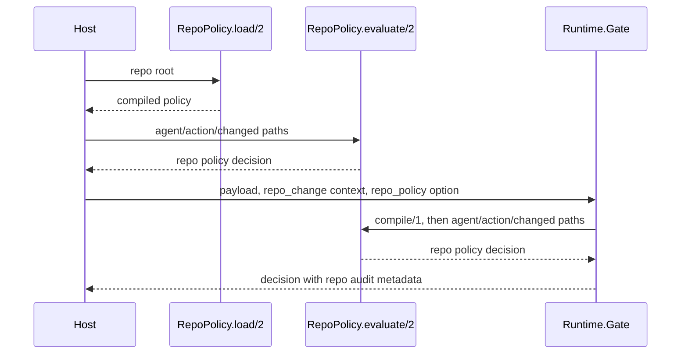

---
sigil_guard:
  id: "SP.11"
  title: "Repo Policy Kernel Contracts"
  domain: security
  status: implemented
  priority: high
  created: "2026-07-01"
  updated: "2026-11-20"
  tags: ["repo-policy", "deterministic-policy", "paths", "governance"]
  depends_on: ["SP.02", "SP.04"]
---

# SP.11 - Repo Policy Kernel Contracts

## Overview

This spec documents the implemented deterministic repo policy kernel. The kernel
evaluates actor/action/path facts against ordered path rules and returns
`allow`, `require_approval`, or `block` with rule ids, unmatched paths, and a
canonical digest. In v3, repo policy is one source of facts for
`BoundaryPolicy`: the runtime gate passes the `RepoPolicy.policy_facts/2`
map to the kernel as the `:repo_facts` option at a repo change.

## Technical Architecture

### Overview

Policies are data, not code. They can be compiled from maps, keyword lists, or
a small line-oriented format. The evaluator normalizes agent/action/path facts,
rejects unsafe paths, applies rule precedence, tracks unmatched paths, and
returns a `%SigilGuard.RepoPolicy.Decision{}`.

Decision precedence is conservative:

1. `:block`
2. `:require_approval`
3. `:allow`

If a path is unmatched, the policy default is the decision for that path and
competes with the matched rules by the same rank. A change with one unmatched
path under `default block` is blocked even when another path matches a
`require_approval` rule. A change that matches no rule at all, including one
with no paths, takes the default.

### Data Flow



The two paths are independent. A host can call `evaluate/2` itself, or pass a
policy to the gate as `:repo_policy`. The gate evaluates that option only at
the `:repo_change` context phase and ignores it at every other phase. Its
audit metadata carries `repo_policy_verdict`, `repo_policy_rules` (matched
rule ids), and `repo_unmatched_paths`, plus `repo_policy_error` when the
policy does not compile. It carries neither the decision digest nor the
policy digest.

## Implemented Contracts

| Contract | Implemented By | Notes |
|----------|----------------|-------|
| Policy compile | `SigilGuard.RepoPolicy.compile/1` | Map/keyword input. |
| Line parser | `SigilGuard.RepoPolicy.parse/1` | `default`, `allow`, `require_approval`, `block`. |
| File loader | `load/2`, `find_file/2`, `load_file/2` | Safe candidates and max size. |
| Evaluator | `evaluate/2` | Agent/action/path context. |
| Decision struct | `SigilGuard.RepoPolicy.Decision` | Verdict, reason, paths, rules, digest. |
| Policy facts | `policy_facts/2` | Builds the five-key map below from a compiled policy and a decision. `Runtime.Gate` calls it at a repo change. |
| Runtime integration | `SigilGuard.Runtime.Gate` | At the `:repo_change` phase with a `:repo_policy` option: `block` blocks, `require_approval` confirms, and either raises runtime risk. |

## V3 Rewire

| Current Surface | V3 Action |
|-----------------|-----------|
| Repo policy decision | `policy_facts/2` builds the policy-facts map below and `BoundaryPolicy.evaluate/2` accepts it as `:repo_facts`. `Runtime.Gate` connects the two at a repo change. |
| `require_approval` | Maps to the Agent Trust `confirm` verdict, in the gate and in the kernel's `:repo_facts` contribution. |
| Policy file digest | `policy_facts/2` returns it as `policy_file_digest`. The gate copies it into the decision's audit metadata as `repo_policy_digest`. |
| Old policy filenames | Replaced per V3 Policy Filenames (D13); legacy names fail with `:legacy_policy_filename`. |
| Repo path facts | The `repo_change` action digest binds the payload's `repository`, `operation`, sorted `paths`, and optional `ref` (SP.01). The context digest carries no path facts, and no digest reads a `RepoPolicy.Decision`. |

## V3 Policy Filenames (D13)

This section records decision D13 normatively. D13 is jointly owned with
SP.04, which records the same filename set in its Policy File Schema
section; the two specs MUST NOT diverge. The names are package-name-derived
and keep the sigil idiom.

The v3 default candidate set, searched in this exact order with the first
existing file winning (the same precedence style as the current loader):

1. `SIGILGUARD_POLICY`
2. `.sigilguard-policy`
3. `.sigilguard/policy`
4. `.github/sigilguard-policy`

Legacy filename handling is fail-closed:

- When no v3 candidate exists, the loader MUST probe the legacy names
  (`SIGIL_POLICY`, `.sigil-policy`, `.sigil/policy`,
  `.github/sigil-policy`) in the same order. If one exists, `find_file/2`
  and `load/2` MUST return
  `{:error, {:legacy_policy_filename, legacy_path, replacement}}` naming
  the found legacy path and its v3 replacement filename. Legacy files are
  never parsed and never silently ignored.
- Legacy detection runs before v3 candidate selection. A legacy file present
  alongside a v3 policy still fails closed; there is no silent coexistence
  path.
- The legacy check applies before an explicit `:candidates` override as well.
  Explicit candidates may add non-default v3 paths, but they do not authorize
  old `SIGIL` filenames as fallbacks.
- Candidate files and their parent components MUST NOT be symbolic links.
  Symlinked candidates are treated as absent. These checks reject observed
  filesystem indirection; they do not protect against hostile writers replacing
  paths between inspection and reading. Hosts own filesystem permissions and
  must prevent concurrent untrusted replacement.
- `load_file/2` takes an explicit path and applies no filename or candidate
  check. A host that passes it a legacy path gets that file parsed.

Migration table (reproduced 1:1 in `MIGRATING-1.0.md`):

| V2 Filename | V3 Filename |
|-------------|-------------|
| `SIGIL_POLICY` | `SIGILGUARD_POLICY` |
| `.sigil-policy` | `.sigilguard-policy` |
| `.sigil/policy` | `.sigilguard/policy` |
| `.github/sigil-policy` | `.github/sigilguard-policy` |

### Bundle-Carried Repo Policy Rules

This subsection is a design candidate. None of it is implemented in 1.0.0
(see Deferred): no code reads a `repo_policy` bundle section, prefixes rule
ids with `bundle:`, or composes bundle rules with file rules.

Trust bundles (SP.02) MAY embed repo-policy rules under a `repo_policy`
section. Rule semantics are identical to the file grammar: agent, action,
path glob, decision.

```json
{
  "repo_policy": {
    "version": 1,
    "default": "require_approval",
    "rules": [
      {
        "id": "org-protect-secrets",
        "decision": "block",
        "agents": ["*"],
        "actions": ["*"],
        "paths": ["priv/secrets/**"],
        "message": "Organization baseline: secrets are never agent-writable"
      }
    ]
  }
}
```

| Field | Constraint |
|-------|------------|
| `version` | Integer `1`. |
| `default` | `"allow"`, `"require_approval"`, or `"block"`; optional, defaults to `"require_approval"`. |
| `rules[].id` | Optional string; defaults to `"rule_<index>"`. Merged rule ids are prefixed `bundle:` so `matched_rules` entries stay unambiguous. |
| `rules[].decision` | `"allow"`, `"require_approval"`, or `"block"`. |
| `rules[].agents`, `rules[].actions` | Non-empty arrays of exact strings or `"*"`. |
| `rules[].paths` | Non-empty arrays of safe relative globs (`*`, `?`, `**`); absolute paths and traversal are rejected by the same normalization as file rules. |
| `rules[].message` | Optional operator-facing string. |

Bundle rules MUST compile through the same `RepoPolicy.compile/1` pipeline
as file rules; an invalid `repo_policy` section fails bundle load with the
existing typed reasons (`:invalid_rule`, `:invalid_policy`).

Composition with file rules is deterministic, and file rules take
precedence, decided per path:

1. A path matched by at least one file rule is decided by file rules alone.
2. A path matched by no file rule is decided by bundle rules.
3. A path matched by neither takes the file policy default when a policy
   file exists, else the bundle default, else the built-in
   `require_approval`.
4. Per-path outcomes combine into the overall verdict with the existing
   ranking: `block` beats `require_approval` beats `allow`.

Why file rules win: repo-local intent wins. The policy file is committed,
reviewed, and versioned inside the governed repository, so it is the most
specific declaration of intent; bundle rules are the organization-wide
baseline for repositories that have not declared local policy. Hosts that
need non-overridable organization mandates MUST enforce them at the
`BoundaryPolicy` layer (SP.04), not through bundle repo-policy rules.

## Policy Facts For Boundary Decisions

`RepoPolicy.policy_facts/2` takes a compiled policy and a decision and returns
exactly this map. `BoundaryPolicy.evaluate/2` (SP.04) reads it from the
`:repo_facts` option: `block` contributes `block`, `require_approval`
contributes `confirm`, and `allow` contributes nothing. When that
contribution carries the final verdict, its rules appear in the decision as
`repo.<rule_id>`, or as `repo.default` when no rule matched.
`Runtime.Gate` makes both calls at the `:repo_change` phase, for its
`:repo_policy` option or the `[repo]` section of its `:boundary_policy` file,
and records `policy_file_digest` and `default_decision` in the decision's
audit metadata as `repo_policy_digest` and `repo_policy_default`. A host that
calls the kernel directly makes the calls itself. Field names are grounded
on `SigilGuard.RepoPolicy.Decision`.

```elixir
%{
  verdict: :allow | :require_approval | :block,
  matched_rules: [%{rule_id: String.t(), explanation: String.t()}],
  unmatched_paths: [String.t()],
  policy_file_digest: String.t(),
  default_decision: :allow | :require_approval | :block
}
```

| Field | Source | Description |
|-------|--------|-------------|
| `verdict` | `Decision.verdict` | Kernel verdict; `require_approval` maps to the profile `confirm` verdict downstream (SP.07). |
| `matched_rules` | `Decision.matched_rule_ids` plus rule messages | One entry per matched rule id, in rule order. `rule_id` is the stable id: `"rule_<index>"` (0-based) from `compile/1`, `"line_<n>"` from the line parser, or the explicit `:id`. `n` is the 1-based line number within the text given to `parse/1`; for the `[repo]` section of a v3 policy file that text starts after the section header, so `n` is not a file line number (SP.04). The `bundle:` prefix belongs to the deferred bundle design. `explanation` is the rule `message`, else the decision `reason`. `Attestation.from_decision/3` does not read this map. It copies the `matched_rules` of the gate decision into `predicate.matched_rules` of a `repo_change` attestation, so the repo rules reach the predicate as the `repo.<rule_id>` and `repo.default` entries above when the decision carries them. An `allow` verdict contributes no rule, and a decision with no matched rules gives a statement without the field. |
| `unmatched_paths` | `Decision.unmatched_paths` | Paths governed by the default, verbatim. |
| `policy_file_digest` | `RepoPolicy.digest/1` | Lowercase-hex SHA-256 of canonical compiled-policy bytes. Distinct from `Decision.digest`, which digests the decision itself; both are audit evidence. |
| `default_decision` | Compiled policy `default` | The default that applied, or would apply, to unmatched paths. |

## Data Model

### Rule

| Field | Type | Required | Description |
|-------|------|----------|-------------|
| `id` | string | yes | Stable rule id. |
| `decision` | atom | yes | `:allow`, `:require_approval`, or `:block`. |
| `agents` | list | yes | Exact ids or `*`. |
| `actions` | list | yes | Exact action names or `*`. |
| `paths` | list | yes | Safe relative globs. |
| `message` | string or nil | no | Operator-facing reason. |
| `index` | integer | yes | Rule order. |

### Decision

| Field | Type | Required | Description |
|-------|------|----------|-------------|
| `verdict` | atom | yes | `:allow`, `:require_approval`, or `:block`. |
| `reason` | string | yes | Explanation. |
| `agent` | string or nil | no | Normalized agent. |
| `action` | string | yes | Normalized action. |
| `changed_paths` | list | yes | Normalized safe paths. |
| `matched_rule_ids` | list | yes | Applied rule ids. |
| `unmatched_paths` | list | yes | Paths governed by default. |
| `digest` | string | yes | Canonical decision digest. |

## Module Map

| Module | Purpose |
|--------|---------|
| `lib/sigil_guard/repo_policy.ex` | Compile, parse, load, evaluate, canonicalize. |
| `lib/sigil_guard/repo_policy/decision.ex` | Decision struct. |
| `lib/sigil_guard/runtime/gate.ex` | Integrates repo policy into runtime risk. |
| `test/sigil_guard/repo_policy_test.exs` | Policy parser/evaluator/path safety tests. |
| `test/sigil_guard/runtime/gate_test.exs` | Runtime integration tests. |

## Error Handling

Return tuples are `{:error, reason}`. `index` is the 0-based position of the
rule in the policy, from `compile/1` and from `parse/1` alike.

| Error | Type | Recovery | User Impact |
|-------|------|----------|-------------|
| `:invalid_policy` | return tuple from `compile/1` | pass a map, keyword list, or `%RepoPolicy{}` | policy not loaded. |
| `:invalid_rules` | return tuple from `compile/1` | make `rules` a list | policy not loaded. |
| `{:invalid_rule, index}`, `{:invalid_rule_id, index}` | return tuple from `compile/1` | make the rule a map or keyword list; make `id` a non-empty string or an atom | policy not loaded. |
| `{:invalid_decision, index}`, `{:invalid_matchers, index}` | return tuple from `compile/1` and `parse/1` | fix the rule's decision, agents, or actions | policy not loaded. |
| `:invalid_decision` | return tuple from `compile/1` and `parse/1` | fix the `default` value | policy not loaded. |
| `{:absolute_path_pattern, index}`, `{:path_traversal_pattern, index}`, `{:missing_paths, index}` | return tuple from `compile/1` and `parse/1` | give the rule at least one safe relative path glob | policy not loaded. |
| `{:invalid_path_pattern, index}` | return tuple from `compile/1` | make each path a non-empty string | policy not loaded. |
| invalid changed path | `:block` decision from `evaluate/2` | pass a safe relative UTF-8 path or a list of them | change blocked. The reason is the string `"Repo policy blocked invalid changed path: <name>"`, where `<name>` is `invalid_changed_paths`, `invalid_changed_path`, `absolute_changed_path`, or `path_traversal`. |
| invalid context | `:block` decision from `evaluate/2` | pass a string or atom agent and action | change blocked. The reason is `"Repo policy blocked invalid context: invalid_agent"` or the same with `invalid_action`. |
| `:policy_too_large` | return tuple from `load/2` and `load_file/2` | reduce file size | policy load fails. |
| `:not_found` | return tuple from `load/2` and `find_file/2` | provide policy | caller can use defaults. |
| `:invalid_options` | return tuple from `load/2`, `find_file/2`, and `load_file/2` | pass a binary path and a keyword list containing only `:candidates` and `:max_bytes` | policy load fails closed before filesystem access. |
| `:invalid_policy_paths`, `:missing_policy_paths`, `:invalid_policy_path`, `:absolute_policy_path`, `:policy_path_traversal` | return tuple from `load/2` and `find_file/2` | pass a non-empty list of safe repo-relative candidate strings | policy load fails after the legacy-filename probe and before candidate lookup. |
| `:invalid_max_bytes` | return tuple from `load/2` and `load_file/2` | pass a non-negative integer | policy load fails before any filesystem access. |
| `{:invalid_policy_file, type}` | return tuple from `load_file/2` | point at a regular file | policy load fails; `type` is the file type found, such as `:directory`. |
| POSIX reason such as `:enoent` | return tuple from `load_file/2` | fix the path or its permissions | policy load fails. |
| `{:legacy_policy_filename, legacy, replacement}` | return tuple from `load/2` and `find_file/2` | rename the file to the named v3 filename | policy load fails closed. It is returned ahead of any candidate or byte-limit error. |

## Security Considerations

- Absolute paths and traversal are rejected before rule matching.
- Loader options are validated before any filesystem access. A non-keyword
  container or an unknown key returns `{:error, :invalid_options}`. A
  malformed value returns its own atom: `:invalid_policy_paths` and the
  related atoms in Error Handling for `:candidates`, and `:invalid_max_bytes`
  for `:max_bytes`. An invalid byte limit cannot bypass the file-size bound
  through Erlang term ordering.
- Rules match exact agent/action strings or `*`; no dynamic atom creation from
  external policy input is required.
- `:block` always outranks weaker decisions.
- Policy is deterministic and should be auditable by decision digest.
- This is a preflight guard, not a replacement for human review or CI tests.

## Testing Strategy

| Test | Module | What It Verifies |
|------|--------|------------------|
| parse policy | `RepoPolicyTest` | Line-oriented format compiles. |
| path safety | `RepoPolicyTest` | Absolute/traversal paths reject. |
| precedence | `RepoPolicyTest` | Block outranks approval and allow. |
| default handling | `RepoPolicyTest` | Unmatched paths apply default. |
| runtime risk | `Runtime.GateTest` | Repo policy affects runtime verdict/risk. |

## Acceptance Criteria

- [x] The loader searches `SIGILGUARD_POLICY`, `.sigilguard-policy`,
      `.sigilguard/policy`, `.github/sigilguard-policy` in that exact order
      and loads the first existing file.
- [x] Each of the four legacy filenames, present without any v3 candidate,
      yields `{:error, {:legacy_policy_filename, legacy, replacement}}`
      naming its v3 replacement; nothing is parsed or silently ignored.
- [x] An explicit `:candidates` option does not bypass the legacy-name check.
- [x] The policy-facts map contains exactly the five specified keys, and
      `policy_file_digest` differs from `Decision.digest` for the same
      evaluation.
- [x] The filename migration table is reproduced 1:1 in `MIGRATING-1.0.md`.

## Implementation Roadmap

- [x] Policy compile and parser implemented.
- [x] Safe file loader implemented.
- [x] Deterministic evaluator implemented.
- [x] Decision digest implemented.
- [x] Runtime integration implemented.
- [x] Implement the D13 filename candidates and the `:legacy_policy_filename` error.
- [x] Build the policy-facts map with `RepoPolicy.policy_facts/2` and accept
      it in `BoundaryPolicy.evaluate/2` as `:repo_facts`.
- [x] Emit the policy-facts map to `BoundaryPolicy` and audit metadata: the
      gate passes it as `:repo_facts`, and its audit metadata holds
      `repo_policy_verdict`, `repo_policy_rules`, `repo_unmatched_paths`,
      `repo_policy_digest`, `repo_policy_default`, and on a compile failure
      `repo_policy_error` (`Runtime.GateTest`).

## Deferred

Bundle-carried repo-policy rules and file/bundle composition are not part of
the 1.0.0 implementation. The schema above remains the post-1.0.0 design
candidate; the implemented contract is the deterministic file policy plus
`RepoPolicy.policy_facts/2`, whose result the gate passes to
`BoundaryPolicy.evaluate/2` as `:repo_facts`.

## Success Metrics

| Metric | Target | Measurement |
|--------|--------|-------------|
| Repo policy tests | pass | `mix test test/sigil_guard/repo_policy_test.exs`. |
| Unsafe paths | blocked | path safety tests. |
| Determinism | stable digest | canonical decision tests. |

## Sources

- [SP.02 - Embedded Trust Bundles](SP.02-embedded-trust-bundles.md)
- [SP.04 - Boundary Scanner And Policy Kernel](SP.04-boundary-scanner-and-policy-kernel.md)
