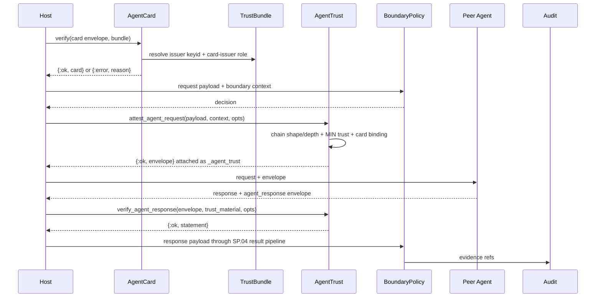

---
sigil_guard:
  id: "SP.13"
  title: "Agent-To-Agent Trust Statements"
  domain: security
  status: implemented
  priority: high
  created: "2026-07-02"
  updated: "2026-11-20"
  tags: ["a2a", "agent-cards", "delegation", "asi07", "agent-trust", "v3"]
  depends_on: ["R.05", "R.06", "SP.01", "SP.02", "SP.03"]
---

# SP.13 - Agent-To-Agent Trust Statements

## Overview

Multi-agent systems have no embedded trust layer: agent cards and
inter-agent messages cross process and organization boundaries with none of
the digest and signing discipline v3 gives tool manifests and tool calls.
This spec makes agent cards DSSE-signed capability-manifest analogs verified
against bundle-declared issuers, and fills in the `agent_request` /
`agent_response` statement types (D7) with peer identity, card digests,
capabilities, and RFC 8693 act-claim-shaped delegation chains. SP.03 stays
tool-focused; SP.13 owns the agent-to-agent surface. The motivating threat
class is OWASP ASI07, insecure inter-agent communication (R.06, TM.10).

## Technical Architecture

### Overview

Two artifacts, one validation discipline. The **agent card** is to an agent
what a capability manifest is to a tool: signed metadata that steers a
counterpart's behavior - supply-chain input, never trusted context (R.05).
The **agent statements** are SP.01 attestations whose predicates extend the
core with peer identity, card binding, and delegation evidence. Exchange
roles are fixed: the *requester* invokes a capability on the *responder*;
the governing card is always the responder's, exactly as the manifest for
`tool_request`/`tool_result` is always the tool's. Trust chains from the
bundle: bundle-declared issuers sign cards, cards list the agent's own keys,
and agent keys sign that agent's attestations. Agent keys never appear
directly in the bundle.

### Data Flow



### Architectural Patterns

| Pattern | Used | Justification |
|---------|------|---------------|
| GenServer | no | Card and statement verification are pure functions. |
| Behaviour | yes | `SigilGuard.Signer` signs; a `SigilGuard.Identity` module resolves per-hop trust when the host passes it as `:identity`. |
| ETS | yes | SP.01 `ReplayStore` replay scope applies to agent statements. No card cache in v3; hosts memoize verified cards. |
| Telemetry | yes | Spans and quarantine events under `[:sigil_guard, :agent_trust, ...]`. |

## Agent Card As Capability-Manifest Analog

### Card Fields (Normative)

The card is a closed-schema map: unknown keys at the top level or inside
`capabilities`/`public_keys` entries fail with `{:error, :invalid_agent_card}`.
Timestamps use the SP.01 ISO 8601 UTC millisecond format; sorted lists sort
ascending by raw byte comparison.

| Field | Type | Required | Description |
|-------|------|----------|-------------|
| `kind` | string | yes | Exactly `sigil_guard_agent_card`; domain separator. |
| `schema_version` | string | yes | Exactly `"1"` for this spec. |
| `agent_id` | string | yes | The agent's own identity; SPIFFE-shaped URI recommended, opaque accepted (R.05). Binds `peer_agent.id` in peer statements. |
| `name` | string | yes | Human-readable agent name; display only, never a trust key. |
| `description` | string | no | Steers counterpart model behavior; signed supply-chain input. |
| `version` | string | yes | Agent implementation/card revision, e.g. `"2.1.0"`. |
| `provider` | string | yes | Operator identity; same shape rules as `agent_id`. |
| `endpoints` | list | yes | Absolute endpoint URI strings, sorted; MAY be empty for in-process agents. |
| `capabilities` | list | yes | Non-empty `{"name": string, "description": string?}` maps, sorted by `name`; duplicate names fail with `:invalid_agent_card`. |
| `protocols` | list | yes | Non-empty opaque protocol identifiers, sorted, e.g. `"a2a/1.0"`. |
| `public_keys` | list | yes | Non-empty `{"algorithm": "ed25519", "keyid": string, "public_key": string}` maps, sorted by `keyid`. `public_key` is base64url (no padding) of the raw 32-byte key; `keyid` MUST equal the SP.01 `"sha256:" <> hex` derivation of that key, else `:invalid_agent_card`. These keys verify the agent's own attestations. |
| `scopes` | list | no | Scope strings, sorted; omitted when absent. |
| `trust_zone` | string | yes | `trusted`, `semi_trusted`, or `untrusted` (closed `SigilGuard.Context` enum); bounded by issuer trust. |
| `issued_at` | string | yes | Card issuance time. |
| `expires_at` | string | yes | MUST be later than `issued_at`, else `:invalid_agent_card`. |

### Card Digest

`card_digest` is the lowercase-hex SHA-256 over the compact JCS bytes
(SP.01 JCS constraints) of the normalized card map. The exact preimage key
set, in JCS order: `agent_id`, `capabilities`, `description` (when present),
`endpoints`, `expires_at`, `issued_at`, `kind`, `name`, `protocols`,
`provider`, `public_keys`, `schema_version`, `scopes` (when present),
`trust_zone`, `version`. Absent optional fields are omitted, never `null`
(SP.01 normalization). The card map never contains signature material:
unlike A2A v1.0's embedded `signatures` member, which the JWS flow strips
before signing, the DSSE envelope carries signatures externally, so no strip
step exists.

### Card Signing And Verification

Cards are DSSE envelopes with payloadType `application/vnd.sigilguard+json`,
PAE, and the keyid convention exactly as defined in SP.01's Attestation
Envelope And Canonical Encoding section. Like the trust bundle (SP.02), the
card is a non-Statement DSSE payload: the payload bytes are the JCS card
bytes, discriminated by `kind`. Verification order is normative:

1. Envelope structure, `payloadType`, duplicate-keyid check, base64 decode
   (SP.01 shared atoms).
2. Keyid resolution against the trust material. For a trust bundle this is
   its `"agent_card"` delegate role (next section; SP.02), not its
   `identity_issuers` section. An unresolvable keyid fails with
   `:unknown_key_id`; a resolved key lacking the bundle role that
   authorizes agent-card issuance (including self-signed cards by
   undeclared keys) fails with `:untrusted_issuer`.
3. Ed25519 over PAE (`:invalid_signature` on failure).
4. Parse the payload, validate the card schema, re-encode the parsed card
   with JCS, and require byte equality with the decoded payload; divergence
   (unsorted lists, non-canonical emission) fails with `:invalid_agent_card`.
5. Freshness: `now > expires_at + skew` or `issued_at > now + skew` fails
   with `:card_expired`. `skew` is the per-call `:max_skew_ms` option,
   default `60_000`. Unlike `Attestation.verify/3` (SP.01), card
   verification does not read the application `:max_skew_ms` key. A `:now`
   that is not a `DateTime` or a `:max_skew_ms` that is not a non-negative
   integer fails with `:invalid_agent_card` before step 1, so the bundle's
   issuer freshness check and this one read the same instant.

`card_digest` is then the SHA-256 of the verified payload bytes. Card trust
comes from the bundle, never from the transport that delivered the card.

### Card-Issuer Role In The Trust Bundle (Normative)

`AgentCard.verify/3` accepts either a plain `%{keyid => public_key}` map or a
verified `%SigilGuard.TrustBundle{}` as `trust_material`. The two forms fix the
step-2 resolution above:

- **Plain map.** Every entry is an authorized card issuer directly (the host has
  pre-resolved trust). A signature whose keyid is absent from the map fails
  `:unknown_key_id`. Because the host chose each key, no `:untrusted_issuer`
  distinction arises for this form.
- **Trust bundle.** Card-issuer keys are the keyids of the bundle **delegate
  role named `"agent_card"`**, resolved through the bundle `keys` map (SP.02).
  This reuses the existing role/keys machinery: `roles.delegates` already
  carries arbitrary uniquely-named roles, and the SP.02 schema already requires
  every role keyid to appear in `keys` with `keyid == "sha256:" <> hex` of the
  raw key. Resolution: a signing keyid absent from the bundle `keys` map fails
  `:unknown_key_id`; a keyid present in `keys` but not listed in the
  `"agent_card"` delegate role (an undeclared key, a self-signed card by a
  non-issuer, or a bundle with no `"agent_card"` role) fails `:untrusted_issuer`.

The `"agent_card"` role is distinct from SP.02's `identity_issuers` section,
which carries trusted actor id strings for per-actor trust-level resolution
(SP.10). No SP.13 code reads `identity_issuers`: neither card-signature
verification nor the delegation-chain MIN-trust derivation below consults it.
A host that wants those ids to affect trust applies them in the `:resolve`
function it passes to the attest helpers. Agent keys (a card's own
`public_keys`) never appear in the bundle; only issuer keys do, via this role.

### Canonical Example And Golden Vectors

Fixed vector inputs, disjoint from SP.01's signer seed: issuer Ed25519 seed
bytes `0x21..0x40`, agent-key seed bytes `0x41..0x60`, `issued_at`
`2026-07-02T12:00:00.000Z`, `expires_at` `2026-08-01T12:00:00.000Z`. Shown
pretty-printed with keys in JCS order; fixtures store compact bytes; every
`<computed: ...>` value is produced at fixture-generation time.

```json
{
  "agent_id": "spiffe://prod.example.org/agents/research-peer",
  "capabilities": [
    {"description": "Summarize a document set", "name": "summarize"},
    {"description": "Web research with citations", "name": "web_research"}
  ],
  "endpoints": ["https://agents.example.org/research-peer/a2a"],
  "expires_at": "2026-08-01T12:00:00.000Z",
  "issued_at": "2026-07-02T12:00:00.000Z",
  "kind": "sigil_guard_agent_card",
  "name": "research-peer",
  "protocols": ["a2a/1.0"],
  "provider": "spiffe://prod.example.org/operators/platform-team",
  "public_keys": [
    {"algorithm": "ed25519", "keyid": "<computed: sha256:...>", "public_key": "<computed: base64url raw 32 bytes>"}
  ],
  "schema_version": "1",
  "scopes": ["research:read"],
  "trust_zone": "semi_trusted",
  "version": "2.1.0"
}
```

DSSE envelope around it:

```json
{
  "payload": "<computed: base64url of the compact JCS card bytes>",
  "payloadType": "application/vnd.sigilguard+json",
  "signatures": [
    {"keyid": "<computed: sha256:... of the issuer key>", "sig": "<computed: base64url Ed25519 over PAE>"}
  ]
}
```

Fixture convention, mirroring SP.01's set:

```
test/fixtures/agent_cards/
  research_peer.card.json      # exact compact JCS card payload bytes
  research_peer.envelope.json  # DSSE envelope, compact, keys in JCS order
  research_peer.expected.json  # seeds, timestamps, card_digest, both keyids,
                               # payload/PAE SHA-256s, signature (base64url)
```

The generator MUST be deterministic; committed fixtures are a frozen
contract, and changing their bytes requires a `schema_version` bump.

### Migration From Host JWS Card Signing

The reference consumer signs A2A v1.0 cards with Ed25519 JWS (RFC 7515) and
verifies capability-registry entries with `Ed25519.verify/3`, reusing
SigilGuard's signer keypair. The DSSE form is additive: the JWS path keeps
working against A2A v1.0 peers, the same keypair signs both forms, and the
consumer migrates when adopting v3. The mapping is 1:1:

| Host JWS (RFC 7515) surface | SigilGuard DSSE surface |
|-----------------------------|-------------------------|
| Protected header `alg: "EdDSA"` | None; the profile fixes Ed25519, removing algorithm agility (SP.01). |
| Protected header `kid` | `signatures[0].keyid` (`"sha256:" <> hex` convention). |
| Payload: base64url of card JSON with `signatures` member stripped | `payload`: base64url of the JCS card bytes; no `signatures` member ever exists in the card. |
| Signing input `BASE64URL(header) || "." || BASE64URL(payload)` | PAE bytes per SP.01: `DSSEv1 31 application/vnd.sigilguard+json <len> <payload>`. |
| `signature`: base64url Ed25519 | `signatures[0].sig`: base64url (no padding) Ed25519 over PAE. |
| Verify key pinned in host config | keyid resolved through bundle-declared card issuers (SP.02). |

## Agent Request And Agent Response Predicates

Both predicates carry the SP.01 core fields that
`Attestation.from_decision/3` emits: `profile`, `statement_type`, `actor`,
`verdict`, `action`, `risk_level`, `issued_at`, `expires_at`, `reason` when
the decision has one, `nonce`, `matched_rules` when the decision has matched
rules, and `evidence` from the `:evidence` option, else from the decision's
`evidence_refs` when that list is not empty. The nonce is generated unless
the caller passes a string as `:nonce`; `nonce: false` or `nonce: nil`
omits it. Both carry the SP.01 `boundary` mirror, and `resource` as
`{"audience": string}` when the caller passes `:audience`. An unknown-peer
statement also carries the entry of rule 6 under Delegation-Chain
Validation, placed first in `matched_rules`. `tool` MUST be absent;
`TrustProfile.validate/1` rejects it with `{:error, :invalid_payload}`.

SP.01 owns the digest rules and already fixes the
`agent_request`/`agent_response` action-digest rows (`peer_agent` +
`capability` + `arguments` / `request_action_digest`), the shared
context-digest field list, and manifest applicability: for both types the
`manifest` subject is the responder's `card_digest`, omitted when no
verified card is bound. predicateType URIs are
`https://sigilguard.dev/attestation/agent_request/v1` and
`https://sigilguard.dev/attestation/agent_response/v1` (SP.01 registry).

Payloads are protocol-neutral maps; hosts adapt A2A/ACP messages into them,
placing protocol specifics (task ids, message parts) under `arguments` or
`result`. Request payload shape: `peer_agent` (string, required),
`capability` (string, required), `arguments` (map, optional),
`delegation_chain` (list, optional). Response payload shape: `peer_agent`
(string, required), `capability` (string, required), `status` (string,
required, exactly `ok` or `error`), `result` (any payload class, optional).
`peer_agent` always names the responder (callee), so the `agent_response`
action digest is producer-independent: requester-side local evidence and a
responder-produced envelope for the same exchange yield the same action
digest - the audit join key together with `request_action_digest`.

### agent_request Predicate Extension Fields

| Field | Type | Required | Description |
|-------|------|----------|-------------|
| `peer_agent` | map | yes | `{"id": string, "card_digest": string}`. `id` MUST equal payload `peer_agent` and, when a card is bound, the card's `agent_id`. `card_digest` (lowercase-hex-64) is omitted when no verified card is bound; then `verdict` MUST be `quarantine` or `block`. |
| `peer_trust` | string | yes | `low`, `medium`, or `high` per Delegation-Chain Validation; `low` when no verified card. |
| `capability` | string | yes | Invoked capability; MUST equal payload `capability` and match a `capabilities[].name` of the bound card, else `{:error, :unknown_capability}`. |
| `delegation_chain` | list | no | Verbatim normalized mirror of the payload chain; omitted when the payload carries none. |

### agent_response Predicate Extension Fields

| Field | Type | Required | Description |
|-------|------|----------|-------------|
| `peer_agent` | map | yes | Same shape and rules as `agent_request`. |
| `peer_trust` | string | yes | Same derivation as `agent_request`. |
| `capability` | string | yes | MUST equal the originating request's capability. `attest_agent_response/3` requires that the bound card declares it. `verify_agent_response/3` compares it with the `:capability` option when the requester passes the capability it invoked, and with the capabilities of the verified `:peer_card`; either mismatch fails with `{:error, :unknown_capability}`. |
| `request_action_digest` | string | yes | Lowercase-hex-64 back-reference to the `agent_request` action digest; also feeds this statement's action digest (SP.01 row), so a forged back-reference fails recomputation with `:digest_mismatch`. |
| `status` | string | yes | Exactly `ok` or `error`, sourced from payload `status`; anything else fails with `:invalid_payload`. |
| `quarantined` | boolean | yes | `true` when the responder's boundary quarantined the content or found quarantine indicators in it, whatever the verdict became. For the `:decision` passed to `attest_agent_response/3` that is: `action: :quarantine`, which includes the unknown-peer override of rule 6; or `effect: :quarantine`, which is how the SP.07 gate reports a quarantine it asks confirmation for; or `audit_metadata.indicator_count` above zero, which is the gate's count of quarantine indicators and holds for a decision the gate blocked. Advisory indicators from a hook or the adaptive detector are not in that count. A decision without the count is read by its `indicators` list: `true` when it is not empty. `Attestation.from_decision/3` accepts a `:quarantined` override; `attest_agent_response/3` does not forward one. |

`delegation_chain` is `agent_request`-only; its presence in an
`agent_response` payload or predicate fails with
`{:error, :invalid_payload}`. The result content is bound through the
Statement `payload` subject digest (no separate predicate field).

Responders SHOULD set `resource.audience` (SP.01 core) to the requester's
identity so a response cannot be replayed to a different requester.
`request_action_digest` does not do this: it covers the responder id, the
capability, and the arguments of the request, so two requesters that send
the same request get the same digest. The responder passes the requester's
identity as `:audience` to `attest_agent_response/3`, which writes
`resource.audience`. The requester passes its own identity as `:audience` to
`verify_agent_response/3`; a statement with another audience, or with none,
fails with `{:error, :invalid_audience}`. The field is covered by the
signature. `attest_agent_request/3` takes `:audience` the same way, for the
responder's identity. An `:audience` that is not a non-empty string fails
the attest helper with `{:error, :invalid_audience}`.

## Delegation-Chain Validation

The chain takes the RFC 8693 `act`-claim shape flattened to a list and is
semantically opaque to the core (R.05): no hop semantics are evaluated
beyond these rules.

1. **Shape.** An ordered list of hop maps with exactly `"actor"` (non-empty
   string, required) and `"evidence"` (opaque reference string, optional;
   omitted when absent). Any other key, empty `actor`, or non-map hop fails
   with `{:error, :invalid_payload}`. Producers MUST omit the field when
   there are no hops; an explicit empty list fails with
   `{:error, :invalid_payload}` so "no delegation" has one encoding.
2. **Order convention.** Element 0 is the outermost RFC 8693 `act` (the
   current acting agent); ascending indexes are deeper nesting (earlier
   delegations). Documented for producers, never interpreted by the core.
3. **Digest binding, order-preserving.** RFC 8785 sorts object members
   only; array order is preserved, so chain order is covered by the payload
   digest and the DSSE signature over the predicate mirror. Whenever a
   payload is supplied, verification MUST compare the JCS bytes of the
   normalized payload chain against those of `predicate.delegation_chain`;
   any reorder, insertion, drop, edit, or one-sided presence fails with
   `{:error, :delegation_chain_tampered}`. A chain that cannot be
   normalized, such as one with a hop that is not a map, fails with
   `{:error, :invalid_payload}`.
   `AgentTrust.verify_delegation_chain/3` makes this comparison after the
   depth check of rule 4. No other function calls it: `Attestation.verify/3`
   does not compare the mirror, so the host that verifies an inbound
   `agent_request` calls it with the request payload and the verified
   predicate. A request helper that made the call itself is not part of the
   v3 surface (see Public API Sketch).
4. **Depth.** Chain length MUST NOT exceed the per-call
   `:max_delegation_depth` (positive integer, default `8`); exceeding it
   fails with `{:error, :delegation_too_deep}`. Deliberately not an
   application-env key: the SP.01 closed config surface is unchanged.
   `attest_agent_request/3` and `verify_delegation_chain/3` read the
   option; `verify_agent_response/3` does not.
5. **Trust derivation.** Effective peer trust is the MIN over
   {resolve(card `agent_id`), resolve(each hop `actor`)} under the
   `SigilGuard.Identity` ordering `:low < :medium < :high`. `resolve/1`
   comes only from per-call options of the attest helpers: the `:resolve`
   option, a one-argument function from actor id to trust level, when
   given; else the `trust_level/1` function of the module passed as
   `:identity`; else a function that returns `:low` for every actor. A
   return value other than `:low`, `:medium`, or `:high` counts as `:low`,
   as does an `:identity` module that does not export `trust_level/1` or
   whose call raises. With neither option `peer_trust` is `low` for every
   peer, including one with a verified card. The application
   `:trust_mappings` key is consulted only when the host passes
   `identity: SigilGuard.Identity.Static` (SP.10), and the bundle
   `identity_issuers` section is never consulted; a host that wants either
   applies it through these options. The result never exceeds any resolved
   level (never escalates) and is recorded as `peer_trust`.

   The helpers read no resolver from application configuration or from a
   bundle because a value that changes what gets signed has to be visible at
   the call (the AGENTS.md rule that pure APIs acquire no hidden
   configuration). `identity_issuers` lists identifiers without trust
   levels, so mapping an entry to a level is a host decision in any case. A
   host that trusts every listed id passes, for example,
   `resolve: fn actor -> if actor in TrustBundle.identity_issuers(bundle), do: :high, else: :low end`.
6. **Unknown peer, fail closed.** A peer for which the caller passes no
   `:peer_card` is unknown. Default: the attested verdict MUST be
   `quarantine` (a `block` decision verdict stays `block`), `peer_trust` is
   `low`, `peer_agent.card_digest` and the `manifest` subject are omitted,
   and `matched_rules` starts with the entry
   `{"id": "agent.unknown_peer.quarantine", "explanation": "no
   bundle-declared issuer matched the peer card"}`, followed by the rules
   of the decision when it has any. Policy MAY strengthen to `block`;
   nothing may weaken to `allow` without a card. With
   `require_peer_card: true` the flow returns `{:error, :unknown_agent}`
   instead of attesting. A `:peer_card` envelope that fails verification
   does not take this path. The attest helper returns the card error
   (`:missing_trust_bundle`, `:unknown_key_id`, `:untrusted_issuer`,
   `:invalid_signature`, `:invalid_agent_card`, `:card_expired`, or an SP.01
   envelope atom) and signs nothing. A host that wants a quarantine
   attestation for such a peer calls the helper again without `:peer_card`.
   The two cases stay apart on purpose: a peer without a card is unknown,
   while a card that fails verification is a refused credential, and an
   unknown-peer statement would not record that one was presented.

A `:peer_card` given as a plain card map instead of a DSSE envelope is
checked against the card schema with `AgentCard.new/1` and then bound as a
verified card. Its signature, issuer, and freshness are not checked on that
path, so the host passes a plain map only for a card it has already verified
with `AgentCard.verify/3`.

The effective trust zone for peer-originated content is the verified card's
`trust_zone`; absent a verified card it is `untrusted`. Hosts MUST NOT
assign a more trusted zone than the card declares.
`AgentTrust.peer_trust_zone/1` returns that zone as an atom for a card that
`AgentCard.verify/3` returned, and `:untrusted` for `nil` or for any value
that is not such a card. The host passes the result as `trust_zone` in the
context under which it gates the peer's content. The attest and verify
helpers use the caller's context unchanged and do not read the card's
`trust_zone`.

## Threat Mapping

Rows copied from R.06's control mapping (its row numbers); TM.10 is this
spec's M5 test family, with row 19 shared with TM.12.

| R.06 row | Attack | ASI class | SP.13 control | Claim | Test |
|----------|--------|-----------|---------------|-------|------|
| 12 | A2A impersonation | ASI07, ASI10 | Card DSSE signature + bundle-declared issuer verification; identity binds only through a verified card's `agent_id` | mitigates | TM.10 |
| 13 | A2A delegation abuse | ASI03, ASI07 | Chain digest binding + mirror comparison, max depth, MIN-trust derivation (never escalates) | mitigates | TM.10 |
| 20 | Rogue agents outside envelope | ASI10 | Unknown/unbundled agents quarantine at the boundary; audit records out-of-envelope actions | detects-at-boundary | TM.10 |
| 19 | Cascading agent failures | ASI08 | Per-hop attestation + chain evidence reconstruct propagation paths; no automatic containment | partial (evidence-only) | TM.12 |
| - | Cross-agent injection via response payloads | ASI01, ASI07 | The host routes `agent_response` payloads through the SP.04 boundary pipeline exactly like tool results (result-phase scanner, sink-aware output contracts); `verify_agent_response/3` does not scan the payload, and a valid envelope never exempts scanning | mitigates | TM.10 |

Host-owned exclusions (no SP.13 claim covers them, per R.06): transport
authentication (mTLS, OAuth flows, token issuance), agent discovery, and
session management. SigilGuard binds the resulting identity, audience, and
resource strings into statements; it never performs those protocols.

## Public API Sketch

Error atoms are defined in Error Handling below or in the SP.01 shared
taxonomy. Trailing-default `opts` make `sign/2` and `verify/2` callable as
written.

```elixir
defmodule SigilGuard.AgentCard do
  @type card :: map()
  @type trust_material ::
          %{optional(String.t()) => binary()} | SigilGuard.TrustBundle.t()
  @type card_error :: :invalid_agent_card | :unsupported_number_range
  @type verify_error ::
          :invalid_envelope | :invalid_payload_type | :invalid_base64
          | :duplicate_keyid | :missing_trust_bundle | :unknown_key_id
          | :untrusted_issuer | :invalid_signature | :invalid_agent_card
          | :card_expired

  @spec new(map()) :: {:ok, card()} | {:error, card_error()}
  # Validates the field table; normalizes keys and sorted lists.

  @spec digest(card()) :: {:ok, String.t()} | {:error, card_error()}
  # Lowercase-hex SHA-256 over the compact JCS bytes of the normalized card.

  @spec sign(card(), signer :: module(), opts :: keyword()) ::
          {:ok, envelope :: map()} | {:error, card_error() | :invalid_signer}
  # opts \\ []; :keyid defaults to the derived "sha256:<hex>" form. The
  # signer implements SigilGuard.Signer and holds a card-issuer key.

  @spec verify(envelope :: map(), trust_material(), opts :: keyword()) ::
          {:ok, card()} | {:error, verify_error()}
  # opts \\ []; :now, :max_skew_ms (default 60_000; the application key is
  # not read). Follows the Card Signing And Verification order, including
  # the JCS byte-equality check.
end
```

```elixir
defmodule SigilGuard.AgentTrust do
  @type attest_error ::
          SigilGuard.AgentCard.verify_error()
          | :unknown_agent | :unknown_capability | :card_digest_mismatch
          | :delegation_too_deep | :delegation_chain_tampered
          | SigilGuard.Attestation.sign_error()
          | SigilGuard.Attestation.from_decision_error()

  @spec attest_agent_request(payload :: map(),
          SigilGuard.Context.t() | map(), opts :: keyword()) ::
          {:ok, envelope :: map()} | {:error, attest_error()}
  # opts: :signer (required), :decision (required SP.04 kernel Decision;
  # verdict preserved except the unknown-peer quarantine override),
  # :peer_card (a DSSE envelope, verified against :trust_material with
  # :now and :max_skew_ms; or a plain card map, schema-checked only),
  # :trust_material, :require_peer_card (default false),
  # :max_delegation_depth (default 8), :resolve or :identity (per-actor
  # trust; without either every actor resolves to :low), :audience (the
  # responder's identity, written as resource.audience), :ttl_ms, :now,
  # :nonce, :evidence, :keyid.
  # Order: :signer and :decision present -> card verify (a failing
  # envelope returns its error) -> chain depth -> payload capability and
  # peer_agent strings -> agent_id binding (mismatch -> :unknown_agent) ->
  # capability declared -> MIN trust -> verdict override (unknown peer
  # only) -> from_decision(statement_type: :agent_request), which checks
  # the chain shape and writes the mirror -> sign.
  # The caller's context is used unchanged. Callers pass phase
  # :tool_request; the explicit statement type wins (SP.01).

  @spec attest_agent_response(payload :: map(),
          SigilGuard.Context.t() | map(), opts :: keyword()) ::
          {:ok, envelope :: map()} | {:error, attest_error()}
  # Mirror for the response boundary (callers pass context phase
  # :tool_result). opts also require :request_action_digest; status reads
  # payload "status"; quarantined follows the decision's action, effect,
  # and quarantine indicators (field table); :audience is the requester's
  # identity; no chain is accepted. Producers: the responder in mutual
  # deployments, or the requester as local boundary evidence when the peer
  # attaches no envelope.

  @spec verify_agent_response(envelope :: map(),
          SigilGuard.AgentCard.trust_material(), opts :: keyword()) ::
          {:ok, statement :: map()}
          | {:error, attest_error() | SigilGuard.Attestation.verify_error()
             | :invalid_payload | :invalid_audience}
  # opts: :request_action_digest (required; absent or not lowercase-hex-64
  # -> :invalid_payload), :peer_card (a DSSE envelope), :card_trust_material
  # (defaults to trust_material), :payload (a map), :capability, :audience,
  # :context, :max_skew_ms, :now, :replay, :replay_ttl_ms.
  # :max_delegation_depth is not read.
  # Order:
  # 1. Verify the :peer_card envelope with AgentCard.verify/3. This
  #    includes card freshness (:card_expired).
  # 2. Choose the key material. With a card: trust_material when it is a
  #    plain map, merged with the card's public_keys; a TrustBundle
  #    contributes no key then, and an empty result fails
  #    :missing_trust_bundle. Without a card: trust_material as
  #    Attestation.verify/3 takes it, so a TrustBundle verifies a response
  #    signed by a key of its "attestation" role (SP.02).
  # 3. Attestation.verify/3 with :now, :max_skew_ms, :replay, and
  #    :replay_ttl_ms only. The SP.01 signature, Statement validation
  #    (status/quarantined shape, :invalid_payload), freshness, and replay
  #    checks run. No digest is recomputed in this step.
  # 4. statement_type is agent_response (else :invalid_payload).
  # 5. predicate request_action_digest equals the option (else
  #    :digest_mismatch). When :payload is a map, the action and payload
  #    subjects equal the digests recomputed from it and the back-reference
  #    (else :digest_mismatch). A :payload that is not a map fails
  #    :invalid_payload.
  # 6. With a card: peer_agent.id equals the card agent_id (else
  #    :unknown_agent), peer_agent.card_digest equals the card digest (else
  #    :card_digest_mismatch), and the manifest subject equals it (else
  #    :manifest_digest_mismatch). Without :peer_card none of these run.
  # 7. With :capability: predicate capability equals it (else
  #    :unknown_capability). With a card: the card declares the predicate
  #    capability (else :unknown_capability).
  # 8. With :audience: predicate resource.audience equals it (else
  #    :invalid_audience, also for an option that is not a non-empty string).
  # 9. With :context: the context subject equals the digest recomputed from
  #    it (else :digest_mismatch).
  # The function returns the statement. It does not scan or gate the
  # payload; the host passes the payload to
  # SigilGuard.Runtime.Gate.evaluate/3 with phase :tool_result (SP.04).

  @spec verify_delegation_chain(payload :: map(), predicate :: map(),
          opts :: keyword()) ::
          :ok
          | {:error, :delegation_chain_tampered | :delegation_too_deep
             | :invalid_payload}
  # opts \\ []; :max_delegation_depth (default 8). Depth check on the
  # payload chain, then the rule 3 comparison of the payload chain with the
  # predicate mirror.

  @spec peer_trust_zone(card :: map() | nil) ::
          :trusted | :semi_trusted | :untrusted
  # The trust_zone of a verified card; :untrusted for nil and for any
  # other value.
end
```

Inbound `agent_request` verification on the responder side composes the
same primitives (`AgentCard.verify/3`, `Attestation.verify/3`,
`AgentTrust.verify_delegation_chain/3`); a dedicated inbound-request helper
is deliberately not part of the v3 surface. The responder calls
`Attestation.verify/3` with the requester's keys, the request `:payload`,
its `:context`, and its own card digest as `:manifest_digest`, which checks
the signature, freshness, and the four digests. It then calls
`verify_delegation_chain/3` with the payload and the verified predicate, and
compares `predicate.peer_agent.id` and, when the requester set one,
`predicate.resource.audience` with its own identity.

## Module Map

| Path | Purpose |
|------|---------|
| `lib/sigil_guard/agent_card.ex` | Card schema, normalization, digest, DSSE sign/verify. |
| `lib/sigil_guard/agent_trust.ex` | Attest/verify helpers, delegation validation, trust derivation. |
| `lib/sigil_guard/attestation/digest.ex` | SP.01-owned; already implements the agent statement digest rows. |
| `test/sigil_guard/agent_card_test.exs` | Card schema, digest, tamper, expiry, issuer tests. |
| `test/sigil_guard/agent_trust_test.exs` | Helper, chain, quarantine, back-reference tests. |
| `test/sigil_guard/threat_model/` | TM.10 family modules (naming owned by the M5 task list). |
| `test/fixtures/agent_cards/` | Golden card vectors. |
| `test/fixtures/agent_trust/agent_request/`, `.../agent_response/` | Statement vectors (SP.01 fixture set). |

## Integration Points

| System | Integration | Direction | Protocol |
|--------|-------------|-----------|----------|
| Host app | `AgentCard` + `AgentTrust` helpers | inbound | Elixir API |
| Attestation (SP.01) | statement build, sign, verify, digests | internal | Elixir API |
| TrustBundle (SP.02) | card-issuer roles, keyid resolution | internal | Elixir API |
| Boundary pipeline (SP.04) | the host passes response payloads to the result pipeline; no SP.13 function calls it | inbound | Elixir API |
| Audit (SP.05) | evidence refs on agent statements | internal | Elixir API |

SP.03 owns the tool surface and points here for A2A; no SP.13 code path
crosses the tool gateway.

## Telemetry And Observability

| Event | Type | Metadata | Purpose |
|-------|------|----------|---------|
| `[:sigil_guard, :agent_trust, :card_verify, :start \| :stop \| :exception]` | span | `:start`: `%{}`. `:stop`: `%{result: :ok \| :error, error: atom() \| nil}` | Card verification latency and failure class. |
| `[:sigil_guard, :agent_trust, :attest, :start \| :stop \| :exception]` | span | `:start`: `%{statement_type: :agent_request \| :agent_response}`. `:stop`: `%{statement_type: ..., result: :ok \| :error, error: atom() \| nil}` | Attest helper outcome. |
| `[:sigil_guard, :agent_trust, :verify, :start \| :stop \| :exception]` | span | `:start`: `%{statement_type: :agent_response}`. `:stop`: `%{statement_type: :agent_response, result: :ok \| :error, error: atom() \| nil}` | Response verification outcome. |
| `[:sigil_guard, :agent_trust, :quarantine]` | event | `%{reason: :unknown_peer, card_digest: nil}` | Unknown-peer visibility; low cardinality. Emitted when an attest helper signs an unknown-peer statement. |

The spans use `:telemetry.span/3`. The `:stop` event of the attest and
verify spans repeats `statement_type`, so one handler has the type and the
outcome. The card span's `:stop` carries the result map only. An
`:exception` event carries the `:start` metadata plus `kind`, `reason`, and
`stacktrace`.

## Error Handling

Spec-local atoms below; SP.01's shared taxonomy (`:invalid_envelope`,
`:invalid_payload_type`, `:invalid_base64`, `:duplicate_keyid`,
`:missing_trust_bundle`, `:unknown_key_id`, `:invalid_signature`,
`:digest_mismatch`, `:manifest_digest_mismatch`, `:expired_attestation`,
`:replay_detected`, `:invalid_payload`, `:unsupported_number_range`,
`:invalid_signer`) applies by reference.

| Error | Trigger | Recovery | User Impact |
|-------|---------|----------|-------------|
| `:invalid_agent_card` | card violates the field table: missing/retyped field, unknown key, wrong `kind`, unsorted or duplicate list entries, keyid derivation mismatch, `expires_at <= issued_at`, or JCS re-encoding does not reproduce the payload bytes | fix and re-sign the card | peer not trusted |
| `:card_digest_mismatch` | in `verify_agent_response/3`, `peer_agent.card_digest` differs from the recomputed digest of the verified `:peer_card` | re-verify against the current card | statement rejected |
| `:unknown_agent` | `peer_agent` identity does not match the bound card's `agent_id`, or `require_peer_card: true` with no `:peer_card` | supply the peer's current card; declare its issuer in the bundle | request/response rejected |
| `:card_expired` | `now > expires_at + skew` or `issued_at > now + skew` for the card | obtain a re-issued card | peer not trusted |
| `:delegation_too_deep` | chain length exceeds `:max_delegation_depth` (default 8) | shorten the chain or raise the per-call limit deliberately | request rejected |
| `:delegation_chain_tampered` | payload chain and predicate mirror differ in JCS bytes (reorder, insert, drop, edit, one-sided presence) | reject; investigate tamper | request rejected |
| `:untrusted_issuer` | card signature key resolves in the bundle but lacks the card-issuer role, or the card is self-signed by an undeclared key | declare the issuer in the bundle | card rejected; an attest helper given this card returns the error and signs nothing |
| `:unknown_capability` | invoked capability not declared in the verified card's `capabilities`; in `verify_agent_response/3`, a response capability that differs from the `:capability` option or that the verified `:peer_card` does not declare | invoke a declared capability or re-issue the card; reject a response for another capability | request or response rejected |
| `:invalid_audience` | an `:audience` option that is not a non-empty string; in `verify_agent_response/3`, a statement whose `resource.audience` differs from the option or is absent | pass the recipient's identity; reject a response addressed elsewhere | statement not signed, or response rejected |

## Security Considerations

- Cards are supply-chain input even when verified: `name` and `description`
  steer counterpart models, so card text entering model context MUST cross
  the SP.04 ingress pipeline like any untrusted content.
- A card's `trust_zone` is only as trustworthy as its bundle-declared
  issuer, and hosts never raise it; unknown peers are `untrusted` and
  quarantine by default (fail closed, R.06 rows 12 and 20).
- Issuer keys and agent keys are separate roles: a compromised agent key
  cannot mint cards, and a compromised issuer is revocable through the
  bundle (SP.02 revocations) without rotating agent keys.
- Delegation chains are carried opaquely; beyond the closed hop shape, no
  parsing of attacker-controlled claim semantics occurs.
- Replay reuses SP.01's `{actor, nonce}` scope when the verifier passes
  `replay: true` and the statement carries a `nonce`. A response replayed
  against a different request fails the `request_action_digest` check. Two
  requests with the same responder, capability, and arguments share that
  digest, so it does not bind a requester. `resource.audience` does: the
  responder sets it through `:audience` and the requester checks it through
  the same option of `verify_agent_response/3`. A requester that passes no
  `:audience` accepts a response addressed to anyone.
- A valid agent envelope never exempts scanning: the host MUST route
  response payloads through the SP.04 result pipeline before they reach
  model context. `verify_agent_response/3` returns the statement and does
  not make that call.
- Transport authentication, discovery, and session management are
  host-owned; SP.13 claims nothing about them.

## Testing Strategy

| Test | Module | What It Verifies |
|------|--------|------------------|
| card golden vector | `AgentCardTest` + conformance | `research_peer.card.json` signs to `research_peer.envelope.json` and verifies back byte-identically. |
| card tamper | `AgentCardTest` | flipped payload byte fails `:invalid_signature`; non-canonical bytes fail `:invalid_agent_card`; edited card fails `:card_digest_mismatch` where bound. |
| expired card | `AgentCardTest` | expiry and future-dating fail `:card_expired` exactly at the skew boundaries. |
| issuer role | `AgentCardTest` | undeclared or role-lacking issuer fails `:untrusted_issuer`. |
| unknown-agent quarantine | `AgentTrustTest` | no card yields verdict `quarantine`, `peer_trust` `low`, omitted `card_digest`/`manifest`; `require_peer_card: true` yields `:unknown_agent`. |
| chain reorder | `AgentTrustTest` | reordered/inserted/dropped/edited payload hops against the signed mirror fail `:delegation_chain_tampered`. |
| depth limit | `AgentTrustTest` | 9 hops fail `:delegation_too_deep` at default 8; custom limits honored. |
| trust-MIN derivation | `AgentTrustTest` | property: `peer_trust` never exceeds any resolved hop or card level; unresolvable actors floor at `:low`. |
| back-reference | `AgentTrustTest` | wrong `:request_action_digest` fails `:digest_mismatch`. |
| response bindings | `AgentTrustTest` | another capability, an undeclared capability, another or absent audience, a changed context, and a non-map payload each fail with their atom; a bundle's attestation role verifies a response without a card. |
| quarantined | `AgentTrustTest` | a gate decision with quarantine indicators attests `quarantined: true` at every trust level; clean content and advisory indicators alone do not. |
| request composition | `AgentTrustTest` | `Attestation.verify/3`, `verify_delegation_chain/3`, and the audience field verify an inbound request; a reordered chain fails both checks. |
| peer zone | `AgentTrustTest` | `peer_trust_zone/1` returns a verified card's zone and `:untrusted` for anything else. |
| pipeline routing | `AgentTrustTest` | verification leaves the payload unchanged, and `Runtime.Gate.evaluate/3`, called by the test as the host would, still blocks injected response content. |
| JWS migration parity | `AgentCardTest` | one keypair signs the JWS and DSSE forms; each verifies under its own verifier per the mapping table. |
| threat family | `test/sigil_guard/threat_model/` | TM.10 rows with negative, tamper, replay, expiration, malformed-input cases. |

## Acceptance Criteria

- [x] `AgentCard.new/1`, `digest/1`, `sign/2,3`, `verify/2,3` implement the
      field table; the card golden vector round-trips byte-identically from
      `test/fixtures/agent_cards/`.
- [x] Every spec-local error atom is produced by at least one test.
- [x] Unknown-peer attestation carries verdict `quarantine`, `peer_trust`
      `low`, no `card_digest`/`manifest` subject; no attest path writes
      `allow` for a peer without a `:peer_card`. A plain card map passed as
      `:peer_card` is schema-checked only, so verifying it first is the
      host's job.
- [x] Chain tamper matrix (reorder, insert, drop, edit, one-sided) fails
      `:delegation_chain_tampered`; depth 9 fails `:delegation_too_deep`.
- [x] `agent_request`/`agent_response` statements pass
      `TrustProfile.validate/1` and round-trip their SP.01 golden vectors.
- [x] `verify_agent_response/3` enforces back-reference, card binding, and
      status/quarantined shape in the documented order, and the capability,
      audience, and context bindings when their options are given.
- [x] `quarantined` follows the decision's action, effect, and quarantine
      indicators, whatever its verdict.
- [x] `verify_agent_response/3` leaves the response payload unchanged, and
      `Runtime.Gate.evaluate/3` still scans it when the host routes it
      through the SP.04 result pipeline. The routing call is the host's; no
      library function makes it.
- [x] The JWS-to-DSSE mapping is validated by a shared-keypair parity test.
- [x] TM.10 threat-family modules are green with rule-9 case coverage.
- [x] Telemetry events fire per the table.

## Implementation Roadmap

Milestone-adjacent placement; the task list owns task IDs.

- [x] M1-adjacent: `agent_request`/`agent_response` predicate extensions
      and digest wiring land with the SP.01 statement work.
- [x] M3-adjacent: `SigilGuard.AgentCard` with card fixtures and bundle
      issuer-role verification.
- [x] M3-adjacent: `SigilGuard.AgentTrust` helpers, delegation validation,
      quarantine default, capability binding.
- [x] M3-adjacent: keep verified response payloads subject to the SP.04
      result pipeline; the host makes the gate call, and a test shows the
      gate still scans a verified response.
- [x] M5-adjacent: TM.10 threat-family suite, conformance vectors, JWS
      parity test.

## Success Metrics

| Metric | Target | Measurement |
|--------|--------|-------------|
| Coverage | >= 95% | `mix test --cover`. |
| Card golden vector | byte-stable across OTP/Elixir releases | conformance suite in CI matrix. |
| Fail-open paths for unknown peers | zero | negative-test review of every attest/verify path. |
| Error taxonomy | every spec-local atom exercised | coverage review. |
| TM.10 family | green before 1.0.0 | M5 gate. |
| Host card migration | mechanical via the mapping table | JWS/DSSE parity test + `MIGRATING-1.0.md` review. |

## Sources

- [R.05 - Actor Identity, Delegation, And A2A](../research/R.05-actor-identity-delegation-and-a2a.md)
- [R.06 - Agentic Threat Model And Control Mapping](../research/R.06-agentic-threat-model-and-control-mapping.md)
- [A2A Protocol Repository (agent cards)](https://github.com/a2aproject/A2A)
- [RFC 8693 - OAuth 2.0 Token Exchange](https://datatracker.ietf.org/doc/html/rfc8693)
- [RFC 7515 - JSON Web Signature](https://datatracker.ietf.org/doc/html/rfc7515)
- [DSSE Protocol Specification v1.0](https://github.com/secure-systems-lab/dsse/blob/master/protocol.md)
- [OWASP Top 10 for Agentic Applications 2026 (ASI07)](https://genai.owasp.org/resource/owasp-top-10-for-agentic-applications-for-2026/)
