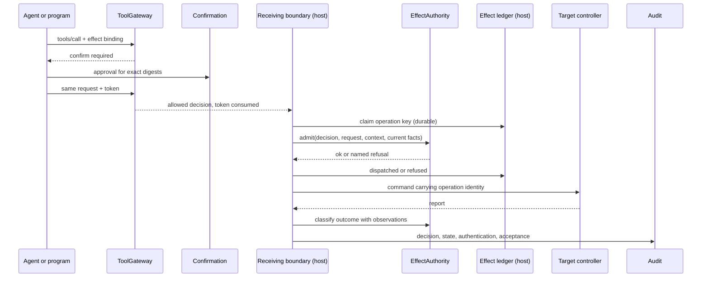

---
sigil_guard:
  id: "SP.19"
  title: "Physical Effect Authority"
  domain: security
  status: planned
  priority: high
  created: "2026-11-19"
  updated: "2026-11-19"
  tags:
    ["physical-effect", "authority", "replay", "confirmation", "toctou",
     "evidence", "robotics"]
  depends_on: ["R.11", "SP.01", "SP.03", "SP.04", "SP.07", "SP.08", "SP.09"]
---

# SP.19 - Physical Effect Authority

## Executive Summary

This spec defines what SigilGuard binds, checks, and records when a tool
request changes the physical world, for example a high-level command to a
robot cell. It separates four properties that are easy to conflate: the
authenticity of a request, the current authority to perform it, the
prevention or reconciliation of repeated external effects, and the physical
correctness of the result. SigilGuard owns the first, contributes a
deny-only check to the second, states exactly where its part of the third
ends, and makes no claim about the fourth.

Status is `planned`. Of 48 requirements, 16 are met by existing code and
cite the module and test, 26 are specified here and not implemented, and 6
are host obligations the library cannot enforce. The design adds no
statement type, DSSE payload type, confirmation claim, `_agent_*` key,
manifest field, or configuration key. The new binding travels inside the
guarded payload, where the existing SP.01 digests already cover it.

## Business Value

- **Problem:** An agent or a generated program can propose a physical action.
  A valid signature or a consumed nonce is then read as more than it is: as
  proof that the target, calibration, and policy are still the reviewed ones,
  that the action has not already happened, or that it succeeded.
- **Solution:** One closed binding record, one deny-only admission check
  against host-supplied current facts, a truthful replay contract, a durable
  host ledger contract for effects, and separate outputs for authentication
  and physical acceptance.
- **Beneficiary:** Hosts that place SigilGuard in front of a device,
  controller, or fleet interface, and operators who must explain a refusal
  or an outcome afterwards.
- **Impact:** Each substitution and each stale condition has one named
  refusal. No document or decision produced by the library describes a
  nonce-store pass or a signed report as physical fact.

## Technical Architecture

### Overview

| Property | Mechanism | Owner | State |
|----------|-----------|-------|-------|
| Authenticity and integrity of a request | SP.01 digests, DSSE signatures, SP.03 confirmation tokens, manifest pinning | SigilGuard | implemented |
| Current authority at dispatch | Effect binding compared with host-supplied current facts; optional effect envelope | SigilGuard checks, host supplies facts | specified |
| At-most-once use of an authority artifact inside one runtime | `SigilGuard.ReplayStore` | SigilGuard | implemented |
| At-most-once dispatch of an effect across restarts and hosts | Durable effect ledger keyed by operation | Host | specified contract |
| Physical safety and correctness | Controller limits, protective functions, acceptance observations | Host and equipment | out of scope |

Terms used below:

- **Physical-effect request:** a `tool_request` (SP.01) that the host guards
  with `effect_binding: :required`.
- **Effect binding:** the closed record defined under Effect Binding Record.
- **Effect envelope:** a closed document listing the operations, targets, and
  parameter bounds a generated program may choose within.
- **Current facts:** values the host reads from its own trusted sources
  immediately before dispatch.
- **Receiving boundary:** the last host component that can refuse before
  external I/O reaches the target.
- **Effect ledger:** host-owned durable storage with one record per
  operation.

### Data Flow



### Architectural Patterns

| Pattern | Used | Justification |
|---------|------|---------------|
| GenServer | no | Validation, admission, and classification are pure. |
| Behaviour | no | The library never calls the ledger; its contract is specified for hosts and exercised with a test fake. |
| ETS | no | No state is added. `ReplayStore` keeps its existing table and lifetime. |
| Telemetry | yes | Existing gateway events gain bounded metadata; no new event family. |
| Network | no | No function defined here performs I/O or reads a clock. |

## Requirements

Requirement IDs are stable. Status values:

- `met`: current code satisfies the requirement; the evidence column names
  the module and the test.
- `specified`: defined by this spec; no library code implements it.
- `host`: obligation on the host application. The library does not enforce
  it and cannot observe a violation.

Test names are quoted from the files under `test/sigil_guard/` as of the
last revision of this spec.

### Scope And Activation

| ID | Requirement | Status | Evidence |
|----|-------------|--------|----------|
| PE.01 | `ToolGateway.guard_request/3` accepts the option `:effect_binding` with the closed values `:off` (default) and `:required`. With `:off` no decision, digest, telemetry metadata, or wire shape changes. Any other value blocks with deny reason `:invalid_effect_binding`. The `MCP.Gateway` functions delegate to `guard_request/3` and pass the option through. `ToolGateway.Base` reads no `ToolGateway` option, this one included. | specified | - |
| PE.02 | Every check in this spec contributes `block` or nothing. It never upgrades a verdict in the SP.04 order `block > quarantine > confirm > redact > allow`, and a passed check never replaces a required confirmation. | specified | - |
| PE.03 | The spec adds no statement type, payload type, confirmation claim, `_agent_*` key, manifest field, or `SigilGuard.Config` key. Existing golden vectors and the consumer contract assertions stay byte-identical. | specified | - |

The capability manifest has no field that marks a tool as physical:
`side_effects` and `reversibility` are closed sets without that class
(SP.03). Classification is therefore a host declaration per call. Binding it
into the signed manifest would need a new manifest format and is not
proposed.

Only `tool_request` is covered. An `agent_request` (SP.13) that asks a peer
to cause a physical effect is not: the peer's gateway applies this spec when
it guards the resulting tool request.

### Binding

A physical-effect request binds the elements below. The first five are bound
today; the binding record adds the rest without changing any digest rule.

| Element | Carrier | Covered by |
|---------|---------|------------|
| Principal | `context.actor`, `context.identity` | SP.01 context digest; token `context_digest` |
| Tool definition | pinned capability manifest | `manifest` subject; token `manifest_digest` |
| Parameters | `params.arguments` | `action` and `payload` subjects; token `action_digest`, `payload_digest` |
| Endpoint | `context.mcp_server`, `context.resource_uri` | SP.01 context digest |
| Authority lifetime | `predicate.expires_at`, token `expires_at` | signature or MAC |
| Target identity and environment | `effect.target` | payload digest |
| Artifact or program digests | `effect.artifacts` | payload digest |
| Frame or calibration revision | `effect.frame_revision` | payload digest |
| Operation deadline | `effect.not_before`, `effect.not_after` | payload digest |
| Policy epoch | `effect.policy_epoch` | payload digest |
| Operation identity | `effect.operation_id` | payload digest |

| ID | Requirement | Status | Evidence |
|----|-------------|--------|----------|
| PE.04 | The principal is bound through `actor` and `identity` in the context digest. A token or attestation issued for one actor does not verify for another. | met | `Attestation.Digest.context_preimage/2`, `Confirmation.verify/5`; `threat_model/tm06_confused_deputy_test.exs` "an approval bound to one actor cannot approve another actor's action" |
| PE.05 | The tool definition is bound through the manifest digest. Definition drift invalidates outstanding approvals. | met | `CapabilityManifest`, `Confirmation`; `confirmation_test.exs` "rejects manifest-bound tokens for changed manifests"; `threat_model/tm05_rug_pull_test.exs` "a description rug pull invalidates the outstanding approval" |
| PE.06 | Parameters are bound as structured JSON: keys, nesting, booleans, `null`, and strings each change the digests. | met | `MCP.SecurityPayload`; `mcp/security_payload_test.exs` "different keys and non-string values produce different security bindings" |
| PE.07 | The endpoint is bound through `mcp_server` and `resource_uri` in the context digest, and the gateway refuses a request whose `:resource` or `:audience` option does not match the pinned manifest. | met | `Attestation.Digest`, `ToolGateway`; `attestation/digest_test.exs` "accepts keyword context extras and rejects unknown statement types"; `threat_model/tm06_confused_deputy_test.exs` "a request indicating the wrong resource is blocked", "a credential minted for the wrong audience is blocked" |
| PE.08 | Values under an unreserved `params._meta` key are part of the bound payload: changing one changes the payload digest and the confirmation digests. The effect binding uses the key `dev.sigilguard/effect` and so needs no new digest rule. | met | `MCP.SecurityPayload`; `mcp/security_payload_test.exs` "metadata capabilities and extensions change the security binding" |
| PE.09 | With `effect_binding: :required`, `guard_request/3` checks the option value, runs the manifest, freshness, resource, visibility, sandbox, and attestation checks in their existing order, and then, before the runtime gate, refuses `consume_confirmation: false` (PE.25), computes the request digests, and validates the record against the closed schema under Effect Binding Record. A request whose digests cannot be computed blocks with `:invalid_payload`. A missing record blocks with `:effect_binding_required`; a malformed one blocks with `:invalid_effect_binding`. Every other decision, including one blocked before the gate, records `action_digest`, `payload_digest`, and `context_digest` in `audit_metadata`, and `effect_binding_digest` and `effect_operation_key` when the record is valid. | specified | - |
| PE.10 | Authority has a bounded lifetime. A confirmation token is refused after `expires_at` with `:expired`; an attestation is refused after `expires_at` plus skew with `:expired_attestation`. Tokens are never renewed. | met | `Confirmation`, `Attestation`; `confirmation_test.exs` "rejects expired tokens"; `attestation_sign_verify_test.exs` "honors expiration skew boundaries" |
| PE.11 | The operation deadline is separate from authority expiry. Admission refuses when `now` is later than `not_after` (`:effect_deadline_passed`) or earlier than `not_before` (`:effect_not_yet_valid`). No skew allowance extends `not_after`. Both the authority lifetime and the deadline must hold. | specified | - |

Numbers need care. RFC 8785 serializes `120` and `120.0` to the same bytes,
so the SP.01 attestation digests treat them as one value, while the
confirmation token digest distinguishes them (`confirmation_test.exs` "an
integer and an equal float share attestation digests but not the
confirmation digest"). The binding record therefore carries strings only,
and envelope bounds accept JSON integers only.

### Substitution Refusal

Two different substitutions exist and are refused at different points.

**Request substitution** changes the presented request or context after
approval. The recomputed digests no longer match the token or attestation.

**Condition substitution** leaves the request unchanged while the world
changes: the endpoint now resolves to another asset, the calibration was
revised, the program bytes differ, or the policy epoch advanced. Digests
still match. Only a comparison against current facts detects it.

| ID | Requirement | Status | Evidence |
|----|-------------|--------|----------|
| PE.12 | Request substitution of any bound element is refused. Token verification returns `:digest_mismatch` or `:manifest_digest_mismatch`; the gateway blocks with deny reason `:confirmation_failed` and records the atom as `confirmation_reason`. Attestation verification returns the same atoms. | met | `Confirmation.verify/5`, `ToolGateway`; `tool_gateway_test.exs` "rejects confirmation tokens when the approved request binding changes"; `attestation_sign_verify_test.exs` "rejects payload, context, action, and manifest tampering" |
| PE.13 | A refused approval is reported as one atom from a closed set. The JSON-RPC error for a failed confirmation carries the status and reason and no request text or token bytes. | met | `ToolGateway`, `MCP.Gateway`; `mcp/gateway_test.exs` "returns JSON-RPC errors for invalid confirmation tokens without leaking request text" |
| PE.14 | `EffectAuthority.admit/5` takes the gateway decision and refuses with `:not_authorized` unless that decision allows this exact request. It then compares the binding with current facts in the fixed order under Admission Order and returns the first failing reason as a bare atom, with no value from the record, the arguments, or the facts. Equal inputs give equal results; the function reads no clock, process state, or application environment. | specified | - |
| PE.15 | `target.environment` is a closed enum, `physical` or `simulated`. A binding approved for one never admits against the other (`:target_environment_mismatch`), even when `target.id` is equal. | specified | - |

`:digest_mismatch` identifies the violated boundary, the approval binding,
and not the element that changed. This is deliberate: a token carries
digests only, so it cannot disclose what was approved. A host that retained
the approved record can name the changed element itself.

### Adaptive Envelope

An exact request is approved once and consumed once. A generated program
needs a different shape: it may choose among a finite set of operations and
parameter values without a new approval for each choice.

| Need | Existing construct | Enforced by the library today |
|------|--------------------|-------------------------------|
| Finite set of operations | Pinned manifests with `require_manifest: true`; policy `[rules]` with `default block` and `allow ... tool:<list> actor:<principal>` | yes |
| An operation's definition cannot drift | Manifest digest | yes |
| Side-effect class against isolation | Manifest `side_effects` and the SP.04 sandbox matrix | yes |
| Parameter bounds fixed per tool | JSON Schema keywords in the pinned `input_schema` | pinned yes, evaluated no |
| Parameter bounds per approved task | none | no |
| Permitted set of targets | none; the policy grammar has no matcher for `mcp_server`, `resource_uri`, or payload values | no |
| A program digest tied to its permitted set | none; `actor:` is the only handle | no |
| One approval covering several operations | none; a token binds one action digest and is single-use | no |
| A bound on the number of operations | none durable; the rate table is per boot | no |

Existing constructs suffice for a static envelope: the set of tools and the
bounds are the same for every task and are fixed when the trust bundle is
signed. They do not suffice for a task-scoped envelope. Four things are
missing: evaluation of arguments against bounds, a target set, a link from a
program digest to its permitted set, and an approval that covers a set. The
effect envelope under Effect Envelope Document supplies exactly these and
nothing else. A count bound stays host-owned because it needs durable state.

| ID | Requirement | Status | Evidence |
|----|-------------|--------|----------|
| PE.16 | A tool without a pinned manifest is blocked when manifests are required, and a policy rule with `tool:` and `actor:` matchers restricts a principal to the tools it lists. | met | `ToolGateway`, `BoundaryPolicy.Match`; `tool_gateway_test.exs` "fails closed for unknown tools without creating atom keys"; `boundary_policy/match_test.exs` "star matches any present tool but requires the actor to match", "an explicit tool list under default block passes only the listed tools for the actor"; `runtime/gate_test.exs` "a null argument does not bypass the policy file default" |
| PE.17 | Static parameter bounds are pinned: the manifest digest covers `input_schema_sha256`, and a changed schema is rejected. | met | `CapabilityManifest`; `threat_model/tm05_rug_pull_test.exs` "a swapped input schema after approval is rejected on the refresh" |
| PE.18 | Evaluating arguments against the pinned JSON Schema is host-owned (SP.16). SigilGuard does not refuse an argument that violates `enum`, `minimum`, or `maximum` in a pinned schema. | host | - |
| PE.19 | An effect envelope is approved by guarding and confirming a host-chosen request that carries the complete document at `params._meta["dev.sigilguard/effect-envelope"]`. That request names a tool with a pinned manifest and is guarded with `effect_binding: :off`, because it dispatches nothing. The existing token binds the document through the payload digest; no new token type exists. Before it presents the approval the host calls `envelope_digest/1`, which refuses a malformed document, and afterwards it records the digest as approved. The library keeps no record of approvals. | specified | - |
| PE.20 | A binding that names an envelope is admitted only when the host supplies a document whose digest equals `effect.envelope.sha256` and the request is a member under Envelope Membership. Otherwise admission returns the named refusal. | specified | - |
| PE.21 | An envelope is immutable and identified by its digest. Widening a bound, adding a target or operation, or extending `not_after` produces a different digest and needs a new approval. No amendment operation exists. | specified | - |

### Replay

Current behaviour, stated against the implementation:

| Fact | Behaviour | Evidence |
|------|-----------|----------|
| What is recorded | SHA-256 fingerprints of `{prefix <> actor, nonce}` with a monotonic expiry in the named ETS table `:sigil_guard_replay`; prefixes are `confirmation:` and `attestation:`. | `replay_store_test.exs` "expiry is measured on the monotonic clock" |
| Concurrent claims | Exactly one of many simultaneous claims for one pair succeeds. | `replay_store_test.exs` "concurrent check_and_put allows exactly one claim for a nonce" |
| Retention | A token nonce is held through `expires_at`. An attestation nonce is held through `expires_at` plus skew, even when a shorter TTL is requested. | `replay_store_test.exs` "attestation replay protection spans expiry skew despite a shorter override" |
| After retention | The pair can be claimed again. The artifact is by then refused on expiry, not by the store. | `replay_store_test.exs` "expired nonce can be reclaimed" |
| Wall clock set back | Retention is a monotonic duration fixed at first verification, while expiry is read from wall time. If wall time moves back after consumption, the claim can lapse while the token still reads as unexpired. | code reading, `confirmation.ex`, `replay_store.ex` |
| Capacity | At 100,000 live claims a new claim returns `:replay_capacity_exceeded`. Live entries are not evicted and the verification fails. The limit is not a `SigilGuard.Config` key. | `replay_store_test.exs` "capacity exhaustion fails closed without evicting a live nonce" |
| Table owner | `SigilGuard.Runtime` owns the table. | `runtime_test.exs` "runtime owns the ETS tables and validated configuration" |
| Runtime or node restart | The table is destroyed with its owner. A token consumed before the restart verifies again afterwards until its `expires_at`. | `confirmation_test.exs` "a consumed token verifies again after the runtime restarts" |
| Several nodes | Each node has its own table. One token can be consumed once per node. | code reading, `replay_store.ex` |
| In-VM callers | The table is `:public` and `ReplayStore.clear/0` is public. Code in the same VM can remove claims. | code reading, `replay_store.ex` |
| Opt-outs | `consume: false` on a token and the default `replay: false` on an attestation skip the store. | `confirmation_test.exs` "can keep confirmation tokens reusable for stateless checks"; SP.01 Replay And Expiry Semantics |
| Gateway attestation check | `ToolGateway.guard_request/3` verifies an inbound attestation without consuming its nonce: it forwards only `:now` and `:max_skew_ms`. | `tool_gateway_test.exs` "accepts valid inbound attestations for optional and required modes" guards one attested request twice |
| What a pass means | The same authority artifact was not accepted earlier by this table instance. It says nothing about whether the effect occurred. Two tokens with different nonces for the same operation both pass. | by construction |

With default lifetimes the exposure after a restart is at most 300 s for a
token and 360 s for an attestation.

| ID | Requirement | Status | Evidence |
|----|-------------|--------|----------|
| PE.22 | Within one runtime, a second consuming verification of the same token or attestation while it is live is refused with `:replay_detected`, including under concurrent attempts. | met | `ReplayStore.check_and_put/4`; `confirmation_test.exs` "consumes confirmation tokens by default"; `attestation_sign_verify_test.exs` "can consume attestation nonces for replay protection" |
| PE.23 | Retention covers the whole acceptance window and is measured on the monotonic clock. | met | `ReplayStore`, `Attestation`; `replay_store_test.exs` tests cited above |
| PE.24 | Capacity exhaustion refuses the new claim and keeps live claims. | met | `ReplayStore`; `replay_store_test.exs` "capacity exhaustion fails closed without evicting a live nonce" |
| PE.25 | A physical-effect request is verified with consumption. With `effect_binding: :required`, `consume_confirmation: false` blocks with `:effect_replay_protection_required`. An inbound attestation is verified without consumption before the gate, as today, and its nonce is consumed once, on the pass whose decision allows execution. A pass that ends in `confirm`, `quarantine`, or `block` consumes nothing, so the same envelope can accompany the confirmed retry. A failed consumption blocks with `:invalid_attestation` and `attestation_error` set to the SP.01 atom, for example `:replay_detected`. | specified | - |
| PE.26 | No decision field, telemetry attribute, audit event, guide, or API document produced by the library describes a replay-store pass as evidence that an effect has not occurred, or `:replay_detected` as evidence that it has. | specified | - |

### Durable Effect Reconciliation

The library does not store operations. The host's effect ledger does, under
this contract.

| ID | Requirement | Status | Evidence |
|----|-------------|--------|----------|
| PE.27 | `EffectAuthority.operation_key/1` returns the lowercase-hex SHA-256 of the JCS bytes of `{"operation_id": ..., "target_id": ...}` taken from a valid binding. `EffectAuthority.binding_digest/1` returns the digest of the JCS bytes of the record. Both are pure. | specified | - |
| PE.28 | Before any external I/O the host writes a ledger record `{operation_key, payload_digest, context_digest, binding_digest, state: claimed}` with create-if-absent semantics. The write is durable across process and node restart and is visible to every host instance that can reach the target. The four values are the `effect_operation_key`, `payload_digest`, `context_digest`, and `effect_binding_digest` that the decision records (PE.09). | host | - |
| PE.29 | A claim for an existing key with equal digests does not dispatch; the host reads the recorded state and reconciles. A claim for an existing key with different digests is refused as `operation_binding_conflict`. | host | - |
| PE.30 | Ledger states and transitions are the closed set under Ledger States. `EffectAuthority.valid_transition?/2` is the pure, shared definition. | specified | - |
| PE.31 | After a restart, a record in `claimed` means no I/O was issued and the host may resume at the admission step with fresh facts. A record in `dispatched`, `acknowledged`, or `cancel_requested` becomes `unknown` and is reconciled against the target by operation identity. It is never dispatched again automatically. | host | - |
| PE.32 | Where the target protocol has a command or order identity, the host conveys `operation_id` in it so the target can suppress a duplicate that the ledger could not. | host | - |

A durable shared ledger gives at-most-once dispatch decisions among
cooperating hosts. It does not give at-most-once physical effect: a command
can be delivered and its acknowledgement lost. Only the effect owner can
close that gap.

### Time Of Check To Time Of Use

Confirmation is the check; external I/O is the use. Between them the
approver's view ages.

| ID | Requirement | Status | Evidence |
|----|-------------|--------|----------|
| PE.33 | Admission takes current facts carrying `observed_at` and a required `:max_fact_age_ms` option. It refuses with `:stale_current_facts` when `now - observed_at` exceeds the bound or `observed_at` is later than `now`. No default bound exists; omitting the option returns `:invalid_options`. | specified | - |
| PE.34 | An admission result is a return value, not a credential. It carries no token, is not cached by the library, and applies only to the dispatch that immediately follows. | specified | - |
| PE.35 | Authority withdrawn before dispatch is refused. Withdrawal is expressed through the current facts: an advanced `policy_epoch` (`:policy_epoch_mismatch`), an envelope the host no longer supplies (`:unknown_effect_envelope`), or a changed principal (`:principal_mismatch`). The ledger records `refused` with the reason and no I/O is issued. | specified | - |
| PE.36 | Authority withdrawn after dispatch never stops work by itself. A cancel sent to the target moves the record to `cancel_requested`. The record reaches `cancelled` only on target or observation evidence that the work did not complete, `finished` when the target reports completion despite the cancel, and `unknown` when neither arrives. A cancel request is never recorded as `cancelled` or `finished`. | specified | - |
| PE.37 | Stale trust material fails closed. An expired bundle or role is rejected at load and at scanner-option resolution; nothing extends validity when a site is offline. | met | `TrustBundle.Verify`, `Runtime`; `trust_bundle/verify_test.exs` "rejects expired roles and expired or future-dated documents"; `runtime_test.exs` "bundle pattern selection resolves explicitly and rejects an expired source" |

Admission narrows the interval between check and use; it does not close it.
After `admit/5` returns `:ok` a person can enter the workspace or a fixture
can move. The controller's own state checks and the equipment's protective
functions own that interval. The trust-bundle cache, with its
accepted-sequence floor and revocation union, is also per boot (SP.02). The
signed `rollback_floor` inside the embedded bundle is the only floor that
survives a restart, so a host that needs the accepted sequence or the
revocation union across restarts persists that state itself.

### Evidence Honesty

A verified signature shows which key endorsed some bytes under a
verification policy. It does not show that the signer measured correctly or
that the action succeeded.

| ID | Requirement | Status | Evidence |
|----|-------------|--------|----------|
| PE.38 | `EffectAuthority.classify_outcome/1` returns three separate fields: `authentication` (`verified`, `unsigned`, `invalid`), `claimed` (`success`, `failure`, `none`), and `acceptance` (`accepted`, `rejected`, `undetermined`). No field is derived from another. | specified | - |
| PE.39 | `acceptance` depends only on host-supplied observations: `rejected` when any observation contradicts, `accepted` when at least `required_observations` distinct sources confirm and none contradicts, otherwise `undetermined`. The report's own claim is never counted as an observation, and an observation whose `source` equals the report issuer is refused as input. | specified | - |
| PE.40 | `EffectAuthority.audit_fields/1` returns the `result` label, the `Audit.ExecutionResult`, and the metadata map for an audit event about a physical-effect operation. `result` is the ledger state. `result_info.success` is `true` only when `acceptance` is `accepted`, `false` when it is `rejected`, and `nil` otherwise. The claim, authentication, and acceptance are separate metadata values. The audit chain covers `result`; `result_info` and `metadata` are outside the chain preimage (SP.09), so acceptance is recorded without chain protection. | specified | - |
| PE.41 | Which observations count, how many are required, and whether sources are independent is the host's acceptance criterion. | host | - |

### Untrusted Observations

| ID | Requirement | Status | Evidence |
|----|-------------|--------|----------|
| PE.42 | Tool results and telemetry returning to a model cross the `tool_result` boundary and are scanned and quarantined there. | met | `Runtime.Gate`, `Quarantine`; `threat_model/tm01_injection_via_tool_results_test.exs` "the gate blocks an injection smuggled into a tool result" |
| PE.43 | A tool request from an untrusted zone is blocked by a kernel invariant that no rule overrides. | met | `BoundaryPolicy`; `boundary_policy_test.exs` "untrusted zone blocks a tool request" |
| PE.44 | Current facts and acceptance observations are explicit arguments built by the host from its own sources. The binding in the request is the claim under test and is never read as a fact. The functions parse closed maps, read identifiers and closed enums only, never interpret free text, refuse unknown keys, apply `SigilGuard.Limits`, and create no atoms from input. | specified | - |
| PE.45 | No input to admission or classification can extend a deadline, add an operation, target, or parameter value to an envelope, change the expected policy epoch, or move a ledger record out of a terminal state. Observations inside an approved envelope need no new approval; a changed goal, target, or envelope does (PE.21). | specified | - |

### Non-Goals

| ID | Requirement | Status | Evidence |
|----|-------------|--------|----------|
| PE.46 | The library decides no trajectory, motion, speed, or force. Envelope bounds limit which requested values are admitted; they do not plan or correct motion. | specified | - |
| PE.47 | The library is not part of an emergency-stop, protective-stop, or other safety function. Its refusal or latency is never the means of stopping motion, and a refusal sends nothing to the target. | specified | - |
| PE.48 | No library output or document claims machinery certification or conformity with a safety or cybersecurity standard or regulation. | specified | - |

Runtime assurance is a different kind of evidence. The Black-Box Simplex
architecture guarantees that system states stay admissible if its decision
module is correct, its plant model is accurate, and it starts from a safe
command sequence. A signature over a command supplies none of these.
Transport security is also a different layer: DDS-Security permission rules
match on domain, topic, partition, and data tag, and none of those criteria
is the content of a command.

## Data Model

### Effect Binding Record

The record is a string-keyed map at `params._meta["dev.sigilguard/effect"]`.
It is closed: an unknown key, a wrong type, or a value outside its rule
fails with `:invalid_effect_binding`.

`fetch_binding/1` reads the record from the `params` value the gateway
binds: the string key `"params"`, or the atom key `:params` when the string
key is absent. Inside it the record sits under `"_meta"` or `:_meta`. A
`params` map that has both metadata keys is ambiguous and fails with
`:invalid_effect_binding`, as does a value at the record key that is not a
map. A request without `params` has no record.

An **identifier** is 1 to 256 bytes of printable ASCII (`0x21` to `0x7E`).
Identifiers are compared byte for byte, with no case folding, Unicode
normalization, or URI normalization. A **timestamp** uses the SP.01 form,
ISO 8601 UTC with millisecond precision.

| Field | Type | Required | Rule |
|-------|------|----------|------|
| `binding_format` | string | yes | Exactly `sigil_guard_effect_binding/v1`. |
| `operation_id` | identifier | yes | Host-assigned; one per intended effect on a target. |
| `target` | map | yes | `{"id": identifier, "environment": "physical" \| "simulated"}`. |
| `artifacts` | list | no | 1 to 16 maps `{"name": identifier, "sha256": lowercase-hex-64}`, sorted ascending by `name`, names unique. Same shape and order as the SP.01 `release` artifacts. |
| `frame_revision` | identifier | no | Revision of the frame, calibration, or map that gives the parameters their physical meaning. |
| `policy_epoch` | identifier | yes | Host-derived; MUST change whenever the trust bundle sequence, the policy file digest, or a revocation changes. |
| `not_before` | timestamp | no | Earliest dispatch time. |
| `not_after` | timestamp | yes | Latest dispatch time; later than `not_before` when both are present. |
| `envelope` | map | no | `{"id": identifier, "sha256": lowercase-hex-64}` naming an approved effect envelope. |

The principal and the parameters are not repeated in the record. They are
`context.actor` and `params.arguments`, and a second copy could disagree
with the first.

A recommended `policy_epoch` is `<bundle_id>:<sequence>:<policy_file_digest>`
from SP.02 and SP.04. The library compares it as an opaque identifier.

### Current Facts

`current` is an atom-keyed closed map built by the host. String keys,
unknown keys, or wrong types fail with `:invalid_current_facts`.

| Field | Type | Required | Source |
|-------|------|----------|--------|
| `:principal` | identifier | yes | Principal authenticated for this dispatch. |
| `:target` | `%{id: identifier, environment: :physical \| :simulated}` | yes | Asset the host is about to address, as the host resolved it. |
| `:artifacts` | list of 1 to 16 `%{name: identifier, sha256: hex}`, names unique, any order | no | Digests the host computed over the exact bytes it will hand to the executor. |
| `:frame_revision` | identifier | no | Revision currently active on the target. |
| `:policy_epoch` | identifier | yes | Epoch currently in force. |
| `:observed_at` | `DateTime` | yes | When the host read these facts. |
| `:now` | `DateTime` | yes | Host time at the call. |

### Admission Order

`admit(decision, request, context, current, opts)` evaluates in this order
and returns the first failure. Optional fields are equal only when both
sides are absent or both are present with equal values.

| Step | Check | Refusal |
|------|-------|---------|
| 1 | Options are a keyword list with a positive integer `:max_fact_age_ms`, an optional `:envelope`, and no other key | `:invalid_options` |
| 2 | `decision` is a `SigilGuard.Decision` with verdict `:allowed` and action `:allow` whose `audit_metadata.action_digest` equals the action digest recomputed from `request`, `context`, and `audit_metadata.protocol_version`, as the gateway computes it | `:not_authorized` |
| 3 | The record is present | `:effect_binding_required` |
| 4 | The record is valid | `:invalid_effect_binding` |
| 5 | `current` is valid | `:invalid_current_facts` |
| 6 | Facts are fresh | `:stale_current_facts` |
| 7 | `current.principal` equals `context.actor` | `:principal_mismatch` |
| 8 | Target ids are equal | `:target_mismatch` |
| 9 | Target environments are equal | `:target_environment_mismatch` |
| 10 | Artifact lists are equal | `:artifact_mismatch` |
| 11 | Frame revisions are equal | `:frame_revision_mismatch` |
| 12 | Policy epochs are equal | `:policy_epoch_mismatch` |
| 13 | `now` is not before `not_before` | `:effect_not_yet_valid` |
| 14 | `now` is not after `not_after` | `:effect_deadline_passed` |
| 15 | Envelope membership | see Envelope Membership |

A record without `envelope` passes step 15 when no `:envelope` option is
supplied. Supplying one for a record that names none fails with
`:effect_envelope_mismatch`.

Step 2 depends on PE.09. Today the gate records `action_digest` only on a
`confirm` decision, where it stays after the token is accepted; a decision
that was allowed without confirmation carries `nil` (`tool_gateway_test.exs`
"a decision allowed without confirmation carries a nil action digest"). The
gateway binds the protocol version it selected, which a `:protocol_version`
option can override ("the :protocol_version option changes the bound action
digest"), so step 2 recomputes with the version the decision records. `context` is the value the host passed to `guard_request/3`,
`metadata` and `workspace_root_digest` included: the action digest covers
the whole context (`confirmation_test.exs` "the confirmation digest covers
context metadata and the workspace root digest").

Step 7 compares `context.actor` only. A context without `actor` never
admits. `identity` is bound by the digests and is not compared.

### Effect Envelope Document

The document is a string-keyed closed map with format marker
`sigil_guard_effect_envelope/v1`. Its digest is the lowercase-hex SHA-256 of
the JCS bytes of the validated document.

| Field | Type | Required | Rule |
|-------|------|----------|------|
| `envelope_format` | string | yes | Exactly `sigil_guard_effect_envelope/v1`. |
| `id` | identifier | yes | Host-assigned. |
| `principal` | identifier | yes | The `context.actor` allowed to act under the envelope. |
| `artifacts` | list | yes | Non-empty; same shape as in the binding. The program and configuration the envelope was approved for. |
| `targets` | list | yes | 1 to 16 target maps, sorted ascending by `id`, ids unique. |
| `operations` | list | yes | 1 to 64 operation maps, sorted ascending by `tool`, tools unique. |
| `frame_revision` | identifier | no | Required revision for every operation. |
| `policy_epoch` | identifier | yes | Epoch the envelope was approved under. |
| `not_after` | timestamp | yes | Last dispatch time for any operation. |

An operation is `{"tool": identifier, "manifest_sha256": lowercase-hex-64,
"parameters": map}` with no other key. `parameters` maps each permitted
top-level argument name, a non-empty UTF-8 string, to one bound. A bound is
a map with exactly one of the two keys below:

| Bound | Form | Argument matches when |
|-------|------|-----------------------|
| enum | `{"enum": [scalar, ...]}` with 1 to 64 UTF-8 strings, booleans, or integers inside the SP.01 integer range | it has the same JSON type and value as a listed scalar; a float never matches |
| range | `{"range": {"min": integer, "max": integer}}`, both inside the SP.01 integer range, `min <= max` | it is a JSON integer with `min <= value <= max` |

Bounds apply to top-level scalar arguments. Floating-point bounds and
bounds on nested values are not defined in v1; a host expresses physical
quantities in integer base units such as millimetres.

### Envelope Membership

Evaluated in order after step 14; the first failure is returned.

| Step | Check | Refusal |
|------|-------|---------|
| 15.1 | The host supplied `:envelope` | `:unknown_effect_envelope` |
| 15.2 | The document is valid | `:invalid_effect_envelope` |
| 15.3 | Its `id` and digest equal `effect.envelope` | `:effect_envelope_mismatch` |
| 15.4 | `context.actor` equals `principal` | `:principal_mismatch` |
| 15.5 | The binding's target is listed | `:target_out_of_envelope` |
| 15.6 | Artifact lists are equal | `:artifact_mismatch` |
| 15.7 | Frame revisions are equal | `:frame_revision_mismatch` |
| 15.8 | Policy epochs are equal | `:policy_epoch_mismatch` |
| 15.9 | `now` and the binding's `not_after` are not after the envelope's `not_after` | `:effect_envelope_expired` |
| 15.10 | The tool named by the request is listed and `decision.audit_metadata.manifest_digest` equals its `manifest_sha256` | `:operation_out_of_envelope` |
| 15.11 | `params.arguments`, or an empty map when the key is absent, is a string-keyed map whose key set equals the operation's `parameters` key set and every value matches its bound | `:parameter_out_of_envelope` |

Whether an envelope is still approved is a host fact. The host passes only
envelopes it currently holds as approved.

### Ledger States

| State | Meaning | May move to |
|-------|---------|-------------|
| `claimed` | Durable record written; no I/O issued | `refused`, `dispatched` |
| `refused` | Admission refused; terminal | - |
| `dispatched` | Recorded immediately before I/O | `acknowledged`, `cancel_requested`, `failed`, `unknown` |
| `acknowledged` | Target acknowledged the command | `finished`, `failed`, `cancel_requested`, `unknown` |
| `cancel_requested` | Host asked the target to cancel | `cancelled`, `finished`, `failed`, `unknown` |
| `unknown` | Outcome not established | `finished`, `failed`, `cancelled` |
| `finished` | Target reported completion; terminal | - |
| `failed` | Target reported failure; terminal | - |
| `cancelled` | Evidence that the work did not complete; terminal | - |

`finished` records what the target reported. Physical acceptance is the
separate `acceptance` value of PE.38 and is stored beside the state.

## Proposed Public API

Not implemented. Names may change only through a revision of this spec.

```elixir
defmodule SigilGuard.EffectAuthority do
  @type refusal ::
          :invalid_options | :not_authorized | :effect_binding_required
          | :invalid_effect_binding | :invalid_current_facts
          | :stale_current_facts | :principal_mismatch | :target_mismatch
          | :target_environment_mismatch | :artifact_mismatch
          | :frame_revision_mismatch | :policy_epoch_mismatch
          | :effect_not_yet_valid | :effect_deadline_passed
          | :unknown_effect_envelope | :invalid_effect_envelope
          | :effect_envelope_mismatch | :effect_envelope_expired
          | :target_out_of_envelope | :operation_out_of_envelope
          | :parameter_out_of_envelope

  @spec fetch_binding(request :: term()) ::
          {:ok, map()}
          | {:error, :effect_binding_required | :invalid_effect_binding}

  @spec validate_binding(term()) :: :ok | {:error, :invalid_effect_binding}

  @spec binding_digest(term()) ::
          {:ok, String.t()} | {:error, :invalid_effect_binding}

  @spec operation_key(term()) ::
          {:ok, String.t()} | {:error, :invalid_effect_binding}

  @spec envelope_digest(term()) ::
          {:ok, String.t()} | {:error, :invalid_effect_envelope}

  @spec admit(
          decision :: term(),
          request :: term(),
          SigilGuard.Context.t() | map() | keyword(),
          current :: term(),
          opts :: term()
        ) :: :ok | {:error, refusal()}

  @spec valid_transition?(from :: atom(), to :: atom()) :: boolean()

  @spec classify_outcome(term()) ::
          {:ok,
           %{
             authentication: :verified | :unsigned | :invalid,
             claimed: :success | :failure | :none,
             acceptance: :accepted | :rejected | :undetermined
           }}
          | {:error, :invalid_outcome_input}

  @spec audit_fields(term()) ::
          {:ok,
           %{
             result: String.t(),
             result_info: SigilGuard.Audit.ExecutionResult.t(),
             metadata: %{optional(String.t()) => String.t()}
           }}
          | {:error, :invalid_audit_input}
end
```

Every function is total over arbitrary terms and returns a tagged tuple
instead of raising. `fetch_binding/1` returns a record only when it is
valid. `classify_outcome/1` takes an atom-keyed closed map with
`:authentication`, `:claimed`, optional `:issuer`, `:observations` (a list of
`%{source: identifier, result: :confirms | :contradicts}`), and
`:required_observations` (positive integer). The host obtains
`:authentication` from `Attestation.verify/3` over the outcome report:
`{:ok, _}` is `:verified`, an error is `:invalid`, and no envelope is
`:unsigned`.

`audit_fields/1` takes an atom-keyed closed map with `:state` (a ledger
state) and optional `:binding_digest`, `:operation_key`, `:refusal` (an
admission refusal), and `:outcome` (the map `classify_outcome/1` returned).
The host passes `result` and `metadata` to `Audit.new_event/5` and sets
`result_info` on the event.

## Module Map

| Module | Purpose | State |
|--------|---------|-------|
| `lib/sigil_guard/effect_authority.ex` | Public API: record lookup, digests, admission order, transition table, outcome classification, audit fields. | in progress |
| `lib/sigil_guard/effect_authority/record.ex` | Closed validator for the binding record and the shared identifier, timestamp, digest, target, and artifact rules. | implemented |
| `lib/sigil_guard/effect_authority/facts.ex` | Closed validator for the host's current facts. | implemented |
| `lib/sigil_guard/effect_authority/envelope.ex` | Closed validator, digest, and membership steps for the effect envelope. | implemented |
| `lib/sigil_guard/tool_gateway.ex` | `:effect_binding` option, PE.09 and PE.25 blocks, attestation nonce consumption. | implemented |
| `lib/sigil_guard/tool_gateway/effect.ex` | Gateway-side state for one physical-effect request: option value, replay protection, digests, and record. | implemented |
| `lib/sigil_guard/telemetry.ex` | Metadata allowlist and OTel attribute names for the three effect keys. | implemented |
| `lib/sigil_guard/confirmation.ex` | Token binding and single use. | existing; unchanged |
| `lib/sigil_guard/replay_store.ex` | Per-boot nonce claims. | existing; unchanged |
| `lib/sigil_guard/mcp/security_payload.ex` | Retains unreserved `_meta` values in the binding; `context/3` builds the gateway context that `guard_request/3` and `admit/5` both digest. | implemented |
| `test/sigil_guard/effect_authority_test.exs` | Unit, tamper, malformed, and property tests. | in progress |
| `test/sigil_guard/tool_gateway_effect_test.exs` | Gateway option, digest recording, replay rules, attestation consumption, and telemetry. | implemented |
| `test/sigil_guard/conformance/physical_effect_test.exs` | SG-F1 to SG-F6. | proposed |
| `test/support/test_effect_ledger.ex` | In-memory ledger fake with a simulated restart. | proposed |
| `test/fixtures/effect_authority/` | Neutral request, manifest, policy, and envelope fixtures. | in progress |
| `test/support/effect_authority_fixture.ex` | Reads the fixtures and builds the baseline context and current facts. | in progress |
| `test/support/test_runtime.ex` | Restarts the supervised runtime to discard per-boot state. | implemented |

## Integration Points

| System | Integration | Direction | Protocol |
|--------|-------------|-----------|----------|
| Host adapter | Sets `:effect_binding`, builds the record, renders the approval | inbound | Elixir API |
| Receiving boundary | Reads current facts, calls `admit/5`, drives the ledger | inbound | Elixir API |
| Effect ledger | Durable operation records | host-owned | host storage |
| Target controller | Command carrying the operation identity; reports | host-owned | device protocol |
| Audit (SP.09) | Decision, state, and outcome metadata | outbound | `SigilGuard.Audit` |

How a boundary carries command identity depends on the target and is the
host's mapping. VDA 5050 3.0.0 identifies an order by `orderId` and
`orderUpdateId` and rejects a lower or conflicting update. A ROS 2 action
goal has a client-generated UUID. MCP `2026-07-28` defines no request-level
idempotency: a JSON-RPC `id` is unique only among outstanding requests and a
retry uses a new one. In none of the three does a cancel request guarantee
that the work stops: an MCP server may ignore it, a ROS 2 action server may
reject it, and VDA 5050 calls order cancellation unreliable.

## Telemetry And Observability

| Event | Type | Metadata | Purpose |
|-------|------|----------|---------|
| `[:sigil_guard, :mcp, :request]` | event | with `effect_binding: :required` only, adds `effect_binding` (`absent`, `valid`, `invalid`), `effect_binding_digest`, `effect_operation_key` | Correlate a gateway decision with a ledger record. |

`EffectAuthority` functions are pure and emit no event, like direct
`Attestation` calls (SP.01). The host emits or audits admission and outcome
results. The added metadata contains no record value, argument value,
target identifier, or operation identifier; the operation key is already a
hash. Existing metadata keeps its SP.03 content. The OTel forwarder maps the
keys to `sigilguard.effect.binding`, `sigilguard.effect.binding_digest`, and
`sigilguard.effect.operation_key`; the two digests are high-cardinality
attributes.

Audit metadata keys for physical-effect events: `effect_binding_digest`,
`effect_operation_key`, `effect_state`, `effect_refusal`,
`effect_authentication`, `effect_claimed`, `effect_acceptance`.

## Error Handling

Gateway deny reasons added by this spec. All map to JSON-RPC code `-31990`
with `data.status` `"blocked"` under the SP.03 registry; no code is minted.

| Deny reason | Trigger | Recovery |
|-------------|---------|----------|
| `:effect_binding_required` | `effect_binding: :required` and no record | attach a binding |
| `:invalid_effect_binding` | malformed record or invalid option value | fix the record or option |
| `:effect_replay_protection_required` | `consume_confirmation: false` on a physical-effect request | verify with consumption |

Two existing reasons gain a trigger under `effect_binding: :required`:
`:invalid_payload` when the request digests cannot be computed, and
`:invalid_attestation` (code `-31985`) when the attestation nonce cannot be
consumed.

Admission refusals are listed under Admission Order and Envelope
Membership. Every refusal requires a fresh gate pass and, where the verdict
is `confirm`, a new token; nothing is retried by the library.

Ledger outcomes `operation_already_claimed` and `operation_binding_conflict`
are host results. They are named here so audit records use one vocabulary.

## Security Considerations

- **Authentication:** unchanged. Signatures, keys, and trust bundles follow
  SP.01 and SP.02. Transport authentication of the target is host-owned.
- **Authorization:** the policy kernel decides (SP.04). Admission can only
  refuse. A pinned manifest, a valid signature, or membership in an envelope
  never grants more than the gate verdict.
- **Input validation:** closed maps, ASCII identifiers, strings instead of
  numbers in the record, integers only in bounds, existing input budgets.
- **Data protection:** refusals and metadata carry atoms and digests. An
  approval UI shows the record to the approver; that display is host-owned.
- **Replay resistance:** per runtime and per boot, as tabled under Replay.
  Effects are reconciled by the host ledger and the target.
- **Clock:** the host supplies `now`. A wrong clock shifts deadlines; the
  library cannot detect it.
- **Confused deputy:** the binding names the target explicitly instead of
  relying on whichever endpoint the gateway can reach.
- **Residual interval:** conditions can change after admission. Protective
  functions required by the equipment stay necessary.

## Conformance Cases

The cases use neutral fixtures: principal
`spiffe://example.test/agent/planner`, targets `urn:example:cell-a:arm-1`
(physical) and `urn:example:sim:arm-1` (simulated), tools `cell.move` and
`cell.grip`, the repository test signer, and no production key or
certification identifier. `R0`, `C0`, `M0`, `F0` are the baseline request,
context, manifest, and current facts; `T0` is a token issued for them.
"Today" says whether a committed test already shows the result.

Each case names a falsifier: an observation that shows the requirement is
not met.

### SG-F1 - Bound Identity

| Step | Input | Expected | Requirement | Today |
|------|-------|----------|-------------|-------|
| 1 | `T0` with `R0`, `C0`, `M0`; then `admit` with `F0` | token accepted; `:ok` | PE.12, PE.14 | token part passes |
| 2 | `R0` with `target.id` changed, same token | `:digest_mismatch` | PE.08, PE.12 | passes for an arbitrary `_meta` value |
| 3 | `R0` with `frame_revision`, an artifact digest, `not_after`, or `policy_epoch` changed, one at a time | `:digest_mismatch` each | PE.08, PE.12 | as step 2 |
| 4 | `R0` with one argument changed | `:digest_mismatch` | PE.06, PE.12 | passes |
| 5 | `C0` with another `actor` | `:digest_mismatch` | PE.04, PE.12 | passes |
| 6 | `M0` with another version | `:manifest_digest_mismatch` | PE.05, PE.12 | passes |
| 7 | `R0`, `C0` unchanged; `F0` with another target id, environment, artifact digest, frame revision, policy epoch, or principal, one at a time | `:target_mismatch`, `:target_environment_mismatch`, `:artifact_mismatch`, `:frame_revision_mismatch`, `:policy_epoch_mismatch`, `:principal_mismatch` | PE.14, PE.15 | new |
| 8 | `F0` with `now` one millisecond after `not_after` | `:effect_deadline_passed` | PE.11 | new |
| 9 | Every refusal above | reason is a bare atom; no fixture value appears in the decision, error data, or telemetry | PE.13, PE.14 | passes for the token path |

Falsifier: any step from 2 to 8 returns an accepted token or `:ok`; two
different condition changes in step 7 return the same reason; a refusal
contains a fixture identifier, digest, or argument value.

### SG-F2 - Adaptive Envelope

Envelope `E0` lists `cell.move` with `x_mm` and `y_mm` ranges and
`speed_mm_s` range 1 to 120, `cell.grip` with `state` enum `open`, `closed`,
and one physical target. `E0` was approved through PE.19.

| Step | Input | Expected | Requirement | Today |
|------|-------|----------|-------------|-------|
| 1 | `cell.move` inside all bounds | `:ok` | PE.20 | new |
| 2 | `cell.grip` with `state` `closed` | `:ok` | PE.20 | new |
| 3 | `speed_mm_s` 121 | `:parameter_out_of_envelope` | PE.20 | new |
| 4 | `speed_mm_s` 120.0, an undeclared argument, or a missing declared argument | `:parameter_out_of_envelope` each | PE.20 | new |
| 5 | Target `urn:example:cell-b:arm-1` | `:target_out_of_envelope` | PE.20 | new |
| 6 | Tool `cell.weld` | `:operation_out_of_envelope`; with manifests required the gateway already blocks with `:unknown_manifest` | PE.16, PE.20 | gateway part passes |
| 7 | `E0` with the speed bound widened to 200, binding still naming the old digest | `:effect_envelope_mismatch` | PE.21 | new |
| 8 | Same as step 1 with no `:envelope` supplied | `:unknown_effect_envelope` | PE.20, PE.35 | new |
| 9 | Static variant without an envelope: the same tools pinned by manifest and a policy rule limiting the principal to them | listed tool passes the rule; unlisted tool and other principal block; an out-of-bounds argument is not refused by the library | PE.16, PE.17, PE.18 | passes |
| 10 | `E0` with an unknown key, a float bound, or unsorted operations | `envelope_digest/1` and `admit` return `:invalid_effect_envelope` | PE.19, PE.20 | new |

Falsifier: an out-of-set tool, target, or value is admitted; every in-set
choice is refused; a widened envelope is admitted under the old approval.

### SG-F3 - Replay Versus Effects

Uses the ledger fake. A restart is simulated by stopping and starting
`SigilGuard.Runtime`; the fake keeps its records.

| Step | Input | Expected | Requirement | Today |
|------|-------|----------|-------------|-------|
| 1 | 100 concurrent consuming verifications of `T0` | one accepted, 99 `:replay_detected` | PE.22 | passes at `ReplayStore` level |
| 2 | `T0` after `expires_at` | `:expired` | PE.10 | passes |
| 3 | A claim when the store holds its capacity | `:replay_capacity_exceeded`; earlier claims still refuse replays | PE.24 | passes |
| 4 | Consume `T0`, restart, verify `T0` again before `expires_at` | the library accepts the token; the ledger claim returns `operation_already_claimed`; one dispatch in total | PE.26, PE.28, PE.29 | new |
| 5 | Two tokens with different nonces for `R0` | both verify; the second ledger claim returns `operation_already_claimed` | PE.29 | new |
| 6 | Same `operation_id` and target with a changed argument | ledger returns `operation_binding_conflict` | PE.29 | new |
| 7 | A different `operation_id` | claimed and dispatched | PE.28 | new |
| 8 | Restart with a record in `dispatched` | record becomes `unknown`; no second dispatch | PE.31 | new |
| 9 | A request with an inbound attestation: guard without a token, guard again with `T0`, then guard a third time with a second token | `confirm`; allowed; `:invalid_attestation` with `replay_detected` | PE.25 | new |

Falsifier: two dispatches for one operation key; a test or document that
attributes the refusal in step 4 or 5 to the replay store; step 7 refused.

### SG-F4 - Time Of Check To Time Of Use

| Step | Input | Expected | Requirement | Today |
|------|-------|----------|-------------|-------|
| 1 | Token accepted, facts unchanged | `:ok`; record `dispatched`; one command at the fake target | PE.33 | new |
| 2 | Policy epoch advanced after the token was accepted | `:policy_epoch_mismatch`; record `refused`; no command | PE.35 | new |
| 3 | Frame revision changed after the token was accepted | `:frame_revision_mismatch`; record `refused`; no command | PE.35 | new |
| 4 | Facts older than `:max_fact_age_ms`; then no `:max_fact_age_ms` | `:stale_current_facts`; `:invalid_options` | PE.33 | new |
| 5 | Command acknowledged, authority withdrawn, cancel sent, target completes anyway | `cancel_requested` then `finished`; never `cancelled` | PE.36 | new |
| 6 | As step 5, target confirms the cancel | `cancel_requested` then `cancelled` | PE.36 | new |
| 7 | As step 5, no report arrives | `cancel_requested` then `unknown` | PE.36 | new |
| 8 | A new operation after the withdrawal | refused as in step 2 | PE.35 | new |
| 9 | `admit` with a blocked decision, a decision still awaiting confirmation, or an allowed decision for another request | `:not_authorized` each | PE.02, PE.14 | new |
| 10 | Step 1 with the gateway given a `:protocol_version` option | `:ok` | PE.14 | new |

Falsifier: a command reaches the fake target after a refusal; the ledger
shows `cancelled` or `finished` without a target report or observation;
`admit/5` returns anything that could be presented later as a credential.

### SG-F5 - Evidence Honesty

`success:` below is `result_info.success` of the audit event.

| Step | Input | Expected | Requirement | Today |
|------|-------|----------|-------------|-------|
| 1 | Signed valid success report; one confirming observation; one required | `verified`, `success`, `accepted`; `success: true` | PE.38, PE.40 | new |
| 2 | Signed valid success report; one contradicting observation | `verified`, `success`, `rejected`; `success: false` | PE.38, PE.39 | new |
| 3 | Unsigned success report; confirming observations as required | `unsigned`, `success`, `accepted` | PE.38 | new |
| 4 | Signed valid success report; no observation | `verified`, `success`, `undetermined`; `success: nil` | PE.39, PE.40 | new |
| 5 | Report with an invalid signature; confirming observations as required | `invalid`, `success`, `accepted` | PE.38 | new |
| 6 | An observation whose `source` equals the report issuer | `:invalid_outcome_input` | PE.39 | new |

Falsifier: `acceptance` changes when only the claim or the signature
changes; `authentication` changes when only observations change;
`success: true` is recorded without an accepting observation.

### SG-F6 - Hostile Input

| Step | Input | Expected | Requirement | Today |
|------|-------|----------|-------------|-------|
| 1 | Existing bounds, canonical-encoding, malformed, and tamper suites | unchanged and green | PE.03 | passes |
| 2 | Record with an unknown key, a number where a string is required, a non-ASCII or empty identifier, unsorted or duplicate artifacts, `not_before` not earlier than `not_after`, or more than 16 artifacts | `:invalid_effect_binding` each | PE.09, PE.44 | new |
| 3 | Target ids that differ only by letter case | `:target_mismatch` | PE.14 | new |
| 4 | String-keyed or over-keyed `current`; non-keyword options | `:invalid_current_facts`; `:invalid_options` | PE.44 | new |
| 5 | Tool result whose observation fields contain instruction text aimed at the model | blocked or quarantined at the `tool_result` boundary | PE.42 | passes |
| 6 | The same text inside an observation `source` or a report passed to `classify_outcome/1` | no change in any output field; non-identifier input is `:invalid_outcome_input` | PE.44, PE.45 | new |
| 7 | Arbitrary generated terms for every argument of every function | tagged result, no raise | PE.44 | new |
| 8 | Any case above | no network call and no new atom | PE.44 | no-network sweeps exist; no committed test measures atom growth |
| 9 | Benign tool result | allowed | PE.42 | passes |
| 10 | A physical-effect request with a `null` argument | blocked with `:invalid_payload` | PE.09 | new |

Falsifier: a malformed input raises or is admitted; text in an observation
changes a result; the atom count grows with distinct inputs.

## Testing Strategy

| Test | Module | What It Verifies |
|------|--------|------------------|
| existing binding and replay tests | suites cited under Requirements | the 16 `met` requirements keep holding |
| characterization | `ConfirmationTest`, `BoundaryPolicy.MatchTest`, `ToolGatewayTest`, `Runtime.GateTest` | restart re-acceptance, the `120` / `120.0` digest behaviour, context coverage of the confirmation digest, an explicit tool-list rule, the nil action digest on a plain allow, and the protocol-version binding |
| happy path | `EffectAuthorityTest` | valid binding, valid envelope, admitted request |
| tamper path | `EffectAuthorityTest` | every admission and membership step returns its reason in order |
| malformed input | `EffectAuthorityTest` | closed maps, identifier rule, limits, totality property |
| expiry | `EffectAuthorityTest` | deadline, envelope expiry, and fact-age boundaries to the millisecond |
| conformance | `PhysicalEffectTest` | SG-F1 to SG-F6 with the ledger fake |
| compatibility | golden vectors, `ConsumerContractsTest` | no byte change with `effect_binding: :off` |

## Implementation Roadmap

- [x] Record source reading and disposition in R.11.
- [x] Specify requirements, data model, and conformance cases.
- [x] Commit characterization tests for the facts shown by probe.
- [x] Implement `SigilGuard.EffectAuthority` record validation and digests.
- [x] Implement admission against current facts.
- [x] Add the `:effect_binding` gateway option and consuming verification.
- [x] Implement envelope membership.
- [ ] Implement outcome classification and audit metadata.
- [ ] Add the ledger fake and SG-F1 to SG-F6.
- [ ] Document host obligations in the strict deployment guide.
- [ ] Qualify one real receiving boundary separately; not part of this
      repository.

## Success Metrics

| Metric | Target | Measurement |
|--------|--------|-------------|
| Conformance cases | 6 of 6 green, positive steps included | `PhysicalEffectTest` |
| Refusal determinism | one reason per failing step | ordered admission tests |
| Existing contract bytes | zero changes | golden vectors, consumer contracts |
| Runtime dependencies and network | zero added | dependency-set and no-network tests |
| Coverage | >= 95% | `mix test --cover` |

## Sources

R.11 records, for every source, the version read and how much of it was
read. No clause of ISO 21423:2026, ISO 10218-1:2025, or IEC 62443 was read;
they bound scope only.

- [R.11](../research/R.11-physical-tool-authority-and-robot-attestation.md)
- [SP.01](SP.01-sigilguard-trust-profile.md),
  [SP.02](SP.02-embedded-trust-bundles.md),
  [SP.03](SP.03-mcp-attestation-gateway.md),
  [SP.04](SP.04-boundary-scanner-and-policy-kernel.md),
  [SP.07](SP.07-runtime-gate-and-streaming-contracts.md),
  [SP.08](SP.08-mcp-gateway-and-confirmation-contracts.md),
  [SP.09](SP.09-audit-chain-and-anchor-contracts.md),
  [SP.13](SP.13-agent-to-agent-trust-statements.md),
  [SP.16](SP.16-mcp-2026-07-28-and-apps-contracts.md)
- [DSSE protocol v1.0.2](https://github.com/secure-systems-lab/dsse/blob/v1.0.2/protocol.md)
- [in-toto Statement v1](https://github.com/in-toto/attestation/blob/v1.2.0/spec/v1/statement.md)
  and [ResourceDescriptor](https://github.com/in-toto/attestation/blob/v1.2.0/spec/v1/resource_descriptor.md)
- [SLSA v1.2 build provenance](https://slsa.dev/spec/v1.2/build-provenance)
- [RFC 8785 - JSON Canonicalization Scheme](https://www.rfc-editor.org/rfc/rfc8785.html)
- [RFC 9449 - DPoP](https://www.rfc-editor.org/rfc/rfc9449.html), section 11
- [RFC 9700 - Best Current Practice for OAuth 2.0 Security](https://www.rfc-editor.org/rfc/rfc9700.html)
- [RFC 8707 - Resource Indicators for OAuth 2.0](https://www.rfc-editor.org/rfc/rfc8707.html)
- [RFC 8881 - NFSv4.1](https://www.rfc-editor.org/rfc/rfc8881.html), section 2.10.6
- [NIST SP 800-63B-4](https://pages.nist.gov/800-63-4/sp800-63b.html), sections 3.2.7 and 3.2.8
- [MCP 2026-07-28 tools](https://modelcontextprotocol.io/specification/2026-07-28/server/tools),
  [cancellation](https://modelcontextprotocol.io/specification/2026-07-28/basic/patterns/cancellation),
  and [base protocol](https://modelcontextprotocol.io/specification/2026-07-28/basic)
- [Bishop and Dilger, Checking for Race Conditions in File Accesses](https://nob.cs.ucdavis.edu/bishop/papers/1996-compsys/racecond.pdf)
- [CWE-367](https://cwe.mitre.org/data/definitions/367.html)
- [Hardy, The Confused Deputy](http://cap-lore.com/CapTheory/ConfusedDeputy.html)
- [VDA 5050 3.0.0](https://github.com/VDA5050/VDA5050/blob/3.0.0/VDA5050_EN.md)
- [ROS 2 DDS-Security integration](https://design.ros2.org/articles/ros2_dds_security.html)
  and [ROS 2 actions](https://design.ros2.org/articles/actions.html)
- [The Black-Box Simplex Architecture for Runtime Assurance of Autonomous CPS](https://arxiv.org/abs/2102.12981)
